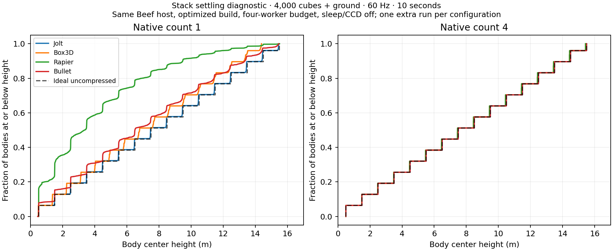

> Historical standalone backend benchmark; no Tessera runtime. Full source/data bundle: [physics-engine-results.zip](physics-engine-results.zip).

# Four physics engines, benchmarked from Beef

This is a fresh standalone benchmark of **Jolt, Box3D, Rapier, and Bullet**, all driven by the same **Beef 0.43.6 Release executable** and the same small C ABI. No Tessera runtime or physics wrapper is involved. All workloads use shared Beef-generated inputs; engine-specific solver algorithms remain different.

**Findings:** Box3D was fastest in the four optimized 4,000-body, four-worker non-mesh workloads. Rapier beat Jolt there by about 1.1–2.0×, while Jolt was faster in the mixed-mesh workload and several query tests. Bullet generally trailed Jolt with four workers, but won some single-worker tests. Box3D lost two capsules through this mesh even with CCD enabled; Bullet's discrete mesh tests failed, while its corrected CCD controls passed. These are workload-specific results, not a universal ranking.

Machine: **AMD Ryzen 9 7900X, 12 physical / 24 logical cores, approximately 64 GiB RAM, Nobara Linux, GCC 16.2.1, Rust 1.99.1**. CPU governor performance, boost on. One-worker tests use CPU 0; four-worker tests use CPUs 0–3, distinct physical cores on one CCD/L3. Desktop software remained open. Native libraries are Release optimized, single precision, no LTO; Beef uses its Release GNU backend (`-O2`).

Versions: **Jolt 5.6.0; Box3D 0.1.0 development snapshot; Rapier 0.36.1 development snapshot; Bullet 3.26 development snapshot**. Exact clean upstream commits, compiler metadata, and binary hashes: [metadata](results/metadata.json).

## Simulation: optimized configuration

Each row is **dynamic body count + one static ground body**, 600 updates at **60 Hz / 16.667 ms**, ten simulated seconds, three fresh-process repeats. Values are **median mean / median p95 step milliseconds**; lower is better. Timings include the Beef→native call. Sleeping and CCD are off. Gravity −9.81, effective friction .5, restitution/damping zero, density 1,000 kg/m³.

**Solver settings:** Jolt one collision step, 10 velocity + 2 position iterations; Box3D four solver substeps; Rapier four solver substeps with 1 internal PGS and 1 stabilization iteration; Bullet one integration step with 10 iterations. Mesh uses Jolt 4+1 iterations and Bullet 5. Optimized Jolt/Box3D/Rapier use AVX2/eight-wide paths where supported; Bullet uses its CPU multithreaded solver. These are normal engine-specific configurations, not a claim of equal physical accuracy. Matching-count controls follow below.

| Workload | Dynamic + static bodies | Active worker budget | Jolt mean / p95 ms | Box3D mean / p95 ms | Rapier mean / p95 ms | Bullet mean / p95 ms |
|---|---:|---:|---:|---:|---:|---:|
| Aligned cubes | 1000 + 1 | 1 | 3.175 / 3.482 | 0.866 / 0.866 | 1.485 / 1.516 | 2.244 / 2.375 |
| Aligned cubes | 1000 + 1 | 4 | 1.369 / 1.722 | 0.339 / 0.341 | 0.803 / 1.014 | 1.092 / 1.179 |
| Aligned cubes | 4000 + 1 | 1 | 15.528 / 19.886 | 3.836 / 4.012 | 12.732 / 13.983 | 13.054 / 16.723 |
| Aligned cubes | 4000 + 1 | 4 | 5.545 / 6.593 | 1.216 / 1.411 | 3.946 / 5.133 | 6.181 / 8.154 |
| Falling rotated cubes | 1000 + 1 | 1 | 2.228 / 3.002 | 0.612 / 0.741 | 0.912 / 1.052 | 2.191 / 2.658 |
| Falling rotated cubes | 1000 + 1 | 4 | 0.789 / 1.015 | 0.270 / 0.307 | 0.438 / 0.556 | 1.138 / 1.275 |
| Falling rotated cubes | 4000 + 1 | 1 | 11.145 / 16.677 | 3.108 / 4.098 | 6.063 / 8.624 | 12.898 / 16.553 |
| Falling rotated cubes | 4000 + 1 | 4 | 3.716 / 5.198 | 1.006 / 1.286 | 1.908 / 2.526 | 5.917 / 7.432 |
| Spheres | 1000 + 1 | 1 | 1.740 / 1.921 | 0.667 / 0.898 | 0.754 / 0.748 | 1.577 / 1.811 |
| Spheres | 1000 + 1 | 4 | 0.638 / 0.736 | 0.289 / 0.354 | 0.390 / 0.480 | 0.960 / 1.365 |
| Spheres | 4000 + 1 | 1 | 8.603 / 9.359 | 3.245 / 4.048 | 5.313 / 6.046 | 8.581 / 10.688 |
| Spheres | 4000 + 1 | 4 | 3.058 / 3.409 | 1.055 / 1.248 | 1.533 / 1.783 | 4.732 / 7.095 |
| Separated cubes | 1000 + 1 | 1 | 0.387 / 0.394 | 0.298 / 0.309 | 0.463 / 0.467 | 1.188 / 1.249 |
| Separated cubes | 1000 + 1 | 4 | 0.188 / 0.195 | 0.115 / 0.118 | 0.259 / 0.279 | 0.383 / 0.400 |
| Separated cubes | 4000 + 1 | 1 | 1.608 / 1.633 | 1.246 / 1.296 | 1.920 / 1.966 | 4.806 / 5.053 |
| Separated cubes | 4000 + 1 | 4 | 0.712 / 0.739 | 0.367 / 0.378 | 0.649 / 0.775 | 1.487 / 1.546 |
| Mixed shapes / mesh | 484 + 1 | 1 | 0.386 / 0.660 | FAIL (0/3 valid) | 0.558 / 0.726 | FAIL (0/3 valid) |
| Mixed shapes / mesh | 484 + 1 | 4 | 0.157 / 0.239 | FAIL (0/3 valid) | 0.271 / 0.391 | FAIL (0/3 valid) |

A failure is retained but not ranked: escaped bodies, nonfinite state or explicit update errors invalidate the simulation. A passing run can still have different compression, jitter or contact behavior; see quality diagnostics below. Solver timings include initial impacts; first/last 120-frame means and repeat ranges are in the raw and aggregated CSVs.

## Four-wide / determinism-enabled comparison

Same 60 Hz, ten-second workload and default solver counts, sleeping/CCD off. Jolt uses its cross-platform-deterministic build, Box3D uses width 4, Rapier uses enhanced determinism and width 4 with parallelism. Bullet uses the baseline-CPU build and **is not certified cross-platform deterministic**. The thread budget is active workers, not every live OS thread; Rapier can have a waiting host thread and Bullet's scheduler retains dormant threads.

| Workload | Dynamic + static bodies | Active worker budget | Jolt mean / p95 ms | Box3D mean / p95 ms | Rapier mean / p95 ms | Bullet baseline mean / p95 ms |
|---|---:|---:|---:|---:|---:|---:|
| Aligned cubes | 4000 + 1 | 1 | 16.798 / 21.238 | 5.062 / 5.271 | 13.562 / 14.471 | 13.405 / 17.393 |
| Aligned cubes | 4000 + 1 | 4 | 6.117 / 7.143 | 1.603 / 1.629 | 4.143 / 4.489 | 5.889 / 7.884 |
| Falling rotated cubes | 4000 + 1 | 1 | 11.540 / 17.104 | 3.717 / 4.737 | 6.419 / 8.706 | 13.297 / 16.914 |
| Falling rotated cubes | 4000 + 1 | 4 | 3.929 / 5.769 | 1.213 / 1.518 | 2.225 / 3.381 | 6.139 / 7.901 |
| Spheres | 4000 + 1 | 1 | 8.963 / 9.774 | 3.768 / 4.475 | 5.431 / 6.641 | 8.234 / 10.507 |
| Spheres | 4000 + 1 | 4 | 3.123 / 3.487 | 1.265 / 1.423 | 1.695 / 2.280 | 4.846 / 7.447 |
| Separated cubes | 4000 + 1 | 1 | 1.712 / 1.734 | 1.623 / 1.677 | 2.266 / 2.273 | 4.915 / 5.164 |
| Separated cubes | 4000 + 1 | 4 | 0.750 / 0.758 | 0.508 / 0.516 | 0.734 / 0.834 | 1.556 / 1.808 |
| Mixed shapes / mesh | 484 + 1 | 1 | 0.407 / 0.695 | FAIL (0/3 valid) | 0.592 / 0.753 | FAIL (0/3 valid) |
| Mixed shapes / mesh | 484 + 1 | 4 | 0.160 / 0.232 | FAIL (0/3 valid) | 0.288 / 0.411 | FAIL (0/3 valid) |

## Identical-count substep controls

4,000 dynamic sharp cubes + ground, optimized build, 60 Hz, sleeping/CCD off, three repetitions. Both counts are native engine API counts: Jolt collision steps, Box3D solver substeps, Rapier solver substeps/iterations, Bullet fixed integration steps. **Equal counts still do not match inner solver work or collision refreshes.** Jolt retains 10+2 iterations per collision step; Bullet retains 10 iterations per integration step.

| Engine | Worker budget | Count 1 mean / p95 ms | Count 4 mean / p95 ms | Highest center y at count 1 / 4 (m) | RMS linear speed count 1 / 4 (m/s) |
|---|---:|---:|---:|---:|---:|
| Jolt | 1 | 15.528 / 19.886 | 46.141 / 50.261 | 15.4621 / 15.4976 | 0.702319 / 0.033282 |
| Jolt | 4 | 5.545 / 6.593 | 17.821 / 19.940 | 15.4621 / 15.4976 | 0.702319 / 0.033282 |
| Box3D | 1 | 4.010 / 4.849 | 3.836 / 4.012 | 14.3884 / 15.4326 | 0.213138 / 0.001420 |
| Box3D | 4 | 1.186 / 1.355 | 1.216 / 1.411 | 14.3884 / 15.4326 | 0.213138 / 0.001420 |
| Rapier | 1 | 11.846 / 15.652 | 12.732 / 13.983 | 15.5105 / 15.4326 | 1.292996 / 0.002321 |
| Rapier | 4 | 3.822 / 5.255 | 3.946 / 5.133 | 15.5105 / 15.4326 | 1.292996 / 0.002321 |
| Bullet | 1 | 13.054 / 16.723 | 40.178 / 42.184 | 15.4725 / 15.4986 | 3.571930 / 0.006887 |
| Bullet | 4 | 6.181 / 8.154 | 17.397 / 20.212 | 15.4741 / 15.4985 | 3.288805 / 0.010200 |

## Quality and sleep behavior

Optimized build, 4,000 dynamic aligned cubes + ground, four-worker budget, 60 Hz, default engine counts. Ideal uncompressed highest center is 15.5 m; lowest center .5 m. Residual linear/angular speed and active count are recorded after ten seconds. Engine-specific default tolerances and sleep policies are preserved, so sleep timings are not equally active workloads.

| Engine | Count | Sleeping | Mean ms | Last 120 frames ms | Active at end | Lowest / highest center y (m) | RMS linear m/s | RMS angular rad/s |
|---|---:|---|---:|---:|---:|---:|---:|---:|
| Jolt | 1 | Off | 5.545 | 5.831407 | 4000 | 0.4815 / 15.4621 | 0.702319 | 0.082628 |
| Box3D | 4 | Off | 1.216 | 1.192973 | 4000 | 0.4989 / 15.4326 | 0.001420 | 0.000207 |
| Rapier | 4 | Off | 3.946 | 4.259974 | 4000 | 0.4989 / 15.4326 | 0.002321 | 0.000330 |
| Bullet | 1 | Off | 6.181 | 7.328398 | 4000 | 0.4069 / 15.4741 | 3.288805 | 0.784000 |
| Jolt | 1 | On | 5.556 | 5.846686 | 4000 | 0.4815 / 15.4621 | 0.702319 | 0.082628 |
| Box3D | 4 | On | 0.152 | 0.000216 | 0 | 0.4989 / 15.4320 | 0.000000 | 0.000000 |
| Rapier | 4 | On | 0.404 | 0.003698 | 0 | 0.4989 / 15.4310 | 0.000000 | 0.000000 |
| Bullet | 1 | On | 2.056 | 0.709212 | 0 | 0.4961 / 15.4769 | 0.000000 | 0.000000 |

Additional final-state captures (one extra run per configuration, not timing repetitions) measure the whole stack distribution. Ideal mean center height is 7.82 m, with 256 bottom-layer cubes. These diagnostics help distinguish residual motion from actual collapse.

| Engine | Native count | Mean center height (m) | Bodies with centers below 0.6 m | RMS linear speed (m/s) |
|---|---:|---:|---:|---:|
| Jolt | 1 | 7.7578 | 256 / 4,000 | 0.702319 |
| Jolt | 4 | 7.8180 | 256 / 4,000 | 0.033282 |
| Box3D | 1 | 7.1195 | 256 / 4,000 | 0.213138 |
| Box3D | 4 | 7.7781 | 256 / 4,000 | 0.001420 |
| Rapier | 1 | 4.1441 | 715 / 4,000 | 1.292996 |
| Rapier | 4 | 7.7781 | 256 / 4,000 | 0.002321 |
| Bullet | 1 | 6.9587 | 320 / 4,000 | 3.550195 |
| Bullet | 4 | 7.8188 | 256 / 4,000 | 0.011214 |

## Mixed shapes on a triangle mesh, including CCD

484 dynamic boxes/spheres/capsules/pyramid hulls + one static mesh body, 2,000 triangles, optimized build, four-worker budget, 60 Hz. Jolt uses 4 velocity + 1 position iterations, Bullet 5; Box3D/Rapier retain defaults. This resembles the old Jolt-versus-Bullet comparison's workload and iteration choices, but does not reproduce its historical geometry, versions or hardware. It checks a modern trend rather than validating every claim in the old document.

| Engine | CCD | Native count | Mean / p95 ms or status | Escaped centers, maximum across repeats |
|---|---|---:|---:|---:|
| Jolt | Off | 1 | 0.157 / 0.239 | 0 |
| Box3D | Off | 4 | FAIL (0/3 valid) | 2 |
| Rapier | Off | 4 | 0.271 / 0.391 | 0 |
| Bullet | Off | 1 | FAIL (0/3 valid) | 16 |
| Jolt | On | 1 | 0.163 / 0.249 | 0 |
| Box3D | On | 4 | FAIL (0/3 valid) | 2 |
| Rapier | On | 4 | 0.276 / 0.388 | 0 |
| Bullet | On | 1 | 0.690 / 0.787 | 0 |
| Jolt | On | 4 | 0.527 / 0.775 | 0 |
| Box3D | On | 4 | FAIL (0/3 valid) | 2 |
| Rapier | On | 4 | 0.276 / 0.400 | 0 |
| Bullet | On | 4 | 2.270 / 2.590 | 0 |

CCD differs by engine: Jolt linear shape casts, Box3D continuous collision, Rapier body CCD/one CCD pass, Bullet a swept-sphere approximation (threshold .01 m, radius half the smallest shape half-extent). Turning CCD on does not establish identical collision handling or guarantee that every setup passes. Failed mesh timings are available in CSV but excluded from speed claims. The zero-margin sharp-geometry choice and engine-specific mesh edge handling are material to these failures; this is not proof that an engine fails all mesh scenes.

## Closest-hit queries from Beef

Frozen, identical initial geometry; one active caller on CPU 0, no simulation steps. All layers and static/dynamic bodies included, no ignored bodies/predicates. Every backend returns hit, fraction, world point and world normal. Five batches of 20,000 calls after a discarded warmup batch; median ns/query. Values include common Beef query generation, loop, native call and result accumulation.

Down ray and sphere sweep: from y=100 downward 200 m; sweep radius .25 m. Across ray: sampled height, horizontal length 16.24 m for 1,000 boxes/spheres or 23.584 m for 4,000. Miss ray: from y=100 upward 100 m. No initial overlaps. Sweeps request zero separation and closest-hit clipping; detailed engine flags, sample footprints and mesh query lengths are in [methodology](METHODOLOGY.md).

### Optimized queries

| Geometry | Dynamic + static bodies | Query | Jolt ns | Box3D ns | Rapier ns | Bullet ns | Hit counts J / Box / R / B (of 20,000) |
|---|---:|---|---:|---:|---:|---:|---|
| Aligned cubes | 1000 + 1 | Ray down | 205.4 | 301.0 | 285.1 | 3112.6 | 20000 / 20000 / 20000 / 20000 |
| Aligned cubes | 1000 + 1 | Ray across | 176.7 | 207.1 | 250.4 | 4225.6 | 13382 / 13382 / 13382 / 13899 |
| Aligned cubes | 1000 + 1 | Ray miss | 54.9 | 47.4 | 102.4 | 78.3 | 0 / 0 / 0 / 0 |
| Aligned cubes | 1000 + 1 | Sphere sweep | 715.6 | 938.4 | 2526.7 | 16228.8 | 20000 / 20000 / 20000 / 20000 |
| Aligned cubes | 4000 + 1 | Ray down | 211.7 | 366.9 | 310.9 | 4689.8 | 20000 / 20000 / 20000 / 20000 |
| Aligned cubes | 4000 + 1 | Ray across | 178.5 | 295.4 | 247.5 | 8170.4 | 13959 / 13959 / 13959 / 14486 |
| Aligned cubes | 4000 + 1 | Ray miss | 49.5 | 46.4 | 102.6 | 77.1 | 0 / 0 / 0 / 0 |
| Aligned cubes | 4000 + 1 | Sphere sweep | 717.2 | 915.7 | 2558.2 | 24814.5 | 20000 / 20000 / 20000 / 20000 |
| Spheres | 1000 + 1 | Ray down | 263.1 | 495.3 | 374.7 | 4006.3 | 20000 / 20000 / 20000 / 20000 |
| Spheres | 1000 + 1 | Ray across | 211.0 | 311.6 | 266.4 | 3378.7 | 10495 / 10495 / 10495 / 10549 |
| Spheres | 1000 + 1 | Ray miss | 48.5 | 46.5 | 103.3 | 77.2 | 0 / 0 / 0 / 0 |
| Spheres | 1000 + 1 | Sphere sweep | 689.2 | 881.0 | 882.7 | 13497.0 | 20000 / 20000 / 20000 / 20000 |
| Spheres | 4000 + 1 | Ray down | 322.4 | 854.4 | 525.8 | 5992.1 | 20000 / 20000 / 20000 / 20000 |
| Spheres | 4000 + 1 | Ray across | 275.9 | 486.6 | 279.3 | 7022.0 | 10965 / 10964 / 10966 / 10996 |
| Spheres | 4000 + 1 | Ray miss | 49.6 | 46.5 | 103.9 | 76.3 | 0 / 0 / 0 / 0 |
| Spheres | 4000 + 1 | Sphere sweep | 728.4 | 845.5 | 918.7 | 20653.8 | 20000 / 20000 / 20000 / 20000 |
| Mixed shapes / mesh | 484 + 1 | Ray down | 266.8 | 228.2 | 341.9 | 414.6 | 20000 / 20000 / 20000 / 20000 |
| Mixed shapes / mesh | 484 + 1 | Ray across | 89.0 | 77.4 | 131.8 | 451.1 | 1425 / 1424 / 1424 / 1431 |
| Mixed shapes / mesh | 484 + 1 | Ray miss | 49.6 | 47.3 | 103.2 | 64.8 | 0 / 0 / 0 / 0 |
| Mixed shapes / mesh | 484 + 1 | Sphere sweep | 698.5 | 727.2 | 2179.1 | 3140.8 | 20000 / 20000 / 20000 / 20000 |

### Four-wide / determinism-enabled queries

| Geometry | Dynamic + static bodies | Query | Jolt ns | Box3D ns | Rapier ns | Bullet ns | Hit counts J / Box / R / B (of 20,000) |
|---|---:|---|---:|---:|---:|---:|---|
| Aligned cubes | 1000 + 1 | Ray down | 198.0 | 311.6 | 285.8 | 3604.0 | 20000 / 20000 / 20000 / 20000 |
| Aligned cubes | 1000 + 1 | Ray across | 159.8 | 212.2 | 243.4 | 4719.7 | 13382 / 13382 / 13382 / 13899 |
| Aligned cubes | 1000 + 1 | Ray miss | 53.0 | 45.1 | 99.6 | 75.7 | 0 / 0 / 0 / 0 |
| Aligned cubes | 1000 + 1 | Sphere sweep | 755.5 | 925.9 | 2640.5 | 16506.0 | 20000 / 20000 / 20000 / 20000 |
| Aligned cubes | 4000 + 1 | Ray down | 214.1 | 370.9 | 320.1 | 5424.7 | 20000 / 20000 / 20000 / 20000 |
| Aligned cubes | 4000 + 1 | Ray across | 178.0 | 299.7 | 245.6 | 9002.6 | 13959 / 13959 / 13959 / 14486 |
| Aligned cubes | 4000 + 1 | Ray miss | 53.0 | 44.3 | 104.8 | 74.3 | 0 / 0 / 0 / 0 |
| Aligned cubes | 4000 + 1 | Sphere sweep | 774.7 | 909.6 | 2654.7 | 25495.5 | 20000 / 20000 / 20000 / 20000 |
| Spheres | 1000 + 1 | Ray down | 266.7 | 521.4 | 386.4 | 4473.0 | 20000 / 20000 / 20000 / 20000 |
| Spheres | 1000 + 1 | Ray across | 218.8 | 336.3 | 275.6 | 3777.9 | 10495 / 10495 / 10495 / 10549 |
| Spheres | 1000 + 1 | Ray miss | 53.5 | 44.0 | 104.6 | 75.5 | 0 / 0 / 0 / 0 |
| Spheres | 1000 + 1 | Sphere sweep | 721.6 | 900.6 | 888.4 | 13346.7 | 20000 / 20000 / 20000 / 20000 |
| Spheres | 4000 + 1 | Ray down | 325.4 | 901.2 | 542.3 | 6616.0 | 20000 / 20000 / 20000 / 20000 |
| Spheres | 4000 + 1 | Ray across | 279.4 | 529.4 | 289.8 | 7694.2 | 10966 / 10964 / 10966 / 10996 |
| Spheres | 4000 + 1 | Ray miss | 53.2 | 44.9 | 105.5 | 76.0 | 0 / 0 / 0 / 0 |
| Spheres | 4000 + 1 | Sphere sweep | 766.8 | 865.2 | 914.3 | 20965.4 | 20000 / 20000 / 20000 / 20000 |
| Mixed shapes / mesh | 484 + 1 | Ray down | 285.9 | 229.0 | 356.6 | 418.4 | 20000 / 20000 / 20000 / 20000 |
| Mixed shapes / mesh | 484 + 1 | Ray across | 93.9 | 76.2 | 132.1 | 482.4 | 1425 / 1424 / 1424 / 1431 |
| Mixed shapes / mesh | 484 + 1 | Ray miss | 53.7 | 44.9 | 107.4 | 64.3 | 0 / 0 / 0 / 0 |
| Mixed shapes / mesh | 484 + 1 | Sphere sweep | 758.5 | 747.5 | 2255.3 | 3279.8 | 20000 / 20000 / 20000 / 20000 |

Query hit/fraction/normal differences are saved instead of assuming identical numerical answers. The timing comparison does not establish equal grazing-hit tolerance or identical mesh backface/internal-edge behavior. These are whole-world closest queries, not a general claim about character controllers, all-hit enumeration, or overlap contact extraction.

## Beef/native overhead controls

Each simulation pair uses fresh worlds, 1,000 aligned cubes + ground, optimized profile, 60 Hz, ten simulated seconds, no sleep/CCD, default engine counts. One run has Beef call each step; the other makes one call into a C++ loop doing the same steps. Order alternates across three repetitions. Most paired median ratios are within about 1.3% of one. Rapier's four-worker control is noisier: paired ratios span roughly 0.865–1.161, with a median about 1.057. That spread does not establish a consistent 5.7% language-boundary penalty. Ratios should be interpreted with repeat-to-repeat desktop/scheduler noise; they are not precise nanosecond interop estimates.

| Engine | Worker budget | Beef-loop mean ms | C++-loop mean ms | Median paired Beef / C++ |
|---|---:|---:|---:|---:|
| Jolt | 1 | 3.1621 | 3.1717 | 0.996× |
| Jolt | 4 | 1.3360 | 1.3286 | 1.000× |
| Box3D | 1 | 0.8674 | 0.8671 | 1.001× |
| Box3D | 4 | 0.3439 | 0.3400 | 1.010× |
| Rapier | 1 | 1.4792 | 1.4880 | 1.002× |
| Rapier | 4 | 0.7029 | 0.6651 | 1.057× |
| Bullet | 1 | 2.2580 | 2.2554 | 0.996× |
| Bullet | 4 | 1.1070 | 1.1188 | 1.012× |

The one-million-call no-op control measures **1.88 ns per Beef→native call plus loop/dependency work**, median of five runs. This does not include each engine's own internal wrapper or locking work.

## Interpretation and reproduction

Read each workload separately. Faster times can accompany more compression, different residual motion, or a failed collision test. Default solver counts and equal-count controls answer different questions; neither proves equal accuracy. These results concern the named engine revisions and this workstation, not Tessera's full frame, a platform-independent ranking, or validated networking determinism.

The mesh workload provides a direct contemporary Jolt/Bullet check, with failures and solver settings visible. It must not be presented as a repeat of the 2022/2023 Jolt paper or as proof of universal superiority. Original document: [Jolt multicore comparison](https://jrouwe.nl/jolt/JoltPhysicsMulticoreScaling.pdf).

Re-run with `./rerun.sh`. It rebuilds native libraries and the Beef driver, validates ABI/free-fall motion, runs the randomized suite, and regenerates tables. A local Rust toolchain is under `toolchain/`; the scripts do not change the user's default toolchain. Source revisions must remain pinned for reproduction. Results and scripts are all local and reviewable:

- [Detailed methodology](METHODOLOGY.md), [machine/build metadata](results/metadata.json).
- [Raw simulations](physics-engine-results.zip), [summary with repeat ranges](results/summary.csv), [query batches](physics-engine-results.zip).
- [Native-loop controls](physics-engine-results.zip), [no-op controls](physics-engine-results.zip), [validation log](physics-engine-results.zip), [run log](physics-engine-results.zip).
- [Beef source](physics-engine-results.zip), [common C ABI](physics-engine-results.zip), [engine adapters](physics-engine-results.zip), [CMake configuration](physics-engine-results.zip).

Joint constraints, character controllers, 2D, WebAssembly, networking, cross-platform replay, memory usage and energy consumption are outside this suite.
