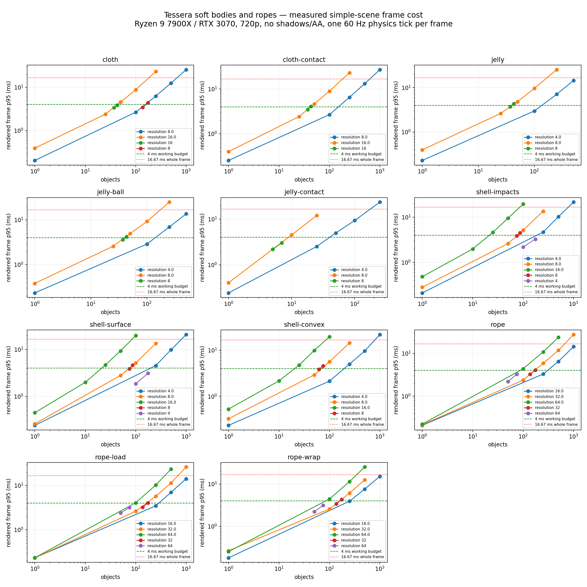

> Historical result: preserved from a local run; this is not a rerun on commit `62f33b0`. Raw-only links download the containing archive; see the archive inventory for its member path.

# Tessera rope and soft-body capacity benchmark

Completed 2026-10-29T10:25:22.719209. Release snapshot on **Ryzen 9 7900X / RTX 3070 (8 GB)**, Linux Vulkan, 1280×720. Physics uses its existing **3 worker threads**, at a 60 Hz simulation step.

## How to use these numbers

A 60 FPS frame has **16.67 ms**; 90 FPS has 11.11 ms and 120 FPS has 8.33 ms. Start with **2–4 ms for ropes and soft bodies combined**, leaving time for the game, rigid bodies, animation, rendering, networking and frame-time spikes. Treat the counts below as a starting budget on this desktop, not a platform guarantee. Use the 95th-percentile (p95) cost, not reciprocal average FPS, to choose a count.

Active CPU cost includes anchor/load motion, one Scene.FixedUpdate and one Scene.Update: physics, wind, collisions, proxies, vertex readback, bounds/normals and rope tube construction. Rendered costs add real vertex uploads and the complete simple-scene frame. Every rendered frame deliberately takes one 60 Hz physics step; a normal uncapped game can render more often than it ticks physics. These are stress timings, not the actual frame rate of a fixed-tick game. Rigid loads, pushers, projectiles, beams and the floor are physics-only colliders; their normal game drawing cost must be added.

**Stability warning:** some tested configurations produced nonfinite vertices. In particular, strong-wind 32×32 cloth at 5 solver iterations failed even at one object. Their timings are discarded; see Stability failures below. Dense 1,538-vertex jelly also developed severe finite deformation and has no usable capacity limit here. Higher-density or lower-iteration settings should be validated before using them in a game. The separate single-body 32×32 probes were finite at 12 and 24 iterations; that does not establish a multi-body count limit at those settings.

## Practical counts at each mesh density

**Largest measured count under a 4 ms rendered-frame budget using the worst process p95 among the repeated runs.** The next measured count is shown to bracket the limit. All visible objects are framed together; shadows and antialiasing are off. The 4 ms figure includes the simple renderer overhead. There are no ordinary game scripts or complex environments in this scene.

| Type | Mesh / rope resolution | Sim vertices per object | Count ≤4 ms | Its rendered p95 ms | Next tested count / p95 ms |
|---|---:|---:|---:|---:|---:|
| cloth | 8 | 81 | 137 | 3.447 | 175 / 4.447 |
| cloth | 16 | 289 | 43 | 3.920 | 50 / 4.601 |
| cloth | 32 | 1089 | unstable | — | not reached |
| cloth-contact | 8 | 81 | 100 | 2.694 | 250 / 6.553 |
| cloth-contact | 16 | 289 | 37 | 3.602 | 43 / 4.064 |
| cloth-contact | 32 | 1089 | unstable | — | not reached |
| jelly | 4 | 98 | 100 | 2.996 | 250 / 7.146 |
| jelly | 8 | 386 | 37 | 3.786 | 43 / 4.387 |
| jelly | 16 | 1538 | unusable shape | — | not reached |
| jelly-ball | 4 | 98 | 100 | 2.892 | 250 / 7.008 |
| jelly-ball | 8 | 386 | 37 | 3.657 | 43 / 4.200 |
| jelly-ball | 16 | 1538 | unusable shape | — | not reached |
| jelly-contact | 4 | 98 | 25 | 2.590 | 50 / 5.138 |
| jelly-contact | 8 | 386 | 7 | 3.079 | 10 / 4.566 |
| jelly-contact | 16 | 1538 | unusable shape | — | not reached |
| shell-impacts | 4 | 98 | 175 | 3.433 | 250 / 4.896 |
| shell-impacts | 8 | 386 | 50 | 2.662 | 75 / 4.176 |
| shell-impacts | 16 | 1538 | 10 | 2.090 | 25 / 4.686 |
| shell-surface | 4 | 98 | 175 | 3.389 | 250 / 4.928 |
| shell-surface | 8 | 386 | 75 | 3.961 | 87 / 4.710 |
| shell-surface | 16 | 1538 | 10 | 2.033 | 25 / 4.882 |
| shell-convex | 4 | 98 | 100 | 2.208 | 250 / 5.178 |
| shell-convex | 8 | 386 | 62 | 3.988 | 75 / 4.707 |
| shell-convex | 16 | 1538 | 10 | 2.242 | 25 / 5.023 |
| rope | 16 | 17 | 250 | 3.577 | 500 / 6.748 |
| rope | 32 | 33 | 137 | 3.273 | 175 / 4.316 |
| rope | 64 | 65 | 75 | 3.417 | 100 / 4.406 |
| rope-load | 16 | 17 | 250 | 3.494 | 500 / 7.050 |
| rope-load | 32 | 33 | 137 | 3.297 | 175 / 4.086 |
| rope-load | 64 | 65 | 75 | 3.237 | 100 / 4.090 |
| rope-wrap (mixed wrapping) | 16 | 17 | 250 | 3.941 | 500 / 7.940 |
| rope-wrap | 32 | 33 | 137 | 3.429 | 175 / 4.301 |
| rope-wrap (mixed wrapping) | 64 | 65 | 75 | 3.355 | 100 / 4.640 |

Cloth resolution is cells across the sheet: 8 → 81 vertices, 16 → 289, 32 → 1,089. Closed bodies use a subdivided box with welded seams: 4 → 98 simulation / 150 render vertices, 8 → 386 / 486, 16 → 1,538 / 1,734. Jelly-ball projects that box onto a sphere and uses pressure 300; cube jelly uses pressure 10. Rope resolution is segments: points = segments + 1; each point draws 8 tube vertices. The solver uses 5 iterations for soft bodies, 8 for ropes, except the sensitivity tests. The wrapping probes ended with 1/10 wrapped ropes at 16 segments and 8/10 at 64, versus 10/10 at 32 and a further 137/137 check at 32. Mixed-wrapping rows measure wrapping-enabled scenes, not a fully engaged pulley capacity; use the 32-segment series for that tested arrangement.

Counts are conservative tested points, not exact maxima. Setup can take much longer than a steady tick: create/prewarm away from critical action or spread creation across frames, and consult the setup column before spawning many bodies at once. A pass at 100 and a fail at 250 means the threshold is somewhere in that interval under these conditions; it does not mean object 101 causes a frame-rate failure. Mixed types share the same budget: do not add all individual limits together.

## Practical usage

- **Flags, capes and curtains:** begin with 8×8 or 16×16 sheets. The tested 32×32 strong-wind cloth was unstable even at one object; avoid that combination until its stability is addressed. Wind keeps cloth active; this sweep measures that case. The contact variant adds a moving rigid sphere for every cloth. Cloth does not collide with cloth.
- **Jelly, cushions and soft balls:** start with roughly 100–400 welded vertices. Keep distant props asleep and avoid many closed soft bodies touching in one pile. The dense jelly-contact case tests adjacent bodies and their collision proxies; use its lower counts for piles rather than isolated-jelly counts. Surface proxies do not provide fully mutual weight support.
- **Denting vehicles and props:** choose shell-impacts with a normal rigid collider for conventional damage. The primary shell-surface case tests direct surface deformation with a full-size rigid collider; the supplementary diagnostic uses a 0.7 m inset collider and is more representative when objects must press into the shell. Shell-convex also allows the collider hull to follow dents. Shell-impact tests periodically fire a 10 kg body at 10 m/s per shell; hull rebuilds are delayed by the engine and ongoing impacts can postpone them. Setup, impact spikes and hull changes deserve additional headroom.
- **Ropes, cables and lifting:** choose explicit segment counts. A default 3 m rope has about 30 segments; longer automatic ropes add about one segment per 10 cm, capped at 256. Rope-load adds a dynamic 10 kg load; rope-wrap tests two dynamic loads routed over a fixed beam. Cost includes rebuilding the 8-sided tube each frame. Use more segments for visible curvature/contact, not simply because the rope is long.
- **Resting scenes:** sleeping physics reduces solver work, but vertex readback/normals/tube rebuilding still run each Update in this snapshot. Many resting bodies still cost CPU and upload bandwidth. Remove/disable simulation for decorations that do not need to move, or replace them with an ordinary mesh.
- **Quality:** more solver iterations cost more; fewer can stretch or soften the result. The iteration sweep is a timing comparison, not proof that low-iteration results look or behave equally well.

## Resolution and iteration sensitivity

| Case | Resolution | Iterations | Objects | CPU total median / p95 ms | Physics median ms | Mesh/update median ms |
|---|---:|---:|---:|---:|---:|---:|
| cloth | 8 | 5 | 100 | 2.159 / 2.280 | 1.796 | 0.373 |
| cloth | 16 | 5 | 100 | 8.002 / 8.174 | 6.734 | 1.254 |
| cloth-contact | 8 | 5 | 100 | 2.193 / 2.336 | 1.830 | 0.368 |
| cloth-contact | 16 | 5 | 100 | 8.157 / 8.398 | 6.887 | 1.257 |
| jelly | 4 | 5 | 100 | 2.444 / 2.611 | 1.818 | 0.631 |
| jelly | 8 | 5 | 100 | 8.344 / 8.843 | 6.282 | 2.054 |
| jelly-ball | 4 | 5 | 100 | 2.350 / 2.573 | 1.720 | 0.635 |
| jelly-ball | 8 | 5 | 100 | 8.155 / 8.555 | 5.994 | 2.157 |
| jelly-contact | 4 | 5 | 100 | 8.542 / 9.007 | 7.904 | 0.648 |
| shell-impacts | 4 | 5 | 100 | 1.391 / 1.485 | 0.780 | 0.613 |
| shell-impacts | 8 | 5 | 100 | 4.414 / 4.688 | 2.333 | 2.095 |
| shell-impacts | 16 | 5 | 100 | 16.694 / 17.626 | 8.993 | 7.670 |
| shell-surface | 4 | 5 | 100 | 1.487 / 1.642 | 0.817 | 0.667 |
| shell-surface | 8 | 5 | 100 | 4.370 / 4.645 | 2.295 | 2.081 |
| shell-surface | 16 | 5 | 100 | 16.975 / 17.882 | 9.145 | 7.808 |
| shell-convex | 4 | 5 | 100 | 1.404 / 1.518 | 0.799 | 0.615 |
| shell-convex | 8 | 5 | 100 | 4.576 / 5.000 | 2.427 | 2.189 |
| shell-convex | 16 | 5 | 100 | 16.951 / 18.042 | 9.179 | 7.626 |
| rope | 16 | 8 | 100 | 1.110 / 1.140 | 0.282 | 0.827 |
| rope | 32 | 8 | 100 | 1.900 / 2.044 | 0.411 | 1.487 |
| rope | 64 | 8 | 100 | 3.817 / 3.949 | 0.797 | 3.016 |
| rope-load | 16 | 8 | 100 | 1.160 / 1.318 | 0.297 | 0.861 |
| rope-load | 32 | 8 | 100 | 1.860 / 1.965 | 0.348 | 1.511 |
| rope-load | 64 | 8 | 100 | 3.523 / 3.583 | 0.588 | 2.930 |
| rope-wrap | 16 | 8 | 100 | 1.088 / 1.279 | 0.294 | 0.787 |
| rope-wrap | 32 | 8 | 100 | 1.939 / 2.071 | 0.431 | 1.505 |
| rope-wrap | 64 | 8 | 100 | 3.601 / 3.738 | 0.670 | 2.928 |
| cloth | 16 | 2 | 100 | 5.670 / 5.939 | 4.378 | 1.300 |
| cloth | 16 | 12 | 100 | 12.948 / 13.423 | 11.654 | 1.309 |
| cloth | 16 | 24 | 100 | 21.362 / 22.368 | 20.060 | 1.318 |
| jelly | 8 | 2 | 100 | 5.022 / 5.261 | 2.900 | 2.151 |
| jelly | 8 | 12 | 100 | 15.354 / 16.167 | 13.261 | 2.173 |
| jelly | 8 | 24 | 100 | 28.078 / 30.898 | 25.969 | 2.111 |
| rope-load | 32 | 2 | 100 | 1.685 / 1.721 | 0.183 | 1.499 |
| rope-load | 32 | 12 | 100 | 1.965 / 2.008 | 0.461 | 1.504 |
| rope-load | 32 | 24 | 100 | 2.449 / 2.508 | 0.863 | 1.586 |

## Resting bodies

No wind or driven motion; 900 settling ticks before the normal warmup. Rendered resting rows are in the supplementary diagnostic section: its corrected settling driver presents each untimed upload frame. The primary rendered settling attempt was excluded; see rest-driver-correction.md. Sleeping counts are observed, not assumed. Ropes do not expose a sleeping count through this fixture.

| Case | Resolution | Objects | Mode | Sleeping soft bodies | Physics median ms | Mesh/update median ms | CPU total p95 ms | Rendered p95 ms |
|---|---:|---:|---|---:|---:|---:|---:|---:|
| cloth | 16 | 100 | cpu | 0 | 4.259 | 1.303 | 5.719 | — |
| jelly | 8 | 100 | cpu | 100 | 0.050 | 2.034 | 2.093 | — |
| shell-impacts | 8 | 100 | cpu | 100 | 0.039 | 1.967 | 2.079 | — |
| shell-surface | 8 | 100 | cpu | 0 | 2.429 | 2.074 | 4.669 | — |
| rope | 32 | 100 | cpu | not reported | 0.007 | 1.497 | 1.564 | — |
| rope-load | 32 | 100 | cpu | not reported | 0.323 | 1.500 | 1.860 | — |

## Simple-scene frame ceiling

Largest measured rendered counts within 8.33 ms and 16.67 ms using worst-process p95. **These consume much or all of a frame and are stress ceilings, not recommended gameplay limits.** Rendering has no shadows/AA and very simple materials; dense environmental collisions and other game systems are absent.

| Type | Resolution | ≤8.33 ms count / actual p95 | ≤16.67 ms count / actual p95 |
|---|---:|---:|---:|
| cloth | 8 | 250 / 6.393 | 500 / 12.575 |
| cloth | 16 | 50 / 4.601 | 100 / 8.922 |
| cloth | 32 | 1 / 1.219 | 1 / 1.219 |
| cloth-contact | 8 | 250 / 6.553 | 500 / 13.380 |
| cloth-contact | 16 | 50 / 4.764 | 100 / 8.981 |
| cloth-contact | 32 | none tested | none tested |
| jelly | 4 | 250 / 7.146 | 500 / 14.570 |
| jelly | 8 | 50 / 4.952 | 100 / 9.866 |
| jelly | 16 | none tested | none tested |
| jelly-ball | 4 | 250 / 7.008 | 500 / 13.821 |
| jelly-ball | 8 | 50 / 4.929 | 100 / 9.282 |
| jelly-ball | 16 | none tested | none tested |
| jelly-contact | 4 | 50 / 5.138 | 100 / 9.398 |
| jelly-contact | 8 | 10 / 4.566 | 25 / 12.151 |
| jelly-contact | 16 | none tested | none tested |
| shell-impacts | 4 | 250 / 4.896 | 500 / 10.388 |
| shell-impacts | 8 | 100 / 5.374 | 250 / 13.688 |
| shell-impacts | 16 | 25 / 4.686 | 50 / 9.523 |
| shell-surface | 4 | 250 / 4.928 | 500 / 10.018 |
| shell-surface | 8 | 100 / 5.224 | 250 / 13.616 |
| shell-surface | 16 | 25 / 4.882 | 50 / 9.387 |
| shell-convex | 4 | 250 / 5.178 | 500 / 9.643 |
| shell-convex | 8 | 100 / 5.707 | 250 / 14.320 |
| shell-convex | 16 | 25 / 5.023 | 50 / 10.064 |
| rope | 16 | 500 / 6.748 | 1000 / 14.406 |
| rope | 32 | 250 / 6.009 | 500 / 11.798 |
| rope | 64 | 100 / 4.406 | 250 / 10.900 |
| rope-load | 16 | 500 / 7.050 | 1000 / 14.337 |
| rope-load | 32 | 250 / 5.853 | 500 / 11.658 |
| rope-load | 64 | 100 / 4.090 | 250 / 10.550 |
| rope-wrap | 16 | 500 / 7.940 | 1000 / 15.429 |
| rope-wrap | 32 | 250 / 6.465 | 500 / 12.921 |
| rope-wrap | 64 | 100 / 4.640 | 250 / 11.379 |

## Complete measured inventory

Each row is the median across independent processes of the named statistic. p95 and p99 are within-process percentiles, then median across processes; they are not confidence intervals. CPU timing reports a full simulation+mesh-update tick; frame timing includes presentation/driver pacing. Initial sweeps use three processes × 120 warmup × 240 measured iterations. Later CPU exploration uses one process × 60 warmup × 120 samples; rendered confirmation uses three processes × 60 warmup × 180 samples. Resting and iteration tests use three processes. Separate profiler runs use one process and 120 measured frames. Each command in the manifest preserves its exact settings; the CSV repeats column distinguishes exploratory from repeated results. Peak RSS includes engine/process memory. Setup is measured separately and is not hidden in steady-state timing.

| Type | Res | Iter | N | State | Mode | Sim vertices | CPU median | CPU p95 | CPU p99 | Frame median | Frame p95 | Frame p99 | Setup ms | RSS MiB |
|---|---:|---:|---:|---|---|---:|---:|---:|---:|---:|---:|---:|---:|---:|
| cloth | 8 | 5 | 0 | active | cpu | 0 | 0.001 | 0.001 | 0.001 | — | — | — | 0.794 | 13.500 |
| cloth | 8 | 5 | 0 | active | render | 0 | 0.002 | 0.003 | 0.003 | 0.112 | 0.168 | 0.293 | 0.805 | 253.504 |
| cloth | 8 | 5 | 1 | active | cpu | 81 | 0.063 | 0.078 | 0.084 | — | — | — | 1.055 | 13.340 |
| cloth | 8 | 5 | 10 | active | cpu | 810 | 0.241 | 0.267 | 0.279 | — | — | — | 2.399 | 13.656 |
| cloth | 8 | 5 | 25 | active | cpu | 2025 | 0.551 | 0.585 | 0.617 | — | — | — | 4.721 | 14.137 |
| cloth | 8 | 5 | 50 | active | cpu | 4050 | 1.086 | 1.201 | 1.261 | — | — | — | 7.691 | 15.191 |
| cloth | 8 | 5 | 100 | active | cpu | 8100 | 2.159 | 2.280 | 2.295 | — | — | — | 14.392 | 16.906 |
| cloth | 8 | 5 | 250 | active | cpu | 20250 | 5.340 | 5.522 | 5.610 | — | — | — | 33.447 | 21.625 |
| cloth | 8 | 5 | 500 | active | cpu | 40500 | 10.470 | 10.919 | 11.180 | — | — | — | 64.690 | 30.039 |
| cloth | 8 | 5 | 1000 | active | cpu | 81000 | 20.694 | 21.634 | 21.964 | — | — | — | 127.657 | 46.898 |
| cloth | 8 | 5 | 1 | active | render | 81 | 0.068 | 0.079 | 0.086 | 0.187 | 0.203 | 0.472 | 1.197 | 253.066 |
| cloth | 8 | 5 | 100 | active | render | 8100 | 2.195 | 2.344 | 2.400 | 2.500 | 2.657 | 2.723 | 14.622 | 258.562 |
| cloth | 8 | 5 | 250 | active | render | 20250 | 5.409 | 5.672 | 5.733 | 6.019 | 6.283 | 6.442 | 33.731 | 265.887 |
| cloth | 8 | 5 | 500 | active | render | 40500 | 10.766 | 11.221 | 11.457 | 12.000 | 12.510 | 12.799 | 65.654 | 279.281 |
| cloth | 8 | 5 | 1000 | active | render | 81000 | 21.263 | 22.167 | 22.461 | 24.623 | 25.707 | 26.112 | 130.294 | 306.844 |
| cloth | 16 | 5 | 1 | active | cpu | 289 | 0.190 | 0.224 | 0.245 | — | — | — | 2.119 | 13.523 |
| cloth | 16 | 5 | 10 | active | cpu | 2890 | 0.917 | 0.949 | 0.961 | — | — | — | 11.578 | 14.648 |
| cloth | 16 | 5 | 25 | active | cpu | 7225 | 2.102 | 2.275 | 2.292 | — | — | — | 27.402 | 16.344 |
| cloth | 16 | 5 | 50 | active | cpu | 14450 | 4.152 | 4.252 | 4.363 | — | — | — | 52.180 | 19.359 |
| cloth | 16 | 5 | 100 | active | cpu | 28900 | 8.002 | 8.174 | 8.327 | — | — | — | 103.941 | 24.906 |
| cloth | 16 | 5 | 250 | active | cpu | 72250 | 19.299 | 19.994 | 20.728 | — | — | — | 256.361 | 44.914 |
| cloth | 16 | 5 | 500 | active | cpu | 144500 | 39.306 | 41.193 | 41.653 | — | — | — | 514.141 | 72.812 |
| cloth | 16 | 5 | 1 | active | render | 289 | 0.210 | 0.246 | 0.273 | 0.333 | 0.391 | 0.581 | 2.148 | 253.746 |
| cloth | 16 | 5 | 25 | active | render | 7225 | 2.051 | 2.209 | 2.259 | 2.230 | 2.385 | 2.435 | 27.729 | 257.922 |
| cloth | 16 | 5 | 50 | active | render | 14450 | 4.183 | 4.322 | 4.366 | 4.445 | 4.553 | 4.601 | 52.668 | 261.094 |
| cloth | 16 | 5 | 100 | active | render | 28900 | 8.152 | 8.410 | 8.661 | 8.518 | 8.777 | 9.024 | 105.463 | 269.934 |
| cloth | 16 | 5 | 250 | active | render | 72250 | 20.467 | 21.398 | 21.986 | 22.358 | 23.361 | 24.042 | 258.338 | 298.621 |
| cloth-contact | 8 | 5 | 1 | active | cpu | 81 | 0.058 | 0.068 | 0.075 | — | — | — | 1.119 | 13.285 |
| cloth-contact | 8 | 5 | 10 | active | cpu | 810 | 0.251 | 0.270 | 0.283 | — | — | — | 2.606 | 13.656 |
| cloth-contact | 8 | 5 | 25 | active | cpu | 2025 | 0.558 | 0.599 | 0.708 | — | — | — | 4.530 | 14.137 |
| cloth-contact | 8 | 5 | 50 | active | cpu | 4050 | 1.122 | 1.170 | 1.252 | — | — | — | 8.192 | 15.156 |
| cloth-contact | 8 | 5 | 100 | active | cpu | 8100 | 2.193 | 2.336 | 2.477 | — | — | — | 14.638 | 16.746 |
| cloth-contact | 8 | 5 | 250 | active | cpu | 20250 | 5.534 | 5.802 | 5.898 | — | — | — | 33.514 | 22.137 |
| cloth-contact | 8 | 5 | 500 | active | cpu | 40500 | 10.736 | 11.210 | 11.519 | — | — | — | 65.111 | 30.840 |
| cloth-contact | 8 | 5 | 1000 | active | cpu | 81000 | 21.645 | 22.480 | 22.845 | — | — | — | 130.031 | 48.625 |
| cloth-contact | 8 | 5 | 1 | active | render | 81 | 0.074 | 0.089 | 0.104 | 0.195 | 0.253 | 0.389 | 1.172 | 255.602 |
| cloth-contact | 8 | 5 | 100 | active | render | 8100 | 2.214 | 2.334 | 2.511 | 2.534 | 2.667 | 2.920 | 14.655 | 258.051 |
| cloth-contact | 8 | 5 | 250 | active | render | 20250 | 5.528 | 5.864 | 5.990 | 6.173 | 6.528 | 6.631 | 35.096 | 266.723 |
| cloth-contact | 8 | 5 | 500 | active | render | 40500 | 10.980 | 11.670 | 12.209 | 12.306 | 13.107 | 13.512 | 68.052 | 280.020 |
| cloth-contact | 8 | 5 | 1000 | active | render | 81000 | 22.479 | 23.668 | 24.209 | 26.037 | 27.050 | 27.541 | 131.263 | 308.555 |
| cloth-contact | 16 | 5 | 1 | active | cpu | 289 | 0.203 | 0.254 | 0.260 | — | — | — | 2.100 | 13.754 |
| cloth-contact | 16 | 5 | 10 | active | cpu | 2890 | 0.931 | 0.943 | 0.991 | — | — | — | 11.528 | 14.648 |
| cloth-contact | 16 | 5 | 25 | active | cpu | 7225 | 2.069 | 2.237 | 2.320 | — | — | — | 26.866 | 16.668 |
| cloth-contact | 16 | 5 | 50 | active | cpu | 14450 | 4.237 | 4.324 | 4.464 | — | — | — | 52.672 | 19.203 |
| cloth-contact | 16 | 5 | 100 | active | cpu | 28900 | 8.157 | 8.398 | 8.633 | — | — | — | 103.835 | 25.363 |
| cloth-contact | 16 | 5 | 250 | active | cpu | 72250 | 19.799 | 20.835 | 21.209 | — | — | — | 256.445 | 43.156 |
| cloth-contact | 16 | 5 | 1 | active | render | 289 | 0.220 | 0.273 | 0.283 | 0.341 | 0.399 | 0.533 | 2.117 | 253.918 |
| cloth-contact | 16 | 5 | 25 | active | render | 7225 | 2.088 | 2.243 | 2.394 | 2.260 | 2.415 | 2.562 | 27.792 | 257.039 |
| cloth-contact | 16 | 5 | 50 | active | render | 14450 | 4.191 | 4.401 | 4.461 | 4.423 | 4.640 | 4.693 | 52.812 | 262.414 |
| cloth-contact | 16 | 5 | 100 | active | render | 28900 | 8.227 | 8.564 | 8.918 | 8.586 | 8.954 | 9.282 | 104.164 | 270.539 |
| cloth-contact | 16 | 5 | 250 | active | render | 72250 | 20.404 | 21.519 | 21.737 | 22.091 | 23.007 | 23.691 | 256.281 | 296.684 |
| jelly | 4 | 5 | 1 | active | cpu | 98 | 0.075 | 0.093 | 0.107 | — | — | — | 1.220 | 13.398 |
| jelly | 4 | 5 | 10 | active | cpu | 980 | 0.270 | 0.280 | 0.296 | — | — | — | 3.272 | 13.969 |
| jelly | 4 | 5 | 25 | active | cpu | 2450 | 0.622 | 0.669 | 0.680 | — | — | — | 6.246 | 14.500 |
| jelly | 4 | 5 | 50 | active | cpu | 4900 | 1.197 | 1.291 | 1.304 | — | — | — | 10.731 | 15.445 |
| jelly | 4 | 5 | 100 | active | cpu | 9800 | 2.444 | 2.611 | 2.662 | — | — | — | 19.946 | 18.094 |
| jelly | 4 | 5 | 250 | active | cpu | 24500 | 5.851 | 6.230 | 6.458 | — | — | — | 46.854 | 25.250 |
| jelly | 4 | 5 | 500 | active | cpu | 49000 | 11.593 | 12.369 | 12.640 | — | — | — | 90.886 | 36.586 |
| jelly | 4 | 5 | 1000 | active | cpu | 98000 | 23.659 | 25.269 | 25.803 | — | — | — | 178.427 | 60.906 |
| jelly | 4 | 5 | 1 | active | render | 98 | 0.088 | 0.102 | 0.110 | 0.210 | 0.228 | 0.246 | 1.248 | 253.852 |
| jelly | 4 | 5 | 100 | active | render | 9800 | 2.497 | 2.665 | 2.733 | 2.808 | 2.981 | 3.059 | 19.566 | 260.301 |
| jelly | 4 | 5 | 250 | active | render | 24500 | 6.133 | 6.420 | 6.548 | 6.794 | 7.090 | 7.201 | 46.580 | 271.648 |
| jelly | 4 | 5 | 500 | active | render | 49000 | 12.238 | 12.886 | 13.123 | 13.736 | 14.481 | 14.852 | 90.234 | 293.008 |
| jelly | 8 | 5 | 1 | active | cpu | 386 | 0.203 | 0.253 | 0.286 | — | — | — | 2.063 | 13.551 |
| jelly | 8 | 5 | 10 | active | cpu | 3860 | 0.975 | 1.105 | 1.117 | — | — | — | 11.852 | 15.039 |
| jelly | 8 | 5 | 25 | active | cpu | 9650 | 2.282 | 2.428 | 2.442 | — | — | — | 27.677 | 17.219 |
| jelly | 8 | 5 | 50 | active | cpu | 19300 | 4.346 | 4.683 | 4.808 | — | — | — | 54.541 | 21.656 |
| jelly | 8 | 5 | 100 | active | cpu | 38600 | 8.344 | 8.843 | 9.051 | — | — | — | 105.934 | 30.418 |
| jelly | 8 | 5 | 250 | active | cpu | 96500 | 20.684 | 21.776 | 22.309 | — | — | — | 263.450 | 55.344 |
| jelly | 8 | 5 | 1 | active | render | 386 | 0.222 | 0.259 | 0.272 | 0.336 | 0.395 | 0.635 | 2.162 | 254.344 |
| jelly | 8 | 5 | 25 | active | render | 9650 | 2.222 | 2.431 | 2.508 | 2.405 | 2.619 | 2.708 | 27.777 | 259.453 |
| jelly | 8 | 5 | 50 | active | render | 19300 | 4.282 | 4.515 | 4.705 | 4.532 | 4.831 | 4.999 | 54.311 | 265.531 |
| jelly | 8 | 5 | 100 | active | render | 38600 | 8.547 | 9.208 | 9.507 | 8.973 | 9.635 | 9.933 | 107.469 | 281.906 |
| jelly | 8 | 5 | 250 | active | render | 96500 | 21.967 | 22.987 | 24.214 | 23.596 | 25.512 | 25.889 | 267.283 | 319.461 |
| jelly | 16 | 5 | 1 | active | cpu | 1538 | 0.644 | 0.707 | 0.738 | — | — | — | 6.687 | 13.906 |
| jelly | 16 | 5 | 10 | active | cpu | 15380 | 186.360 | 210.215 | 218.772 | — | — | — | 45.158 | 21.785 |
| jelly | 16 | 5 | 1 | active | render | 1538 | 0.629 | 0.704 | 0.738 | 0.748 | 0.826 | 1.003 | 5.811 | 254.613 |
| jelly-ball | 4 | 5 | 1 | active | cpu | 98 | 0.071 | 0.085 | 0.086 | — | — | — | 1.287 | 13.281 |
| jelly-ball | 4 | 5 | 10 | active | cpu | 980 | 0.301 | 0.330 | 0.812 | — | — | — | 3.859 | 13.656 |
| jelly-ball | 4 | 5 | 25 | active | cpu | 2450 | 0.637 | 0.659 | 0.665 | — | — | — | 7.543 | 14.457 |
| jelly-ball | 4 | 5 | 50 | active | cpu | 4900 | 1.154 | 1.237 | 1.275 | — | — | — | 13.154 | 15.547 |
| jelly-ball | 4 | 5 | 100 | active | cpu | 9800 | 2.350 | 2.573 | 2.632 | — | — | — | 23.198 | 17.730 |
| jelly-ball | 4 | 5 | 250 | active | cpu | 24500 | 5.686 | 6.046 | 6.215 | — | — | — | 55.390 | 24.781 |
| jelly-ball | 4 | 5 | 500 | active | cpu | 49000 | 11.179 | 12.048 | 12.179 | — | — | — | 107.960 | 36.605 |
| jelly-ball | 4 | 5 | 1 | active | render | 98 | 0.089 | 0.109 | 0.117 | 0.209 | 0.234 | 0.531 | 1.255 | 253.316 |
| jelly-ball | 4 | 5 | 100 | active | render | 9800 | 2.425 | 2.551 | 2.640 | 2.749 | 2.881 | 3.021 | 23.901 | 260.516 |
| jelly-ball | 4 | 5 | 250 | active | render | 24500 | 5.853 | 6.284 | 6.591 | 6.469 | 6.922 | 7.206 | 56.209 | 271.164 |
| jelly-ball | 4 | 5 | 500 | active | render | 49000 | 11.903 | 12.299 | 12.723 | 13.155 | 13.575 | 14.177 | 109.852 | 292.410 |
| jelly-ball | 8 | 5 | 1 | active | cpu | 386 | 0.186 | 0.227 | 0.268 | — | — | — | 2.543 | 13.125 |
| jelly-ball | 8 | 5 | 10 | active | cpu | 3860 | 0.953 | 1.019 | 1.087 | — | — | — | 13.636 | 15.086 |
| jelly-ball | 8 | 5 | 25 | active | cpu | 9650 | 2.231 | 2.394 | 2.436 | — | — | — | 33.644 | 16.844 |
| jelly-ball | 8 | 5 | 50 | active | cpu | 19300 | 4.238 | 4.613 | 4.740 | — | — | — | 64.662 | 21.617 |
| jelly-ball | 8 | 5 | 100 | active | cpu | 38600 | 8.155 | 8.555 | 8.938 | — | — | — | 128.886 | 29.863 |
| jelly-ball | 8 | 5 | 250 | active | cpu | 96500 | 20.011 | 20.962 | 21.468 | — | — | — | 318.145 | 55.098 |
| jelly-ball | 8 | 5 | 1 | active | render | 386 | 0.200 | 0.249 | 0.276 | 0.324 | 0.382 | 0.688 | 2.545 | 257.105 |
| jelly-ball | 8 | 5 | 25 | active | render | 9650 | 2.194 | 2.381 | 2.464 | 2.382 | 2.579 | 2.937 | 34.006 | 258.918 |
| jelly-ball | 8 | 5 | 50 | active | render | 19300 | 4.290 | 4.650 | 4.861 | 4.539 | 4.927 | 5.136 | 67.270 | 264.973 |
| jelly-ball | 8 | 5 | 100 | active | render | 38600 | 8.315 | 8.793 | 9.062 | 8.762 | 9.201 | 9.485 | 133.553 | 277.668 |
| jelly-ball | 8 | 5 | 250 | active | render | 96500 | 21.818 | 22.934 | 23.327 | 23.489 | 24.878 | 25.457 | 324.978 | 316.441 |
| jelly-ball | 16 | 5 | 1 | active | cpu | 1538 | 0.600 | 0.626 | 0.653 | — | — | — | 6.525 | 13.852 |
| jelly-ball | 16 | 5 | 10 | active | cpu | 15380 | 173.490 | 194.906 | 201.687 | — | — | — | 50.008 | 21.945 |
| jelly-ball | 16 | 5 | 1 | active | render | 1538 | 0.694 | 0.765 | 0.781 | 0.814 | 0.894 | 1.412 | 6.331 | 254.672 |
| jelly-contact | 4 | 5 | 1 | active | cpu | 98 | 0.077 | 0.090 | 0.110 | — | — | — | 1.178 | 13.352 |
| jelly-contact | 4 | 5 | 10 | active | cpu | 980 | 0.815 | 0.895 | 0.931 | — | — | — | 4.463 | 13.781 |
| jelly-contact | 4 | 5 | 25 | active | cpu | 2450 | 2.004 | 2.121 | 2.137 | — | — | — | 8.030 | 14.777 |
| jelly-contact | 4 | 5 | 50 | active | cpu | 4900 | 4.190 | 4.512 | 4.568 | — | — | — | 13.289 | 18.078 |
| jelly-contact | 4 | 5 | 100 | active | cpu | 9800 | 8.542 | 9.007 | 9.230 | — | — | — | 24.768 | 18.523 |
| jelly-contact | 4 | 5 | 250 | active | cpu | 24500 | 21.575 | 22.382 | 22.796 | — | — | — | 60.073 | 26.887 |
| jelly-contact | 4 | 5 | 1 | active | render | 98 | 0.087 | 0.108 | 0.121 | 0.207 | 0.243 | 0.594 | 1.173 | 253.707 |
| jelly-contact | 4 | 5 | 25 | active | render | 2450 | 2.103 | 2.342 | 2.461 | 2.283 | 2.526 | 2.644 | 7.517 | 255.207 |
| jelly-contact | 4 | 5 | 50 | active | render | 4900 | 4.312 | 4.736 | 5.031 | 4.550 | 4.981 | 5.480 | 13.302 | 260.965 |
| jelly-contact | 4 | 5 | 100 | active | render | 9800 | 8.512 | 9.001 | 9.251 | 8.848 | 9.350 | 9.603 | 25.219 | 260.816 |
| jelly-contact | 4 | 5 | 250 | active | render | 24500 | 21.538 | 22.665 | 23.442 | 22.303 | 23.608 | 24.339 | 58.306 | 277.789 |
| jelly-contact | 8 | 5 | 1 | active | cpu | 386 | 0.191 | 0.234 | 0.274 | — | — | — | 2.520 | 13.191 |
| jelly-contact | 8 | 5 | 10 | active | cpu | 3860 | 3.854 | 4.178 | 4.365 | — | — | — | 13.831 | 15.406 |
| jelly-contact | 8 | 5 | 25 | active | cpu | 9650 | 10.255 | 11.063 | 11.257 | — | — | — | 32.555 | 18.898 |
| jelly-contact | 8 | 5 | 50 | active | cpu | 19300 | 21.602 | 23.029 | 23.267 | — | — | — | 64.269 | 23.410 |
| jelly-contact | 8 | 5 | 1 | active | render | 386 | 0.226 | 0.263 | 0.285 | 0.345 | 0.406 | 0.709 | 2.315 | 257.836 |
| jelly-contact | 8 | 5 | 10 | active | render | 3860 | 3.926 | 4.351 | 4.531 | 4.083 | 4.518 | 4.729 | 14.076 | 258.156 |
| jelly-contact | 8 | 5 | 25 | active | render | 9650 | 10.804 | 11.833 | 12.120 | 11.037 | 12.038 | 12.330 | 34.279 | 259.789 |
| jelly-contact | 16 | 5 | 1 | active | cpu | 1538 | 0.587 | 0.648 | 0.661 | — | — | — | 6.322 | 14.094 |
| jelly-contact | 16 | 5 | 10 | active | cpu | 15380 | 267.803 | 288.152 | 293.238 | — | — | — | 53.517 | 22.066 |
| jelly-contact | 16 | 5 | 1 | active | render | 1538 | 0.663 | 0.715 | 0.727 | 0.780 | 0.833 | 1.024 | 5.672 | 255.691 |
| shell-impacts | 4 | 5 | 1 | active | cpu | 98 | 0.056 | 0.067 | 0.072 | — | — | — | 1.009 | 13.766 |
| shell-impacts | 4 | 5 | 10 | active | cpu | 980 | 0.165 | 0.180 | 0.184 | — | — | — | 2.091 | 13.969 |
| shell-impacts | 4 | 5 | 25 | active | cpu | 2450 | 0.369 | 0.411 | 0.438 | — | — | — | 3.700 | 14.617 |
| shell-impacts | 4 | 5 | 50 | active | cpu | 4900 | 0.818 | 0.883 | 0.904 | — | — | — | 6.777 | 18.215 |
| shell-impacts | 4 | 5 | 100 | active | cpu | 9800 | 1.391 | 1.485 | 1.558 | — | — | — | 14.020 | 18.789 |
| shell-impacts | 4 | 5 | 250 | active | cpu | 24500 | 3.461 | 3.667 | 3.873 | — | — | — | 28.041 | 29.176 |
| shell-impacts | 4 | 5 | 500 | active | cpu | 49000 | 7.161 | 7.683 | 8.048 | — | — | — | 56.287 | 43.340 |
| shell-impacts | 4 | 5 | 1000 | active | cpu | 98000 | 15.680 | 16.744 | 17.539 | — | — | — | 111.667 | 74.348 |
| shell-impacts | 4 | 5 | 1 | active | render | 98 | 0.054 | 0.067 | 0.088 | 0.180 | 0.213 | 0.621 | 1.080 | 254.059 |
| shell-impacts | 4 | 5 | 250 | active | render | 24500 | 3.714 | 4.025 | 4.328 | 4.349 | 4.681 | 4.995 | 30.426 | 276.145 |
| shell-impacts | 4 | 5 | 500 | active | render | 49000 | 8.162 | 8.895 | 9.390 | 9.453 | 10.209 | 10.646 | 60.934 | 301.328 |
| shell-impacts | 4 | 5 | 1000 | active | render | 98000 | 16.857 | 18.078 | 19.210 | 20.091 | 21.473 | 22.531 | 118.692 | 346.023 |
| shell-impacts | 8 | 5 | 1 | active | cpu | 386 | 0.089 | 0.105 | 0.112 | — | — | — | 1.601 | 13.699 |
| shell-impacts | 8 | 5 | 10 | active | cpu | 3860 | 0.493 | 0.532 | 0.565 | — | — | — | 7.422 | 15.219 |
| shell-impacts | 8 | 5 | 25 | active | cpu | 9650 | 1.108 | 1.168 | 1.242 | — | — | — | 16.753 | 20.324 |
| shell-impacts | 8 | 5 | 50 | active | cpu | 19300 | 2.192 | 2.298 | 2.410 | — | — | — | 32.022 | 23.152 |
| shell-impacts | 8 | 5 | 100 | active | cpu | 38600 | 4.414 | 4.688 | 4.903 | — | — | — | 62.852 | 33.145 |
| shell-impacts | 8 | 5 | 250 | active | cpu | 96500 | 11.472 | 12.021 | 12.619 | — | — | — | 157.340 | 62.230 |
| shell-impacts | 8 | 5 | 1 | active | render | 386 | 0.113 | 0.129 | 0.143 | 0.233 | 0.284 | 0.536 | 1.694 | 254.164 |
| shell-impacts | 8 | 5 | 50 | active | render | 19300 | 2.198 | 2.320 | 2.484 | 2.448 | 2.612 | 2.752 | 34.052 | 266.316 |
| shell-impacts | 8 | 5 | 100 | active | render | 38600 | 4.436 | 4.700 | 5.021 | 4.848 | 5.141 | 5.457 | 64.679 | 281.012 |
| shell-impacts | 8 | 5 | 250 | active | render | 96500 | 11.681 | 12.388 | 13.077 | 12.714 | 13.495 | 14.120 | 159.499 | 324.594 |
| shell-impacts | 16 | 5 | 1 | active | cpu | 1538 | 0.225 | 0.249 | 0.253 | — | — | — | 3.695 | 14.340 |
| shell-impacts | 16 | 5 | 10 | active | cpu | 15380 | 1.633 | 1.694 | 1.802 | — | — | — | 26.131 | 20.895 |
| shell-impacts | 16 | 5 | 25 | active | cpu | 38450 | 3.979 | 4.204 | 4.447 | — | — | — | 64.378 | 33.977 |
| shell-impacts | 16 | 5 | 50 | active | cpu | 76900 | 8.348 | 8.766 | 9.198 | — | — | — | 129.171 | 52.070 |
| shell-impacts | 16 | 5 | 100 | active | cpu | 153800 | 16.694 | 17.626 | 19.076 | — | — | — | 249.841 | 86.676 |
| shell-impacts | 16 | 5 | 1 | active | render | 1538 | 0.290 | 0.344 | 0.361 | 0.418 | 0.485 | 0.919 | 3.826 | 258.418 |
| shell-impacts | 16 | 5 | 10 | active | render | 15380 | 1.673 | 1.778 | 1.886 | 1.848 | 1.983 | 2.176 | 27.036 | 262.602 |
| shell-impacts | 16 | 5 | 25 | active | render | 38450 | 4.025 | 4.284 | 4.552 | 4.285 | 4.592 | 4.855 | 64.329 | 279.074 |
| shell-impacts | 16 | 5 | 50 | active | render | 76900 | 8.367 | 8.917 | 9.537 | 8.848 | 9.447 | 10.012 | 128.044 | 306.406 |
| shell-impacts | 16 | 5 | 100 | active | render | 153800 | 17.043 | 18.024 | 19.306 | 18.421 | 19.430 | 20.832 | 253.312 | 363.977 |
| shell-surface | 4 | 5 | 1 | active | cpu | 98 | 0.036 | 0.043 | 0.045 | — | — | — | 1.083 | 15.422 |
| shell-surface | 4 | 5 | 10 | active | cpu | 980 | 0.152 | 0.177 | 0.192 | — | — | — | 2.321 | 15.734 |
| shell-surface | 4 | 5 | 25 | active | cpu | 2450 | 0.343 | 0.386 | 0.395 | — | — | — | 3.809 | 14.902 |
| shell-surface | 4 | 5 | 50 | active | cpu | 4900 | 0.681 | 0.760 | 0.817 | — | — | — | 7.582 | 16.199 |
| shell-surface | 4 | 5 | 100 | active | cpu | 9800 | 1.487 | 1.642 | 1.781 | — | — | — | 12.340 | 18.945 |
| shell-surface | 4 | 5 | 250 | active | cpu | 24500 | 3.309 | 3.639 | 3.814 | — | — | — | 28.633 | 27.395 |
| shell-surface | 4 | 5 | 500 | active | cpu | 49000 | 6.908 | 7.672 | 8.331 | — | — | — | 58.681 | 43.844 |
| shell-surface | 4 | 5 | 1000 | active | cpu | 98000 | 15.702 | 16.932 | 17.222 | — | — | — | 115.482 | 72.090 |
| shell-surface | 4 | 5 | 1 | active | render | 98 | 0.056 | 0.073 | 0.087 | 0.176 | 0.241 | 0.536 | 1.172 | 258.055 |
| shell-surface | 4 | 5 | 250 | active | render | 24500 | 3.371 | 3.818 | 4.166 | 4.035 | 4.550 | 5.103 | 31.593 | 276.258 |
| shell-surface | 4 | 5 | 500 | active | render | 49000 | 7.517 | 8.416 | 8.913 | 8.972 | 9.885 | 10.274 | 61.036 | 297.547 |
| shell-surface | 4 | 5 | 1000 | active | render | 98000 | 16.248 | 17.475 | 18.040 | 19.513 | 20.892 | 21.339 | 121.853 | 344.105 |
| shell-surface | 8 | 5 | 1 | active | cpu | 386 | 0.106 | 0.120 | 0.124 | — | — | — | 1.597 | 13.773 |
| shell-surface | 8 | 5 | 10 | active | cpu | 3860 | 0.511 | 0.551 | 0.566 | — | — | — | 7.574 | 15.375 |
| shell-surface | 8 | 5 | 25 | active | cpu | 9650 | 1.100 | 1.179 | 1.207 | — | — | — | 16.760 | 20.211 |
| shell-surface | 8 | 5 | 50 | active | cpu | 19300 | 2.180 | 2.354 | 2.382 | — | — | — | 32.307 | 23.633 |
| shell-surface | 8 | 5 | 100 | active | cpu | 38600 | 4.370 | 4.645 | 4.749 | — | — | — | 65.629 | 32.863 |
| shell-surface | 8 | 5 | 250 | active | cpu | 96500 | 11.476 | 12.154 | 12.249 | — | — | — | 156.157 | 63.688 |
| shell-surface | 8 | 5 | 1 | active | render | 386 | 0.105 | 0.121 | 0.137 | 0.230 | 0.261 | 0.748 | 1.761 | 255.945 |
| shell-surface | 8 | 5 | 50 | active | render | 19300 | 2.348 | 2.539 | 2.588 | 2.617 | 2.803 | 3.018 | 33.708 | 266.516 |
| shell-surface | 8 | 5 | 100 | active | render | 38600 | 4.439 | 4.745 | 4.930 | 4.840 | 5.170 | 5.401 | 66.693 | 280.688 |
| shell-surface | 8 | 5 | 250 | active | render | 96500 | 11.633 | 12.481 | 12.752 | 12.676 | 13.527 | 13.862 | 159.691 | 327.020 |
| shell-surface | 16 | 5 | 1 | active | cpu | 1538 | 0.263 | 0.295 | 0.316 | — | — | — | 3.891 | 14.504 |
| shell-surface | 16 | 5 | 10 | active | cpu | 15380 | 1.730 | 1.809 | 1.850 | — | — | — | 27.207 | 22.328 |
| shell-surface | 16 | 5 | 25 | active | cpu | 38450 | 4.308 | 4.619 | 4.812 | — | — | — | 66.517 | 34.074 |
| shell-surface | 16 | 5 | 50 | active | cpu | 76900 | 8.292 | 8.751 | 8.974 | — | — | — | 125.938 | 52.324 |
| shell-surface | 16 | 5 | 100 | active | cpu | 153800 | 16.975 | 17.882 | 18.353 | — | — | — | 249.265 | 89.504 |
| shell-surface | 16 | 5 | 1 | active | render | 1538 | 0.260 | 0.313 | 0.342 | 0.386 | 0.449 | 0.653 | 3.677 | 254.555 |
| shell-surface | 16 | 5 | 10 | active | render | 15380 | 1.683 | 1.816 | 1.915 | 1.856 | 1.998 | 2.436 | 26.661 | 262.992 |
| shell-surface | 16 | 5 | 25 | active | render | 38450 | 4.097 | 4.377 | 4.535 | 4.368 | 4.677 | 4.909 | 65.199 | 278.605 |
| shell-surface | 16 | 5 | 50 | active | render | 76900 | 8.374 | 8.865 | 9.079 | 8.849 | 9.379 | 9.626 | 127.109 | 305.691 |
| shell-surface | 16 | 5 | 100 | active | render | 153800 | 17.468 | 18.328 | 18.714 | 18.823 | 19.814 | 20.257 | 255.844 | 362.215 |
| shell-convex | 4 | 5 | 1 | active | cpu | 98 | 0.041 | 0.058 | 0.083 | — | — | — | 1.038 | 13.137 |
| shell-convex | 4 | 5 | 10 | active | cpu | 980 | 0.211 | 0.237 | 0.440 | — | — | — | 2.550 | 14.113 |
| shell-convex | 4 | 5 | 25 | active | cpu | 2450 | 0.370 | 0.417 | 0.819 | — | — | — | 4.425 | 14.980 |
| shell-convex | 4 | 5 | 50 | active | cpu | 4900 | 0.801 | 0.859 | 1.753 | — | — | — | 7.408 | 16.406 |
| shell-convex | 4 | 5 | 100 | active | cpu | 9800 | 1.404 | 1.518 | 3.077 | — | — | — | 14.263 | 19.664 |
| shell-convex | 4 | 5 | 250 | active | cpu | 24500 | 3.881 | 4.148 | 8.348 | — | — | — | 33.345 | 29.312 |
| shell-convex | 4 | 5 | 500 | active | cpu | 49000 | 7.224 | 7.865 | 15.176 | — | — | — | 63.879 | 45.410 |
| shell-convex | 4 | 5 | 1000 | active | cpu | 98000 | 15.917 | 17.124 | 33.978 | — | — | — | 125.831 | 79.582 |
| shell-convex | 4 | 5 | 1 | active | render | 98 | 0.058 | 0.071 | 0.094 | 0.178 | 0.234 | 0.652 | 1.185 | 253.559 |
| shell-convex | 4 | 5 | 100 | active | render | 9800 | 1.439 | 1.749 | 3.161 | 1.762 | 2.131 | 3.488 | 14.218 | 261.684 |
| shell-convex | 4 | 5 | 250 | active | render | 24500 | 3.946 | 4.361 | 8.442 | 4.567 | 4.998 | 9.056 | 33.962 | 275.750 |
| shell-convex | 4 | 5 | 500 | active | render | 49000 | 7.482 | 8.267 | 16.240 | 8.802 | 9.593 | 17.660 | 66.306 | 303.191 |
| shell-convex | 4 | 5 | 1000 | active | render | 98000 | 16.583 | 18.433 | 34.987 | 19.674 | 21.815 | 37.714 | 132.016 | 348.266 |
| shell-convex | 8 | 5 | 1 | active | cpu | 386 | 0.087 | 0.114 | 0.140 | — | — | — | 1.629 | 15.844 |
| shell-convex | 8 | 5 | 10 | active | cpu | 3860 | 0.485 | 0.541 | 0.987 | — | — | — | 7.436 | 15.781 |
| shell-convex | 8 | 5 | 25 | active | cpu | 9650 | 1.115 | 1.236 | 2.238 | — | — | — | 18.037 | 20.785 |
| shell-convex | 8 | 5 | 50 | active | cpu | 19300 | 2.169 | 2.381 | 4.348 | — | — | — | 33.925 | 24.387 |
| shell-convex | 8 | 5 | 100 | active | cpu | 38600 | 4.576 | 5.000 | 8.712 | — | — | — | 68.719 | 34.766 |
| shell-convex | 8 | 5 | 250 | active | cpu | 96500 | 11.640 | 13.009 | 21.661 | — | — | — | 165.133 | 69.094 |
| shell-convex | 8 | 5 | 1 | active | render | 386 | 0.111 | 0.128 | 0.169 | 0.232 | 0.327 | 0.724 | 1.651 | 254.273 |
| shell-convex | 8 | 5 | 50 | active | render | 19300 | 2.386 | 2.588 | 4.744 | 2.647 | 2.912 | 5.009 | 34.698 | 267.008 |
| shell-convex | 8 | 5 | 100 | active | render | 38600 | 4.721 | 5.146 | 9.132 | 5.142 | 5.612 | 9.567 | 70.442 | 281.492 |
| shell-convex | 8 | 5 | 250 | active | render | 96500 | 12.056 | 13.121 | 23.074 | 13.026 | 14.302 | 24.026 | 169.840 | 326.469 |
| shell-convex | 16 | 5 | 1 | active | cpu | 1538 | 0.230 | 0.286 | 0.333 | — | — | — | 3.821 | 14.484 |
| shell-convex | 16 | 5 | 10 | active | cpu | 15380 | 1.646 | 1.834 | 2.057 | — | — | — | 27.297 | 21.465 |
| shell-convex | 16 | 5 | 25 | active | cpu | 38450 | 3.969 | 4.221 | 4.960 | — | — | — | 64.897 | 33.418 |
| shell-convex | 16 | 5 | 50 | active | cpu | 76900 | 8.212 | 9.527 | 10.064 | — | — | — | 130.473 | 53.664 |
| shell-convex | 16 | 5 | 100 | active | cpu | 153800 | 16.951 | 18.042 | 20.356 | — | — | — | 254.453 | 93.688 |
| shell-convex | 16 | 5 | 1 | active | render | 1538 | 0.326 | 0.369 | 0.444 | 0.451 | 0.529 | 0.783 | 3.642 | 254.789 |
| shell-convex | 16 | 5 | 10 | active | render | 15380 | 1.664 | 1.893 | 2.377 | 1.837 | 2.167 | 2.553 | 26.985 | 263.148 |
| shell-convex | 16 | 5 | 25 | active | render | 38450 | 4.058 | 4.449 | 5.709 | 4.331 | 4.740 | 5.970 | 65.514 | 279.203 |
| shell-convex | 16 | 5 | 50 | active | render | 76900 | 8.712 | 9.453 | 11.644 | 9.158 | 9.873 | 12.074 | 130.479 | 305.453 |
| shell-convex | 16 | 5 | 100 | active | render | 153800 | 17.165 | 18.524 | 22.903 | 18.273 | 19.564 | 24.771 | 258.960 | 362.035 |
| rope | 16 | 8 | 1 | active | cpu | 17 | 0.030 | 0.040 | 0.048 | — | — | — | 0.934 | 15.383 |
| rope | 16 | 8 | 10 | active | cpu | 170 | 0.118 | 0.146 | 0.153 | — | — | — | 1.190 | 13.469 |
| rope | 16 | 8 | 25 | active | cpu | 425 | 0.263 | 0.319 | 0.338 | — | — | — | 1.694 | 14.094 |
| rope | 16 | 8 | 50 | active | cpu | 850 | 0.515 | 0.527 | 0.533 | — | — | — | 2.488 | 14.480 |
| rope | 16 | 8 | 100 | active | cpu | 1700 | 1.110 | 1.140 | 1.265 | — | — | — | 4.153 | 17.711 |
| rope | 16 | 8 | 250 | active | cpu | 4250 | 2.675 | 2.909 | 3.137 | — | — | — | 9.625 | 18.379 |
| rope | 16 | 8 | 500 | active | cpu | 8500 | 5.020 | 5.092 | 5.592 | — | — | — | 17.803 | 24.039 |
| rope | 16 | 8 | 1000 | active | cpu | 17000 | 9.977 | 10.432 | 10.774 | — | — | — | 34.517 | 34.531 |
| rope | 16 | 8 | 2000 | active | cpu | 34000 | 20.407 | 20.737 | 21.011 | — | — | — | 68.312 | 56.684 |
| rope | 16 | 8 | 1 | active | render | 17 | 0.035 | 0.046 | 0.055 | 0.155 | 0.209 | 0.730 | 0.887 | 253.102 |
| rope | 16 | 8 | 250 | active | render | 4250 | 2.568 | 2.636 | 3.002 | 3.184 | 3.288 | 3.640 | 10.727 | 263.367 |
| rope | 16 | 8 | 500 | active | render | 8500 | 5.109 | 5.252 | 5.816 | 6.226 | 6.488 | 6.901 | 20.858 | 275.188 |
| rope | 16 | 8 | 1000 | active | render | 17000 | 11.619 | 11.797 | 12.165 | 13.990 | 14.300 | 14.649 | 39.541 | 299.309 |
| rope | 32 | 8 | 1 | active | cpu | 33 | 0.034 | 0.043 | 0.045 | — | — | — | 0.972 | 13.363 |
| rope | 32 | 8 | 10 | active | cpu | 330 | 0.202 | 0.211 | 0.216 | — | — | — | 1.551 | 13.754 |
| rope | 32 | 8 | 25 | active | cpu | 825 | 0.511 | 0.609 | 0.630 | — | — | — | 2.434 | 16.234 |
| rope | 32 | 8 | 50 | active | cpu | 1650 | 0.948 | 0.961 | 0.967 | — | — | — | 4.276 | 15.043 |
| rope | 32 | 8 | 100 | active | cpu | 3300 | 1.900 | 2.044 | 2.296 | — | — | — | 8.107 | 16.719 |
| rope | 32 | 8 | 250 | active | cpu | 8250 | 4.737 | 4.804 | 5.132 | — | — | — | 16.421 | 25.797 |
| rope | 32 | 8 | 500 | active | cpu | 16500 | 9.414 | 9.590 | 10.200 | — | — | — | 32.504 | 30.645 |
| rope | 32 | 8 | 1000 | active | cpu | 33000 | 19.040 | 19.301 | 19.394 | — | — | — | 62.899 | 48.500 |
| rope | 32 | 8 | 1 | active | render | 33 | 0.048 | 0.056 | 0.066 | 0.175 | 0.216 | 0.698 | 0.987 | 254.234 |
| rope | 32 | 8 | 100 | active | render | 3300 | 1.942 | 2.010 | 2.271 | 2.271 | 2.371 | 2.688 | 7.989 | 259.781 |
| rope | 32 | 8 | 250 | active | render | 8250 | 5.047 | 5.134 | 5.431 | 5.746 | 5.883 | 6.490 | 18.670 | 271.371 |
| rope | 32 | 8 | 500 | active | render | 16500 | 9.863 | 10.276 | 10.406 | 11.266 | 11.733 | 12.268 | 36.315 | 291.758 |
| rope | 32 | 8 | 1000 | active | render | 33000 | 20.553 | 20.831 | 21.072 | 24.719 | 27.409 | 27.877 | 71.344 | 352.516 |
| rope | 64 | 8 | 1 | active | cpu | 65 | 0.059 | 0.064 | 0.069 | — | — | — | 1.145 | 15.273 |
| rope | 64 | 8 | 10 | active | cpu | 650 | 0.384 | 0.391 | 0.396 | — | — | — | 2.272 | 13.875 |
| rope | 64 | 8 | 25 | active | cpu | 1625 | 0.946 | 0.967 | 0.996 | — | — | — | 4.087 | 16.797 |
| rope | 64 | 8 | 50 | active | cpu | 3250 | 1.849 | 2.146 | 2.201 | — | — | — | 7.218 | 16.648 |
| rope | 64 | 8 | 100 | active | cpu | 6500 | 3.817 | 3.949 | 4.230 | — | — | — | 13.773 | 19.730 |
| rope | 64 | 8 | 250 | active | cpu | 16250 | 9.606 | 9.722 | 9.875 | — | — | — | 32.786 | 28.953 |
| rope | 64 | 8 | 500 | active | cpu | 32500 | 18.479 | 18.753 | 18.992 | — | — | — | 63.032 | 46.117 |
| rope | 64 | 8 | 1 | active | render | 65 | 0.074 | 0.084 | 0.096 | 0.187 | 0.224 | 0.713 | 1.149 | 253.504 |
| rope | 64 | 8 | 100 | active | render | 6500 | 3.828 | 3.913 | 3.936 | 4.244 | 4.346 | 4.698 | 15.390 | 265.824 |
| rope | 64 | 8 | 250 | active | render | 16250 | 9.711 | 9.935 | 13.259 | 10.597 | 10.836 | 14.136 | 35.704 | 289.305 |
| rope | 64 | 8 | 500 | active | render | 32500 | 19.533 | 19.847 | 23.371 | 22.362 | 23.550 | 26.105 | 70.663 | 338.922 |
| rope-load | 16 | 8 | 1 | active | cpu | 17 | 0.035 | 0.040 | 0.042 | — | — | — | 0.911 | 13.289 |
| rope-load | 16 | 8 | 10 | active | cpu | 170 | 0.137 | 0.145 | 0.153 | — | — | — | 1.561 | 13.254 |
| rope-load | 16 | 8 | 25 | active | cpu | 425 | 0.290 | 0.309 | 0.318 | — | — | — | 2.548 | 13.590 |
| rope-load | 16 | 8 | 50 | active | cpu | 850 | 0.580 | 0.605 | 0.635 | — | — | — | 4.446 | 14.488 |
| rope-load | 16 | 8 | 100 | active | cpu | 1700 | 1.160 | 1.318 | 1.479 | — | — | — | 7.913 | 17.695 |
| rope-load | 16 | 8 | 250 | active | cpu | 4250 | 2.894 | 2.936 | 2.953 | — | — | — | 17.705 | 21.375 |
| rope-load | 16 | 8 | 500 | active | cpu | 8500 | 4.906 | 5.143 | 5.590 | — | — | — | 35.113 | 27.051 |
| rope-load | 16 | 8 | 1000 | active | cpu | 17000 | 9.893 | 10.958 | 11.093 | — | — | — | 67.978 | 36.887 |
| rope-load | 16 | 8 | 2000 | active | cpu | 34000 | 20.429 | 21.703 | 22.426 | — | — | — | 136.401 | 60.508 |
| rope-load | 16 | 8 | 1 | active | render | 17 | 0.041 | 0.051 | 0.070 | 0.164 | 0.233 | 0.824 | 1.073 | 254.203 |
| rope-load | 16 | 8 | 250 | active | render | 4250 | 2.762 | 2.835 | 2.945 | 3.401 | 3.469 | 3.684 | 19.148 | 264.340 |
| rope-load | 16 | 8 | 500 | active | render | 8500 | 5.552 | 5.760 | 6.172 | 6.753 | 7.011 | 7.379 | 37.705 | 276.336 |
| rope-load | 16 | 8 | 1000 | active | render | 17000 | 11.290 | 11.672 | 11.858 | 13.745 | 14.172 | 14.649 | 74.241 | 301.426 |
| rope-load | 32 | 8 | 1 | active | cpu | 33 | 0.041 | 0.047 | 0.049 | — | — | — | 1.067 | 13.344 |
| rope-load | 32 | 8 | 10 | active | cpu | 330 | 0.204 | 0.217 | 0.251 | — | — | — | 1.954 | 13.531 |
| rope-load | 32 | 8 | 25 | active | cpu | 825 | 0.523 | 0.572 | 0.634 | — | — | — | 3.341 | 14.219 |
| rope-load | 32 | 8 | 50 | active | cpu | 1650 | 1.005 | 1.024 | 1.033 | — | — | — | 5.864 | 15.207 |
| rope-load | 32 | 8 | 100 | active | cpu | 3300 | 1.860 | 1.965 | 2.014 | — | — | — | 10.784 | 16.973 |
| rope-load | 32 | 8 | 250 | active | cpu | 8250 | 4.939 | 5.153 | 7.313 | — | — | — | 26.180 | 22.477 |
| rope-load | 32 | 8 | 500 | active | cpu | 16500 | 9.111 | 9.646 | 9.822 | — | — | — | 51.548 | 31.977 |
| rope-load | 32 | 8 | 1000 | active | cpu | 33000 | 18.482 | 19.114 | 19.732 | — | — | — | 100.675 | 50.336 |
| rope-load | 32 | 8 | 1 | active | render | 33 | 0.053 | 0.064 | 0.075 | 0.182 | 0.233 | 0.637 | 1.035 | 253.949 |
| rope-load | 32 | 8 | 100 | active | render | 3300 | 1.998 | 2.267 | 2.398 | 2.333 | 2.627 | 2.801 | 12.165 | 259.586 |
| rope-load | 32 | 8 | 250 | active | render | 8250 | 4.846 | 4.976 | 5.370 | 5.533 | 5.741 | 6.201 | 28.705 | 271.590 |
| rope-load | 32 | 8 | 500 | active | render | 16500 | 9.826 | 10.048 | 10.102 | 11.170 | 11.435 | 11.801 | 55.546 | 292.484 |
| rope-load | 32 | 8 | 1000 | active | render | 33000 | 19.720 | 20.766 | 21.575 | 23.705 | 26.139 | 26.569 | 109.191 | 349.082 |
| rope-load | 64 | 8 | 1 | active | cpu | 65 | 0.062 | 0.071 | 0.075 | — | — | — | 1.276 | 13.348 |
| rope-load | 64 | 8 | 10 | active | cpu | 650 | 0.375 | 0.382 | 0.410 | — | — | — | 2.588 | 16.039 |
| rope-load | 64 | 8 | 25 | active | cpu | 1625 | 0.916 | 1.021 | 1.608 | — | — | — | 5.237 | 15.387 |
| rope-load | 64 | 8 | 50 | active | cpu | 3250 | 1.842 | 1.874 | 1.885 | — | — | — | 9.349 | 16.551 |
| rope-load | 64 | 8 | 100 | active | cpu | 6500 | 3.523 | 3.583 | 3.951 | — | — | — | 17.393 | 20.121 |
| rope-load | 64 | 8 | 250 | active | cpu | 16250 | 8.753 | 8.898 | 9.101 | — | — | — | 43.714 | 29.484 |
| rope-load | 64 | 8 | 500 | active | cpu | 32500 | 17.879 | 18.786 | 19.053 | — | — | — | 83.711 | 45.719 |
| rope-load | 64 | 8 | 1 | active | render | 65 | 0.077 | 0.090 | 0.094 | 0.193 | 0.234 | 0.671 | 1.178 | 253.621 |
| rope-load | 64 | 8 | 100 | active | render | 6500 | 3.594 | 3.665 | 4.110 | 3.992 | 4.084 | 4.622 | 19.869 | 266.973 |
| rope-load | 64 | 8 | 250 | active | render | 16250 | 9.002 | 9.337 | 9.705 | 9.897 | 10.261 | 10.724 | 47.690 | 288.297 |
| rope-load | 64 | 8 | 500 | active | render | 32500 | 18.452 | 19.035 | 22.137 | 21.435 | 23.374 | 24.946 | 92.930 | 342.984 |
| rope-wrap | 16 | 8 | 1 | active | cpu | 17 | 0.037 | 0.047 | 0.052 | — | — | — | 1.002 | 13.336 |
| rope-wrap | 16 | 8 | 10 | active | cpu | 170 | 0.126 | 0.168 | 0.197 | — | — | — | 1.991 | 13.375 |
| rope-wrap | 16 | 8 | 25 | active | cpu | 425 | 0.296 | 0.350 | 0.441 | — | — | — | 3.525 | 15.895 |
| rope-wrap | 16 | 8 | 50 | active | cpu | 850 | 0.554 | 0.613 | 0.661 | — | — | — | 5.806 | 14.637 |
| rope-wrap | 16 | 8 | 100 | active | cpu | 1700 | 1.088 | 1.279 | 1.306 | — | — | — | 9.740 | 16.219 |
| rope-wrap | 16 | 8 | 250 | active | cpu | 4250 | 2.637 | 2.912 | 2.985 | — | — | — | 24.244 | 20.148 |
| rope-wrap | 16 | 8 | 500 | active | cpu | 8500 | 5.255 | 5.809 | 6.198 | — | — | — | 45.101 | 27.055 |
| rope-wrap | 16 | 8 | 1000 | active | cpu | 17000 | 10.776 | 11.460 | 11.708 | — | — | — | 89.252 | 42.781 |
| rope-wrap | 16 | 8 | 2000 | active | cpu | 34000 | 22.773 | 24.722 | 25.367 | — | — | — | 182.270 | 70.828 |
| rope-wrap | 16 | 8 | 1 | active | render | 17 | 0.045 | 0.055 | 0.073 | 0.162 | 0.179 | 0.522 | 1.071 | 257.602 |
| rope-wrap | 16 | 8 | 250 | active | render | 4250 | 3.021 | 3.271 | 3.365 | 3.652 | 3.913 | 4.129 | 26.614 | 268.027 |
| rope-wrap | 16 | 8 | 500 | active | render | 8500 | 5.508 | 6.386 | 6.731 | 6.694 | 7.569 | 8.608 | 50.549 | 283.301 |
| rope-wrap | 16 | 8 | 1000 | active | render | 17000 | 11.526 | 12.256 | 12.716 | 14.215 | 15.138 | 15.700 | 99.607 | 319.980 |
| rope-wrap | 32 | 8 | 1 | active | cpu | 33 | 0.049 | 0.057 | 0.059 | — | — | — | 1.006 | 13.355 |
| rope-wrap | 32 | 8 | 10 | active | cpu | 330 | 0.215 | 0.239 | 0.274 | — | — | — | 2.343 | 14.000 |
| rope-wrap | 32 | 8 | 25 | active | cpu | 825 | 0.504 | 0.600 | 0.609 | — | — | — | 4.735 | 14.309 |
| rope-wrap | 32 | 8 | 50 | active | cpu | 1650 | 0.970 | 1.043 | 1.173 | — | — | — | 7.852 | 15.012 |
| rope-wrap | 32 | 8 | 100 | active | cpu | 3300 | 1.939 | 2.071 | 2.145 | — | — | — | 15.076 | 17.820 |
| rope-wrap | 32 | 8 | 250 | active | cpu | 8250 | 4.809 | 5.182 | 5.527 | — | — | — | 37.218 | 23.105 |
| rope-wrap | 32 | 8 | 500 | active | cpu | 16500 | 9.654 | 10.242 | 10.528 | — | — | — | 70.349 | 35.797 |
| rope-wrap | 32 | 8 | 1000 | active | cpu | 33000 | 19.512 | 20.233 | 20.403 | — | — | — | 140.504 | 55.156 |
| rope-wrap | 32 | 8 | 1 | active | render | 33 | 0.055 | 0.063 | 0.081 | 0.183 | 0.264 | 0.794 | 1.200 | 253.680 |
| rope-wrap | 32 | 8 | 100 | active | render | 3300 | 1.979 | 2.125 | 2.350 | 2.335 | 2.554 | 2.835 | 16.756 | 262.164 |
| rope-wrap | 32 | 8 | 250 | active | render | 8250 | 5.308 | 5.382 | 5.463 | 6.012 | 6.103 | 6.317 | 40.005 | 278.414 |
| rope-wrap | 32 | 8 | 500 | active | render | 16500 | 10.720 | 10.988 | 11.095 | 12.151 | 12.526 | 12.715 | 80.275 | 305.195 |
| rope-wrap | 64 | 8 | 1 | active | cpu | 65 | 0.068 | 0.077 | 0.096 | — | — | — | 1.225 | 15.453 |
| rope-wrap | 64 | 8 | 10 | active | cpu | 650 | 0.388 | 0.399 | 0.406 | — | — | — | 4.025 | 14.129 |
| rope-wrap | 64 | 8 | 25 | active | cpu | 1625 | 0.927 | 0.946 | 0.956 | — | — | — | 7.335 | 15.281 |
| rope-wrap | 64 | 8 | 50 | active | cpu | 3250 | 1.831 | 1.866 | 2.086 | — | — | — | 14.689 | 18.926 |
| rope-wrap | 64 | 8 | 100 | active | cpu | 6500 | 3.601 | 3.738 | 3.750 | — | — | — | 28.546 | 20.410 |
| rope-wrap | 64 | 8 | 250 | active | cpu | 16250 | 9.032 | 9.455 | 9.851 | — | — | — | 64.634 | 32.727 |
| rope-wrap | 64 | 8 | 500 | active | cpu | 32500 | 18.273 | 18.736 | 19.439 | — | — | — | 127.887 | 48.793 |
| rope-wrap | 64 | 8 | 1 | active | render | 65 | 0.084 | 0.096 | 0.103 | 0.209 | 0.251 | 0.568 | 1.363 | 254.297 |
| rope-wrap | 64 | 8 | 100 | active | render | 6500 | 3.836 | 3.969 | 4.765 | 4.240 | 4.423 | 5.375 | 29.618 | 271.172 |
| rope-wrap | 64 | 8 | 250 | active | render | 16250 | 9.735 | 10.252 | 11.165 | 10.671 | 11.371 | 12.284 | 72.741 | 299.621 |
| rope-wrap | 64 | 8 | 500 | active | render | 32500 | 19.463 | 20.049 | 20.443 | 22.448 | 25.196 | 26.119 | 144.291 | 393.273 |
| cloth | 16 | 5 | 100 | rest | cpu | 28900 | 5.507 | 5.719 | 5.883 | — | — | — | 100.688 | 24.945 |
| jelly | 8 | 5 | 100 | rest | cpu | 38600 | 2.084 | 2.093 | 2.096 | — | — | — | 107.297 | 30.117 |
| shell-impacts | 8 | 5 | 100 | rest | cpu | 38600 | 2.006 | 2.079 | 2.121 | — | — | — | 63.889 | 33.023 |
| shell-surface | 8 | 5 | 100 | rest | cpu | 38600 | 4.491 | 4.669 | 4.819 | — | — | — | 63.432 | 33.051 |
| rope | 32 | 8 | 100 | rest | cpu | 3300 | 1.504 | 1.564 | 1.579 | — | — | — | 7.200 | 16.750 |
| rope-load | 32 | 8 | 100 | rest | cpu | 3300 | 1.822 | 1.860 | 1.992 | — | — | — | 11.662 | 16.941 |
| cloth | 16 | 2 | 100 | active | cpu | 28900 | 5.670 | 5.939 | 6.204 | — | — | — | 101.551 | 27.047 |
| cloth | 16 | 12 | 100 | active | cpu | 28900 | 12.948 | 13.423 | 13.752 | — | — | — | 109.705 | 26.613 |
| cloth | 16 | 24 | 100 | active | cpu | 28900 | 21.362 | 22.368 | 23.059 | — | — | — | 119.902 | 25.152 |
| jelly | 8 | 2 | 100 | active | cpu | 38600 | 5.022 | 5.261 | 5.491 | — | — | — | 103.190 | 30.312 |
| jelly | 8 | 12 | 100 | active | cpu | 38600 | 15.354 | 16.167 | 16.745 | — | — | — | 114.316 | 30.406 |
| jelly | 8 | 24 | 100 | active | cpu | 38600 | 28.078 | 30.898 | 31.135 | — | — | — | 128.142 | 30.238 |
| rope-load | 32 | 2 | 100 | active | cpu | 3300 | 1.685 | 1.721 | 2.081 | — | — | — | 10.970 | 17.059 |
| rope-load | 32 | 12 | 100 | active | cpu | 3300 | 1.965 | 2.008 | 2.079 | — | — | — | 11.200 | 16.906 |
| rope-load | 32 | 24 | 100 | active | cpu | 3300 | 2.449 | 2.508 | 2.537 | — | — | — | 11.502 | 17.094 |
| cloth | 32 | 12 | 1 | active | cpu | 1089 | 0.936 | 0.947 | 0.979 | — | — | — | 6.142 | 13.969 |
| cloth | 32 | 12 | 1 | active | render | 1089 | 0.934 | 1.084 | 1.099 | 1.060 | 1.205 | 1.219 | 5.858 | 254.332 |
| cloth | 32 | 24 | 1 | active | cpu | 1089 | 1.469 | 1.720 | 1.722 | — | — | — | 6.863 | 14.105 |
| cloth | 32 | 24 | 1 | active | render | 1089 | 1.761 | 1.848 | 1.861 | 1.877 | 1.965 | 1.976 | 6.725 | 256.414 |
| cloth | 8 | 5 | 175 | active | render | 14175 | 3.758 | 3.958 | 4.112 | 4.207 | 4.420 | 4.625 | 24.299 | 262.512 |
| cloth | 8 | 5 | 137 | active | render | 11097 | 2.926 | 3.030 | 3.194 | 3.297 | 3.423 | 3.671 | 19.144 | 259.965 |
| cloth | 16 | 5 | 37 | active | render | 10693 | 3.018 | 3.179 | 3.198 | 3.217 | 3.382 | 3.396 | 39.648 | 258.730 |
| cloth | 16 | 5 | 43 | active | render | 12427 | 3.503 | 3.652 | 3.860 | 3.722 | 3.874 | 4.082 | 45.386 | 262.102 |
| cloth-contact | 16 | 5 | 37 | active | render | 10693 | 3.095 | 3.272 | 3.434 | 3.297 | 3.473 | 3.648 | 39.461 | 258.965 |
| cloth-contact | 16 | 5 | 43 | active | render | 12427 | 3.596 | 3.839 | 3.923 | 3.812 | 4.060 | 4.164 | 45.891 | 260.336 |
| jelly | 8 | 5 | 37 | active | render | 14282 | 3.241 | 3.515 | 3.699 | 3.455 | 3.728 | 3.907 | 40.903 | 263.898 |
| jelly | 8 | 5 | 43 | active | render | 16598 | 3.853 | 4.085 | 4.209 | 4.113 | 4.340 | 4.463 | 47.595 | 263.855 |
| jelly-ball | 8 | 5 | 37 | active | render | 14282 | 3.191 | 3.413 | 3.519 | 3.406 | 3.627 | 3.745 | 48.953 | 262.000 |
| jelly-ball | 8 | 5 | 43 | active | render | 16598 | 3.690 | 3.954 | 4.055 | 3.933 | 4.187 | 4.288 | 56.681 | 262.832 |
| jelly-contact | 8 | 5 | 5 | active | render | 1930 | 1.911 | 2.050 | 2.110 | 2.052 | 2.186 | 2.254 | 7.751 | 256.832 |
| jelly-contact | 8 | 5 | 7 | active | render | 2702 | 2.656 | 2.895 | 3.043 | 2.798 | 3.036 | 3.192 | 10.502 | 255.051 |
| shell-impacts | 8 | 5 | 75 | active | render | 28950 | 3.302 | 3.541 | 3.724 | 3.630 | 3.869 | 4.040 | 49.103 | 275.594 |
| shell-impacts | 8 | 5 | 87 | active | render | 33582 | 3.841 | 4.101 | 4.311 | 4.206 | 4.484 | 4.674 | 56.547 | 277.949 |
| shell-surface | 8 | 5 | 75 | active | render | 28950 | 3.313 | 3.548 | 3.618 | 3.649 | 3.890 | 3.960 | 49.108 | 274.898 |
| shell-surface | 8 | 5 | 87 | active | render | 33582 | 4.025 | 4.254 | 4.400 | 4.392 | 4.631 | 4.761 | 56.627 | 279.297 |
| shell-convex | 8 | 5 | 75 | active | render | 28950 | 3.332 | 4.229 | 6.657 | 3.657 | 4.555 | 6.983 | 52.073 | 274.031 |
| shell-convex | 8 | 5 | 62 | active | render | 23932 | 2.787 | 3.566 | 5.703 | 3.104 | 3.853 | 6.001 | 43.600 | 271.988 |
| rope | 32 | 8 | 175 | active | render | 5775 | 3.395 | 3.552 | 3.805 | 3.918 | 4.072 | 4.313 | 13.415 | 265.422 |
| rope | 32 | 8 | 137 | active | render | 4521 | 2.732 | 2.814 | 2.929 | 3.179 | 3.272 | 3.432 | 10.746 | 262.992 |
| rope-load | 32 | 8 | 175 | active | render | 5775 | 3.467 | 3.560 | 3.785 | 3.987 | 4.053 | 4.298 | 19.942 | 266.656 |
| rope-load | 32 | 8 | 137 | active | render | 4521 | 2.649 | 2.781 | 2.939 | 3.109 | 3.232 | 3.380 | 16.307 | 263.258 |
| rope-wrap | 32 | 8 | 175 | active | render | 5775 | 3.698 | 3.761 | 3.822 | 4.221 | 4.290 | 4.419 | 28.044 | 270.199 |
| rope-wrap | 32 | 8 | 137 | active | render | 4521 | 2.687 | 2.954 | 3.052 | 3.112 | 3.380 | 3.539 | 23.182 | 266.625 |
| rope | 64 | 8 | 50 | active | render | 3250 | 1.919 | 1.940 | 1.950 | 2.165 | 2.185 | 2.198 | 8.143 | 259.152 |
| rope | 64 | 8 | 75 | active | render | 4875 | 2.897 | 2.944 | 2.994 | 3.232 | 3.278 | 3.341 | 11.388 | 263.457 |
| rope-load | 64 | 8 | 50 | active | render | 3250 | 1.885 | 2.141 | 2.271 | 2.134 | 2.403 | 2.529 | 10.379 | 259.145 |
| rope-load | 64 | 8 | 75 | active | render | 4875 | 2.788 | 2.846 | 3.034 | 3.123 | 3.171 | 3.387 | 14.986 | 262.625 |
| rope-wrap | 64 | 8 | 50 | active | render | 3250 | 1.861 | 1.910 | 2.242 | 2.118 | 2.205 | 2.516 | 15.137 | 262.000 |
| rope-wrap | 64 | 8 | 75 | active | render | 4875 | 2.766 | 2.805 | 3.039 | 3.084 | 3.140 | 3.379 | 22.456 | 266.309 |
| shell-impacts | 4 | 5 | 100 | active | render | 9800 | 1.520 | 1.781 | 1.898 | 1.880 | 2.198 | 2.384 | 13.491 | 261.574 |
| shell-impacts | 4 | 5 | 175 | active | render | 17150 | 2.469 | 2.793 | 3.030 | 2.960 | 3.277 | 3.647 | 22.579 | 266.906 |
| shell-surface | 4 | 5 | 100 | active | render | 9800 | 1.343 | 1.519 | 1.633 | 1.664 | 1.855 | 2.068 | 12.855 | 261.211 |
| shell-surface | 4 | 5 | 175 | active | render | 17150 | 2.350 | 2.611 | 2.783 | 2.845 | 3.117 | 3.456 | 21.507 | 267.980 |

## Validation, limits and reproducibility

- 829 recorded measurement processes: 825 valid, 4 invalid. Invalid runs are excluded from capacity tables. Pilot runs are separate logs and are not part of the measured inventory.
- Finite geometry alone is insufficient: supplementary size/edge-length checks found grossly deformed dense jelly, and matching configurations are excluded from practical capacities while preserving their raw timings.
- Every accepted process must return success, emit exactly the requested samples, report finite final geometry and zero solver-capacity errors. Rendered runs must also emit the requested frame intervals and nonzero draw calls. Shell dent checks and contacts are stored in the manifest; a zero exit alone is insufficient.
- Benchmark scenes are deliberately repeatable: moving jelly/shell transforms keep them awake, wind drives cloth/free ropes, attached rope anchors are driven, and rigid pushers/projectiles exercise contact. These do not model every animation or collision pattern in a real level.
- The early wrapped-rope pilot used an invalid layout and was discarded. The corrected workload follows the existing tested two-load/beam arrangement. No engine performance changes were made for this benchmark.
- Physics snapshots are local to this machine and use three existing Jolt workers. Other hardware, worker counts, temperatures, editor overhead and GPU workloads can move limits. Runs are sequential, unpinned, on a normal desktop. No Unity comparison is implied.
- Overlapping closed bodies use per-step surface proxies; this is a different workload from separated bodies. Soft-body cloth does not collide with cloth; closed-body proxy interactions do not provide symmetric load support.
- The convex-shell case includes a finite number of repeated impacts; dents can saturate, and the delayed hull refresh may occur outside a particular timed window. It is not a guaranteed worst-case hull-rebuild benchmark.

- [Summary CSV](summary.csv), [per-process statistics](processes.csv), [commands/checks](manifest.json), [environment](environment.json), [source hashes](source-sha256.json), [benchmark source](../../archives/softbody-03.tar.gz), [runner](../../archives/softbody-02.tar.gz).
- A checkpoint changed the sampling schedule to focus on useful budgets. Completed groups were retained; partial groups were excluded and recorded in excluded-partial-processes.json. The resumed runner and original runner are both saved.
- Individual .log files retain every raw phase/frame sample and correctness check. Separate .tprofile recordings and their .md reports capture engine profiler data; profiler runs are excluded from capacity tables.

## Stability failures

These configurations failed finite-geometry validation and have **no valid performance limit** in this report. A nonfinite body may appear cheap because it stops doing useful work; its timing is discarded. Strong wind here is strength 3 with gusts 0.5, not the default Wind Zone strength. The root cause is not established by timing alone.

- cloth, resolution 32, 5 iterations, 1 objects.
- cloth-contact, resolution 32, 5 iterations, 1 objects.

Invalid run names: cloth-32-5-1-active-cpu-0, cloth-32-5-1-active-render-0, cloth-contact-32-5-1-active-cpu-0, cloth-contact-32-5-1-active-render-0

- **Unusable finite deformation:** jelly, resolution 16, 5 iterations: a nominal 1 m body spanned 540.0182 m, with an edge stretched 7802.766× its rest length. The matching configurations are excluded from recommended counts and frame ceilings even though their raw timings remain in the inventory.

- **Unusable finite deformation:** jelly-ball, resolution 16, 5 iterations: a nominal 1 m body spanned 474.73572 m, with an edge stretched 14504.502× its rest length. The matching configurations are excluded from recommended counts and frame ceilings even though their raw timings remain in the inventory.

- **Unusable finite deformation:** jelly-contact, resolution 16, 5 iterations: a nominal 1 m body spanned 330.8228 m, with an edge stretched 5697.625× its rest length. The matching configurations are excluded from recommended counts and frame ceilings even though their raw timings remain in the inventory.

The high-density jelly slowdown is contaminated by this deformation: enlarged surfaces create proxy/contact work even for objects initially spaced apart. It must not be interpreted as the cost of correctly shaped high-resolution jelly.

## What the profiler shows

Separate 100-object recordings identify the dominant costs (instrumented averages, excluded from capacity limits):

| Workload | Physics.Step ms | SoftBody / Rope LateUpdate ms |
|---|---:|---:|
| 289-vertex wind cloth | 6.726 | 1.299 |
| 386-vertex touching jelly | 41.983 | 2.122 |
| 386-vertex convex shell | 2.610 | 2.135 |
| 32-segment loaded rope | 0.431 | 1.617 |

Rope tube rebuilding/readback dominates the loaded-rope recording. Contact-heavy jelly is dominated by the physics step, which includes proxy work and the solver. Convex-shell SoftBody.FixedUpdate reached 4.367 ms in its worst profiled frame, consistent with the delayed collider-refresh path costing a burst; its average was only 0.119 ms. Those costs explain why segment/mesh density, contact layout and crash spikes matter more than a universal object count. Higher iterations and sleeping/mesh-update figures should be evaluated separately.

## Additional geometry, wrapping and built-in sphere checks

An additional executable uses the same captured engine/native library and appends untimed shape-size/edge-stretch/wrapping checks. Its binary hash and commands are in diagnostics.json. Its shell-surface collider is inset to 0.7 m rather than the primary sweep’s 1 m box, so those rows are a separate contact configuration. Other base scene settings are retained. These geometry probes are not replacements for the repeated capacity sweep. The shell probes start immediately after setup (zero warmup) to include initial impacts; their maximum frame costs help expose bursts.

| Case | Res | N | Mode | Finite | CPU p95 ms | Frame p95 ms | Maximum frame ms | Max body span m | Max edge length / rest | Wrapped ropes |
|---|---:|---:|---|---|---:|---:|---:|---:|---:|---:|
| jelly | 4 | 10 | cpu | True | 0.290 | — | — | 1.0694003 | 1.002594 | 0 |
| jelly | 8 | 10 | cpu | True | 1.098 | — | — | 1.1247787 | 1.0188352 | 0 |
| jelly | 16 | 1 | cpu | True | 0.604 | — | — | 229.18704 | 3748.9998 | 0 |
| jelly | 16 | 10 | cpu | True | 217.378 | — | — | 540.0182 | 7802.766 | 0 |
| jelly-ball | 8 | 10 | cpu | True | 1.017 | — | — | 1.1642599 | 2.184832 | 0 |
| jelly-ball | 16 | 10 | cpu | True | 197.188 | — | — | 474.73572 | 14504.502 | 0 |
| rope-wrap | 16 | 10 | cpu | True | 0.145 | — | — | 0 | 0 | 1 |
| rope-wrap | 32 | 10 | cpu | True | 0.239 | — | — | 0 | 0 | 10 |
| rope-wrap | 64 | 10 | cpu | True | 0.480 | — | — | 0 | 0 | 8 |
| shell-impacts | 8 | 11 | render | False | 0.644 | 0.842 | 8.569 | 1.1292967 | 1.187064 | 0 |
| shell-surface | 8 | 11 | render | False | 0.609 | 0.857 | 8.362 | 1.7959768 | 10.375271 | 0 |
| shell-convex | 8 | 11 | render | False | 0.716 | 1.170 | 8.889 | 1.0728378 | 1.0971432 | 0 |
| shell-surface | 8 | 25 | render | True | 1.361 | 1.568 | 1.924 | 1.5975513 | 13.313404 | 0 |
| shell-surface | 8 | 25 | render | True | 1.334 | 1.531 | 1.911 | 1.5975513 | 13.313404 | 0 |
| shell-surface | 8 | 25 | render | True | 1.304 | 1.500 | 1.877 | 1.5975513 | 13.313404 | 0 |
| shell-surface | 8 | 50 | render | True | 2.568 | 2.835 | 3.228 | 1.5752435 | 11.812878 | 0 |
| shell-surface | 8 | 50 | render | True | 2.603 | 2.992 | 3.884 | 1.5752435 | 11.812878 | 0 |
| shell-surface | 8 | 50 | render | True | 2.641 | 2.900 | 3.203 | 1.5752435 | 11.812878 | 0 |
| shell-surface | 8 | 75 | render | True | 3.751 | 4.076 | 4.341 | 1.5975513 | 13.313404 | 0 |
| shell-surface | 8 | 75 | render | True | 3.956 | 4.292 | 4.444 | 1.5975513 | 13.313404 | 0 |
| shell-surface | 8 | 75 | render | True | 3.917 | 4.257 | 5.604 | 1.5975513 | 13.313404 | 0 |
| shell-surface | 8 | 100 | render | True | 5.059 | 5.519 | 5.927 | 1.5752435 | 11.812878 | 0 |
| shell-surface | 8 | 100 | render | True | 5.144 | 5.554 | 5.789 | 1.5752435 | 11.812878 | 0 |
| shell-surface | 8 | 100 | render | True | 5.441 | 5.852 | 6.360 | 1.5752435 | 11.812878 | 0 |
| jelly-builtin | 1 | 1 | cpu | True | 0.124 | — | — | 1.0647876 | 1.340692 | 0 |
| jelly-builtin | 1 | 10 | cpu | True | 0.409 | — | — | 1.0649526 | 1.3407371 | 0 |
| jelly-builtin | 1 | 25 | cpu | True | 0.956 | — | — | 1.0649583 | 1.3407471 | 0 |
| jelly-builtin | 1 | 50 | cpu | True | 1.829 | — | — | 1.0649555 | 1.3407531 | 0 |
| jelly-builtin | 1 | 100 | cpu | True | 3.639 | — | — | 1.0649555 | 1.3407531 | 0 |
| jelly-builtin | 1 | 250 | cpu | True | 8.454 | — | — | 1.0649555 | 1.3407531 | 0 |
| jelly-builtin | 1 | 1 | render | True | 0.139 | 0.263 | 0.876 | 1.0230114 | 1.3397045 | 0 |
| jelly-builtin | 1 | 1 | render | True | 0.136 | 0.265 | 0.733 | 1.0230114 | 1.3397045 | 0 |
| jelly-builtin | 1 | 1 | render | True | 0.150 | 0.312 | 0.839 | 1.0230114 | 1.3397045 | 0 |
| jelly-builtin | 1 | 100 | render | True | 3.703 | 4.047 | 4.562 | 1.0231366 | 1.340403 | 0 |
| jelly-builtin | 1 | 100 | render | True | 3.749 | 4.075 | 5.316 | 1.0231366 | 1.340403 | 0 |
| jelly-builtin | 1 | 100 | render | True | 3.686 | 4.025 | 4.298 | 1.0231366 | 1.340403 | 0 |
| jelly-builtin | 1 | 250 | render | True | 8.969 | 9.661 | 11.670 | 1.0231366 | 1.340403 | 0 |
| jelly-builtin | 1 | 250 | render | True | 8.855 | 9.564 | 11.586 | 1.0231366 | 1.340403 | 0 |
| jelly-builtin | 1 | 250 | render | True | 9.015 | 9.710 | 9.896 | 1.0231366 | 1.340403 | 0 |
| cloth | 16 | 100 | render | True | 5.885 | 6.521 | 6.724 | 2.0000687 | 1.0002427 | 0 |
| cloth | 16 | 100 | render | True | 5.934 | 6.578 | 6.763 | 2.0000687 | 1.0002427 | 0 |
| cloth | 16 | 100 | render | True | 5.774 | 6.417 | 6.538 | 2.0000687 | 1.0002427 | 0 |
| jelly | 8 | 100 | render | True | 2.139 | 2.523 | 2.554 | 1.0401001 | 1.0182232 | 0 |
| jelly | 8 | 100 | render | True | 2.171 | 2.557 | 2.582 | 1.0401001 | 1.0182232 | 0 |
| jelly | 8 | 100 | render | True | 2.219 | 2.643 | 2.706 | 1.0401001 | 1.0182232 | 0 |
| shell-impacts | 8 | 100 | render | True | 2.087 | 2.473 | 2.482 | 1.0000019 | 1.000001 | 0 |
| shell-impacts | 8 | 100 | render | True | 2.090 | 2.479 | 2.516 | 1.0000019 | 1.000001 | 0 |
| shell-impacts | 8 | 100 | render | True | 2.128 | 2.519 | 2.718 | 1.0000019 | 1.000001 | 0 |
| shell-surface | 8 | 100 | render | True | 4.916 | 6.053 | 6.277 | 1.2588692 | 1.4862123 | 0 |
| shell-surface | 8 | 100 | render | True | 4.895 | 5.741 | 6.206 | 1.2588692 | 1.4862123 | 0 |
| shell-surface | 8 | 100 | render | True | 4.757 | 5.617 | 5.989 | 1.2588692 | 1.4862123 | 0 |
| rope | 32 | 100 | render | True | 1.525 | 1.855 | 2.274 | 0 | 0 | 0 |
| rope | 32 | 100 | render | True | 1.584 | 1.963 | 1.968 | 0 | 0 | 0 |
| rope | 32 | 100 | render | True | 1.679 | 2.058 | 2.681 | 0 | 0 | 0 |
| rope-load | 32 | 100 | render | True | 1.999 | 2.378 | 3.602 | 0 | 0 | 0 |
| rope-load | 32 | 100 | render | True | 1.991 | 2.332 | 3.748 | 0 | 0 | 0 |
| rope-load | 32 | 100 | render | True | 2.015 | 2.386 | 2.428 | 0 | 0 | 0 |
| cloth | 32 | 1 | cpu | True | 0.965 | — | — | 2.8136027 | 1.6178887 | 0 |
| cloth | 32 | 1 | cpu | True | 1.727 | — | — | 2.675301 | 1.8515605 | 0 |
| cloth | 16 | 43 | cpu | True | 3.683 | — | — | 2.8995478 | 1.4263796 | 0 |
| jelly-contact | 8 | 7 | cpu | True | 2.935 | — | — | 1.2986598 | 1.8638853 | 0 |
| jelly-contact | 16 | 1 | cpu | True | 0.601 | — | — | 330.8228 | 5697.625 | 0 |
| rope-wrap | 32 | 137 | cpu | True | 2.648 | — | — | 0 | 0 | 137 |
| jelly-builtin | 1 | 50 | render | True | 1.852 | 2.091 | 3.016 | 1.0231366 | 1.340403 | 0 |
| jelly-builtin | 1 | 50 | render | True | 1.849 | 2.068 | 2.422 | 1.0231366 | 1.340403 | 0 |
| jelly-builtin | 1 | 50 | render | True | 1.820 | 2.057 | 2.405 | 1.0231366 | 1.340403 | 0 |
| jelly-builtin | 1 | 75 | render | True | 2.790 | 3.098 | 3.515 | 1.0231365 | 1.3404001 | 0 |
| jelly-builtin | 1 | 75 | render | True | 2.735 | 3.049 | 3.634 | 1.0231365 | 1.3404001 | 0 |
| jelly-builtin | 1 | 75 | render | True | 2.826 | 3.106 | 3.851 | 1.0231365 | 1.3404001 | 0 |

**Built-in sphere (146 simulation vertices, pressure 300): 75 objects at 3.106 ms worst-process rendered p95**, within the same 4 ms working budget.

**Inset surface shell (386 simulation vertices): 50 objects at 2.992 ms worst-process rendered p95**, within the same 4 ms working budget.

jelly-builtin uses the actual builtin:sphere mesh (the resolution argument is unused), with pressure 300. jelly-ball in the primary sweep instead uses an evenly meshed subdivided-box sphere to avoid a pole topology. The primitive and topology are not interchangeable quality/performance assumptions.

## Capacity curves

[Export SVG](capacity.svg). Curves show medians of process p95s; practical recommendations above use the worst process p95.
