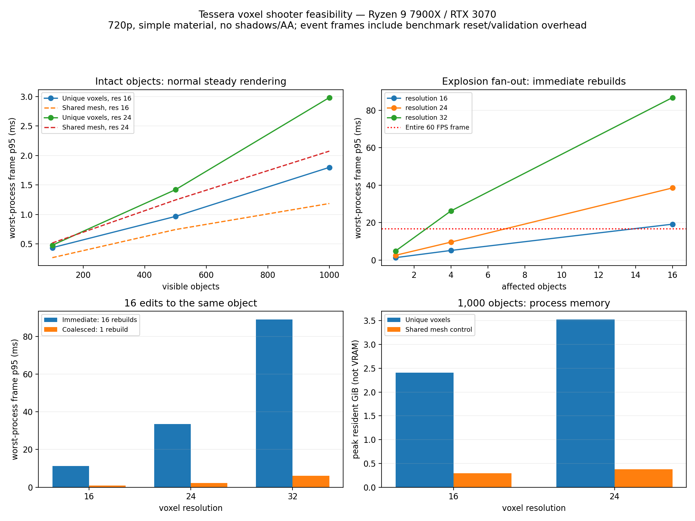

> Historical result: preserved from a local run; this is not a rerun on commit `62f33b0`. Raw-only links download the containing archive; see the archive inventory for its member path.

# Tessera destructible voxel shooter benchmark

Completed 2026-10-29T19:16:18.947465. Fixed Release snapshot, Ryzen 9 7900X, RTX 3070 8 GB, Linux/Vulkan. **254 measured processes**; all command lines, samples and checks are retained.

## Assessment

**A bounded shooter with destructible map sections, explosions and digging looks plausible on this desktop. Idle rendering is not the main obstacle. Immediate mesh/collision rebuilds, fragmentation correctness, memory, and scheduling destruction bursts are the important constraints.** This is not a whole-game or multiplayer capacity guarantee.

Every VoxelObject retains a normal generated mesh between edits. Only the affected object remeshes. There is no whole-map rebuild in these tests. Each voxel object still owns a grid, its own mesh and collision data; identical voxel objects do not automatically share their meshes.

## Intact map pieces

720p, one directional light, simple vertex-coloured material, no shadows/AA; all pieces framed together. Mesh colliders are enabled. Values are the worst process p95 among three independent runs. Peak RSS is CPU process resident memory, **not total RAM+VRAM**; it includes renderer/driver allocations and setup peaks.

| Objects | Resolution | Unique voxel meshes p95 ms | Same-geometry shared-mesh control p95 ms | Voxel process peak RSS MiB | Shared control RSS MiB |
|---|---:|---:|---:|---:|---:|
| 100 | 16 | 0.438 | 0.268 | 417.676 | 258.801 |
| 500 | 16 | 0.967 | 0.744 | 1322.930 | 281.289 |
| 1000 | 16 | 1.798 | 1.186 | 2463.504 | 305.109 |
| 100 | 24 | 0.479 | 0.517 | 529.957 | 267.457 |
| 500 | 24 | 1.420 | 1.246 | 1892.816 | 321.191 |
| 1000 | 24 | 2.981 | 2.074 | 3606.094 | 387.809 |
| 100 | 32 | 0.653 | — | 737.188 | — |
| 500 | 32 | 2.794 | — | 2942.219 | — |
| 100 | 48 | 2.581 | — | 1377.004 | — |

The shared-mesh control draws the **same voxel-generated geometry** at the same object count using one source mesh. It retains one VoxelObject, then shares that mesh among ordinary MeshRenderers; it is an instancing/reuse control, not a destructible replacement. All objects still have mesh colliders. RSS includes one extra int8 density backup per benchmark voxel object for reproducible edits, even in idle tests; a game without backups saves that portion. No VRAM ceiling is established.

1080p with shadows and antialiasing enabled:

| Objects | Voxel p95 ms | Shared control p95 ms |
|---|---:|---:|
| 100 | 1.017 | — |
| 500 | 2.322 | 1.922 |

## Bullets and digging

**Bullet carve radius is 0.32 m (64 cm diameter): a large visible chip, not a realistic calibre-sized bullet hole.** Resolution 24 over a 4 m object means 16.7 cm cells; resolution 48 means 8.3 cm cells. Millimetre bullet holes require decals or a different finer/local representation. Objects can instead be made physically smaller at the same resolution for finer cells.

Digging tests use a 4 m grid containing a 3.2 m × 3.2 m × 0.7 m wall and a 0.5 m-radius cut through its centre. The exact mesh collider must let a ray through the new hole after every edit. Other bullet tests use a solid primitive box. Every measured iteration begins with an untimed density-only restore, then performs productive edits; no Fill or mesh/collision rebuilding is hidden in the measured edit. Reset cleanup and correctness scans are outside the narrow SAMPLE action/CPU timers. Full rendered FRAME intervals still include that benchmark housekeeping, so event-frame figures conservatively include work a production game would replace with its own event/cleanup logic.

| Resolution | Cell size cm (4 m grid) | Mesh generation/edit only, CPU p95 ms | With exact static collision, CPU p95 ms | With convex rigidbody, CPU p95 ms | Carving bullet: rendered p95 ms | Digging through wall: rendered p95 ms |
|---|---:|---:|---:|---:|---:|---:|
| 8 | 50.00 | — | — | — | — | 0.293 |
| 16 | 25.00 | 0.336 | 0.998 | 0.336 | 1.261 | 0.546 |
| 24 | 16.67 | 0.707 | 2.239 | 0.960 | 2.005 | 1.028 |
| 32 | 12.50 | 1.385 | 4.416 | 1.499 | 3.969 | 1.657 |
| 48 | 8.33 | 3.533 | 10.782 | 3.555 | 11.653 | 4.228 |

Resolution-8 bullet tests changed density but failed the benchmark’s positive-solid-sample removal gate; their timings are excluded. This does not prove the engine cannot draw any small dent: it means this coarse grid did not pass this specific material-removal test. Digging at that resolution is tested separately.

The CPU-only collision comparison includes edit, meshing and collider/body rebuilding but no graphics device. The difference between no collider and mesh collider is an estimate of collision integration cost, not a separately instrumented pure Jolt function. Moving convex collision cannot represent concave holes or tunnels; it is appropriate for approximate loose props/debris, not exact traversable wall openings.

Bullets that do not carve are much less demanding:

| Intact objects, resolution 24 | 1,000 ray queries: CPU total p95 ms |
|---|---:|
| 100 | 1.597 |
| 500 | 1.762 |
| 1000 | 1.831 |

All 1,000 ray queries must hit. This is a synthetic query batch, not 1,000 fully simulated projectiles or networked shots.

## Explosions affecting multiple objects

Synthetic fan-out: each affected 4 m-grid box receives its own 1 m-radius carve at a fixed local point. This models the cost of touching N objects, not the geometry of a single 1 m world-space explosion spanning widely separated boxes. Real blast overlap, full object removal and fragmentation can change cost. No fragments are detached in this fan-out case; fragmentation is measured separately.

| Resolution | Affected objects | Rendered median ms | Worst-process rendered p95 ms |
|---|---:|---:|---:|
| 16 | 1 | 0.977 | 1.250 |
| 16 | 4 | 3.503 | 5.093 |
| 16 | 16 | 13.318 | 19.130 |
| 24 | 1 | 2.414 | 2.510 |
| 24 | 4 | 9.185 | 9.542 |
| 24 | 16 | 37.675 | 38.482 |
| 32 | 1 | 4.677 | 4.785 |
| 32 | 4 | 18.975 | 26.178 |
| 32 | 16 | 74.845 | 86.731 |

A 60 FPS frame is 16.67 ms; a 120 FPS frame is 8.33 ms. These destruction costs must fit alongside the rest of the game. They are not whole-game FPS predictions. Event-frame intervals also include the repeat/reset and validation overhead described above; narrow action columns isolate the edit service time.

## Dirty-object queue and coalescing

**Coalescing is measured here in a benchmark-only prototype; it is not enabled in the engine.** It applies the same density edits, then calls the current Rebuild once per dirty object, including exact collision rebuilding. It has no threads, asynchronous collision cooking or compute shader. The prototype omits fragment splitting and networking. Final density FNV hashes, vertex counts and triangle counts must match immediate editing for every paired case.

| Resolution | Edits to one object | Immediate rendered p95 ms | One rebuild rendered p95 ms | Speedup (frame medians) |
|---|---:|---:|---:|---:|
| 16 | 4 | 2.966 | 1.034 | 3.56× |
| 16 | 16 | 11.358 | 0.918 | 12.46× |
| 24 | 4 | 8.125 | 3.478 | 3.81× |
| 24 | 16 | 33.498 | 2.348 | 14.59× |
| 32 | 4 | 15.619 | 4.326 | 3.79× |
| 32 | 16 | 88.901 | 6.120 | 15.14× |

A queue should deduplicate dirty objects, combine same-object hits, prioritize nearby gameplay-relevant changes, and use a time budget rather than a fixed object count. CPU meshing can be prepared on workers; GPU uploads and physics swaps need safe ownership/commit points. Density changes that happen while a worker is meshing need versioning so completed work does not overwrite newer edits.

A simple queue-drain estimate below uses the **worst process p95 single-object CPU action time** measured for a blast, then assumes whole jobs must fit in the budget. It is arithmetic, not an implemented queue benchmark. It excludes other game work, collision-commit synchronization, async latency and scheduling overhead. An object taking longer than the budget cannot be made cheap merely by putting it in a queue; it needs smaller pieces, finer-grained jobs or background work.

| Resolution | Single-object service estimate ms | Budget ms/frame | Objects/frame | Frames to finish 16 objects | Delay at 60 FPS ms |
|---|---:|---:|---:|---:|---:|
| 16 | 1.045 | 2 | 1 | 16 | 266.7 |
| 16 | 1.045 | 4 | 3 | 6 | 100.0 |
| 16 | 1.045 | 8 | 7 | 3 | 50.0 |
| 24 | 2.339 | 2 | job exceeds budget | — | — |
| 24 | 2.339 | 4 | 1 | 16 | 266.7 |
| 24 | 2.339 | 8 | 3 | 6 | 100.0 |
| 32 | 4.568 | 2 | job exceeds budget | — | — |
| 32 | 4.568 | 4 | job exceeds budget | — | — |
| 32 | 4.568 | 8 | 1 | 16 | 266.7 |

Immediate impact particles, dust and decals can hide short visual delays, but a newly visible hole should not remain blocked by old collision. Voxel-density hitscan queries could respond before mesh/collider replacement; player and rigidbody collision still need an updated representation. A queue does not remove total work, and repeated demand above its service rate grows the backlog.

## Fragment creation and debris

The split test uses two solid lobes joined by a narrow bridge. A centre cut must detach a fragment. It includes fragment allocation, remeshing, convex collision, rigidbody creation and one physics/update tick. Old fragments are removed outside the timer to repeat the same event; this does not measure permanent accumulation.

| Simultaneous splits, resolution 24 | Rendered p95 ms | Fragments per event |
|---|---:|---:|
| 1 | 1.614 | 1 |
| 4 | 5.795 | 4 |
| 16 | 22.872 | 16 |

**Correctness blocker:** the resolution-16 split test fails grid-layout validation. SpawnPiece creates a new default-resolution component, then changes resolution without resizing its sample arrays/counter before copying the parent grid. The observed fragment retains the default 25³ samples instead of 17³. Above default resolution, the source also copies a larger parent grid into default-sized fragment arrays, so those fragmentation cases were deliberately not executed. Fix and regression-test fragment allocation before using mixed resolutions for destructible map pieces. Timings for the rejected split are excluded.

Existing detached pieces retain the full parent-sized voxel grid, even when the fragment is tiny. Their collision is a convex hull, not an exact concave surface. The following debris stress uses already-created separate voxel boxes with convex rigidbodies on a floor; they are gently kept active. It isolates ongoing debris cost, not fragment spawning or a dense rubble pile.

| Active debris objects | Resolution | Worst-process rendered p95 ms | Peak process RSS MiB |
|---|---:|---:|---:|
| 100 | 8 | 0.466 | 360.812 |
| 500 | 8 | 1.659 | 1053.656 |
| 100 | 16 | 0.494 | 413.648 |
| 500 | 16 | 1.769 | 1306.723 |
| 100 | 24 | 0.488 | 515.461 |
| 500 | 24 | 1.670 | 1828.559 |

A production game should cap active fragments, remove/merge small debris, and consider converting distant settled rubble to ordinary meshes. Every retained fragment being recursively destructible costs more memory than visual rubble alone. Dense piles, chains of explosions and full structure collapse need additional tests.

## Imported model startup

Setup includes voxelization and initial collision; subsequent idle CPU ticks are not voxelizing the model repeatedly. These are simple built-in closed cube/sphere meshes, not production assets with thousands of triangles. Model voxelization scans samples against source triangles and can be much more expensive for detailed assets. Precompute/cache voxel data for shipped maps rather than voxelizing a whole level during action.

| Source | Resolution | Setup median ms |
|---|---:|---:|
| model-cube | 16 | 3.366 |
| model-cube | 24 | 5.761 |
| model-cube | 32 | 10.053 |
| model-sphere | 16 | 6.856 |
| model-sphere | 24 | 10.545 |
| model-sphere | 32 | 15.905 |

## Compute shaders

GPU meshing was **not benchmarked or implemented**. It could accelerate density processing/visual marching cubes, but current Jolt collision still needs CPU-accessible geometry and CPU shape preparation. A GPU collision-mesh generator would therefore still require asynchronous readback and physics integration. Separate coarse collision meshes may help, provided gameplay holes remain representable. The no-collider versus static-collider rows show why speeding up visual meshing alone cannot eliminate the entire update cost. Start by coalescing edits and profiling mesh/collision stages; evaluate compute against that improved CPU baseline.

## Suggested shooter design

- Use VoxelObjects for independently destructible wall sections, terrain-like blocks and props; leave weapons, characters and tiny cosmetic items as ordinary meshes unless they genuinely need volumetric destruction.
- Begin with resolution 16–24 for ordinary map sections; use small physical chunks for required detail rather than setting every large model to 48. Keep sections closed and avoid very long, thin models that waste a cubic grid.
- Ordinary bullets can use hitscan and decals. Reserve volumetric carving for explosions, digging and selected weapons; if carving every bullet, batch same-object edits before rebuilding.
- Add a deduplicated, versioned update queue with a small measured frame budget, and separate visible/hitscan responsiveness from safe physics-shape commits. Profile its queue age under sustained combat, not only average FPS.
- Fix the nondefault-resolution fragment allocation issue, bound active debris and memory, and test real map geometry with multiple simultaneous explosions before committing to a whole-map destruction design.
- Multiplayer carve event routing and shared fragment identities exist, but these tests are single-process with no network session. Bandwidth, authoritative validation, late-join world state, replication of queue delays and desync resistance are not established. Navigation updates after destruction are not included.

## Full measured inventory

Statistics are medians across processes except the explicitly named worst-process p95. Each event case uses 8 warmup and 40 samples × 3 processes unless its command specifies otherwise; idle/render tests use 40/100, rays 20/80, debris 60/120, model setup 2/10. Separate instrumented profiler runs use one process and do not contribute to practical comparison tables.

| Case | N | Res | Edits | Collision | Mode | Action median ms | Action p95 ms | Physics median ms | CPU total p95 ms | Worst-process frame p95 ms | Setup ms | RSS MiB |
|---|---:|---:|---:|---|---|---:|---:|---:|---:|---:|---:|---:|
| idle | 100 | 16 | 0 | mesh | render | 0.000 | 0.000 | 0.004 | 0.011 | 0.438 | 145.787 | 417.676 |
| shared | 100 | 16 | 0 | mesh | render | 0.000 | 0.000 | 0.003 | 0.008 | 0.268 | 35.111 | 258.801 |
| idle | 500 | 16 | 0 | mesh | render | 0.000 | 0.000 | 0.015 | 0.045 | 0.967 | 727.493 | 1322.930 |
| shared | 500 | 16 | 0 | mesh | render | 0.000 | 0.000 | 0.009 | 0.026 | 0.744 | 160.630 | 281.289 |
| idle | 1000 | 16 | 0 | mesh | render | 0.000 | 0.000 | 0.031 | 0.095 | 1.798 | 1466.476 | 2463.504 |
| shared | 1000 | 16 | 0 | mesh | render | 0.000 | 0.000 | 0.016 | 0.063 | 1.186 | 321.105 | 305.109 |
| idle | 100 | 24 | 0 | mesh | render | 0.000 | 0.000 | 0.004 | 0.011 | 0.479 | 287.087 | 529.957 |
| shared | 100 | 24 | 0 | mesh | render | 0.000 | 0.000 | 0.003 | 0.009 | 0.517 | 119.576 | 267.457 |
| idle | 500 | 24 | 0 | mesh | render | 0.000 | 0.000 | 0.016 | 0.046 | 1.420 | 1434.109 | 1892.816 |
| shared | 500 | 24 | 0 | mesh | render | 0.000 | 0.000 | 0.009 | 0.032 | 1.246 | 562.483 | 321.191 |
| idle | 1000 | 24 | 0 | mesh | render | 0.000 | 0.000 | 0.035 | 0.099 | 2.981 | 2795.277 | 3606.094 |
| shared | 1000 | 24 | 0 | mesh | render | 0.000 | 0.000 | 0.017 | 0.062 | 2.074 | 1165.426 | 387.809 |
| idle | 100 | 32 | 0 | mesh | render | 0.000 | 0.000 | 0.004 | 0.010 | 0.653 | 493.221 | 737.188 |
| idle | 500 | 32 | 0 | mesh | render | 0.000 | 0.000 | 0.013 | 0.047 | 2.794 | 2527.374 | 2942.219 |
| idle | 100 | 48 | 0 | mesh | render | 0.000 | 0.000 | 0.004 | 0.013 | 2.581 | 1161.206 | 1377.004 |
| idle | 100 | 24 | 0 | mesh | hq | 0.000 | 0.000 | 0.005 | 0.013 | 1.017 | 295.834 | 529.586 |
| idle | 500 | 24 | 0 | mesh | hq | 0.000 | 0.000 | 0.018 | 0.048 | 2.322 | 1445.523 | 1895.164 |
| shared | 500 | 24 | 0 | mesh | hq | 0.000 | 0.000 | 0.009 | 0.032 | 1.922 | 566.245 | 322.410 |
| rays | 100 | 24 | 0 | mesh | cpu | 1.558 | 1.589 | 0.003 | 1.597 | — | 260.028 | 83.379 |
| rays | 500 | 24 | 0 | mesh | cpu | 1.689 | 1.721 | 0.014 | 1.762 | — | 1291.128 | 358.465 |
| rays | 1000 | 24 | 0 | mesh | cpu | 1.618 | 1.738 | 0.029 | 1.831 | — | 2588.605 | 701.613 |
| slab | 1 | 8 | 1 | mesh | render | 0.074 | 0.096 | 0.001 | 0.099 | 0.293 | 1.881 | 249.328 |
| shots | 1 | 16 | 1 | none | cpu | 0.254 | 0.270 | 0.001 | 0.271 | — | 2.068 | 13.848 |
| shots | 1 | 16 | 1 | mesh | cpu | 0.743 | 0.937 | 0.001 | 0.940 | — | 2.518 | 14.379 |
| shots | 1 | 16 | 1 | dynamic | cpu | 0.316 | 0.328 | 0.018 | 0.357 | — | 2.128 | 13.918 |
| shots | 1 | 16 | 1 | mesh | render | 0.661 | 0.702 | 0.002 | 0.704 | 1.261 | 2.616 | 251.449 |
| slab | 1 | 16 | 1 | mesh | render | 0.336 | 0.347 | 0.002 | 0.349 | 0.546 | 2.111 | 250.957 |
| shots-split | 1 | 16 | 1 | mesh | cpu | 0.745 | 0.763 | 0.001 | 0.764 | — | 2.575 | 14.426 |
| shots | 1 | 24 | 1 | none | cpu | 0.679 | 0.686 | 0.001 | 0.687 | — | 2.453 | 13.629 |
| shots | 1 | 24 | 1 | mesh | cpu | 2.219 | 2.239 | 0.001 | 2.240 | — | 4.133 | 15.578 |
| shots | 1 | 24 | 1 | dynamic | cpu | 0.769 | 0.782 | 0.017 | 0.805 | — | 2.680 | 14.051 |
| shots | 1 | 24 | 1 | mesh | render | 1.821 | 1.837 | 0.002 | 1.839 | 2.005 | 4.298 | 252.559 |
| slab | 1 | 24 | 1 | mesh | render | 0.821 | 0.844 | 0.002 | 0.846 | 1.028 | 2.944 | 250.582 |
| shots-split | 1 | 24 | 1 | mesh | cpu | 2.212 | 2.226 | 0.001 | 2.228 | — | 4.150 | 15.492 |
| shots | 1 | 32 | 1 | none | cpu | 1.374 | 1.384 | 0.001 | 1.385 | — | 3.640 | 14.734 |
| shots | 1 | 32 | 1 | mesh | cpu | 4.266 | 4.346 | 0.001 | 4.348 | — | 6.861 | 17.746 |
| shots | 1 | 32 | 1 | dynamic | cpu | 1.455 | 1.486 | 0.011 | 1.496 | — | 3.691 | 14.859 |
| shots | 1 | 32 | 1 | mesh | render | 3.601 | 3.645 | 0.002 | 3.647 | 3.969 | 6.401 | 255.195 |
| slab | 1 | 32 | 1 | mesh | render | 1.464 | 1.476 | 0.002 | 1.480 | 1.657 | 4.038 | 251.309 |
| shots-split | 1 | 32 | 1 | mesh | cpu | 4.477 | 4.537 | 0.001 | 4.539 | — | 6.882 | 17.680 |
| shots | 1 | 48 | 1 | none | cpu | 3.397 | 3.414 | 0.001 | 3.415 | — | 6.153 | 17.070 |
| shots | 1 | 48 | 1 | mesh | cpu | 10.594 | 10.678 | 0.001 | 10.681 | — | 14.213 | 24.043 |
| shots | 1 | 48 | 1 | dynamic | cpu | 3.532 | 3.546 | 0.010 | 3.568 | — | 6.590 | 17.410 |
| shots | 1 | 48 | 1 | mesh | render | 10.815 | 10.982 | 0.002 | 10.986 | 11.653 | 14.700 | 263.082 |
| slab | 1 | 48 | 1 | mesh | render | 3.933 | 3.953 | 0.002 | 3.955 | 4.228 | 8.358 | 255.398 |
| shots-split | 1 | 48 | 1 | mesh | cpu | 11.161 | 11.257 | 0.002 | 11.260 | — | 13.843 | 24.188 |
| blast | 1 | 16 | 1 | mesh | render | 0.820 | 1.035 | 0.002 | 1.038 | 1.250 | 2.591 | 251.070 |
| blast | 4 | 16 | 4 | mesh | render | 3.288 | 3.375 | 0.002 | 3.378 | 5.093 | 7.471 | 253.895 |
| blast | 16 | 16 | 16 | mesh | render | 12.763 | 13.331 | 0.004 | 13.343 | 19.130 | 24.806 | 265.457 |
| blast | 1 | 24 | 1 | mesh | render | 2.242 | 2.327 | 0.002 | 2.329 | 2.510 | 4.165 | 252.461 |
| blast | 4 | 24 | 4 | mesh | render | 8.886 | 8.940 | 0.002 | 8.944 | 9.542 | 13.348 | 258.395 |
| blast | 16 | 24 | 16 | mesh | render | 36.722 | 37.047 | 0.007 | 37.056 | 38.482 | 47.219 | 280.227 |
| blast | 1 | 32 | 1 | mesh | render | 4.435 | 4.490 | 0.002 | 4.492 | 4.785 | 6.727 | 256.312 |
| blast | 4 | 32 | 4 | mesh | render | 18.344 | 18.724 | 0.005 | 18.733 | 26.178 | 21.925 | 266.621 |
| blast | 16 | 32 | 16 | mesh | render | 72.763 | 73.434 | 0.010 | 73.449 | 86.731 | 81.467 | 318.172 |
| burst | 1 | 16 | 4 | mesh | render | 2.649 | 2.677 | 0.002 | 2.679 | 2.966 | 2.552 | 252.117 |
| batch | 1 | 16 | 4 | mesh | render | 0.655 | 0.700 | 0.002 | 0.702 | 1.034 | 2.675 | 251.285 |
| burst | 1 | 16 | 16 | mesh | render | 10.849 | 10.872 | 0.002 | 10.874 | 11.358 | 2.566 | 255.031 |
| batch | 1 | 16 | 16 | mesh | render | 0.752 | 0.778 | 0.002 | 0.780 | 0.918 | 2.824 | 250.926 |
| burst | 1 | 24 | 4 | mesh | render | 7.520 | 7.650 | 0.003 | 7.657 | 8.125 | 4.364 | 254.109 |
| batch | 1 | 24 | 4 | mesh | render | 1.886 | 1.899 | 0.002 | 1.906 | 3.478 | 4.210 | 253.152 |
| burst | 1 | 24 | 16 | mesh | render | 31.809 | 32.029 | 0.004 | 32.035 | 33.498 | 4.046 | 261.078 |
| batch | 1 | 24 | 16 | mesh | render | 2.058 | 2.073 | 0.002 | 2.076 | 2.348 | 4.134 | 252.176 |
| burst | 1 | 32 | 4 | mesh | render | 15.021 | 15.053 | 0.002 | 15.055 | 15.619 | 6.657 | 258.574 |
| batch | 1 | 32 | 4 | mesh | render | 3.846 | 3.875 | 0.002 | 3.877 | 4.326 | 6.926 | 255.191 |
| burst | 1 | 32 | 16 | mesh | render | 64.499 | 65.925 | 0.007 | 65.937 | 88.901 | 6.584 | 271.785 |
| batch | 1 | 32 | 16 | mesh | render | 4.133 | 4.451 | 0.002 | 4.454 | 6.120 | 6.668 | 255.809 |
| split | 1 | 24 | 1 | mesh | render | 1.256 | 1.265 | 0.132 | 1.402 | 1.614 | 2.561 | 252.297 |
| split | 4 | 24 | 4 | mesh | render | 4.956 | 4.982 | 0.449 | 5.462 | 5.795 | 7.447 | 258.957 |
| split | 16 | 24 | 16 | mesh | render | 19.620 | 20.257 | 1.545 | 21.848 | 22.872 | 26.598 | 281.938 |
| debris | 100 | 8 | 0 | dynamic | render | 0.004 | 0.004 | 0.101 | 0.157 | 0.466 | 93.873 | 360.812 |
| debris | 500 | 8 | 0 | dynamic | render | 0.019 | 0.019 | 0.463 | 0.718 | 1.659 | 460.555 | 1053.656 |
| debris | 100 | 16 | 0 | dynamic | render | 0.004 | 0.004 | 0.124 | 0.204 | 0.494 | 125.773 | 413.648 |
| debris | 500 | 16 | 0 | dynamic | render | 0.019 | 0.021 | 0.475 | 0.856 | 1.769 | 610.770 | 1306.723 |
| debris | 100 | 24 | 0 | dynamic | render | 0.004 | 0.004 | 0.119 | 0.186 | 0.488 | 180.788 | 515.461 |
| debris | 500 | 24 | 0 | dynamic | render | 0.019 | 0.021 | 0.407 | 0.746 | 1.670 | 879.041 | 1828.559 |
| model-cube | 1 | 16 | 0 | mesh | cpu | 0.000 | 0.000 | 0.001 | 0.001 | — | 3.366 | 14.219 |
| model-cube | 1 | 24 | 0 | mesh | cpu | 0.000 | 0.000 | 0.001 | 0.001 | — | 5.761 | 15.223 |
| model-cube | 1 | 32 | 0 | mesh | cpu | 0.000 | 0.000 | 0.001 | 0.001 | — | 10.053 | 17.668 |
| model-sphere | 1 | 16 | 0 | mesh | cpu | 0.000 | 0.000 | 0.001 | 0.001 | — | 6.856 | 14.418 |
| model-sphere | 1 | 24 | 0 | mesh | cpu | 0.000 | 0.000 | 0.001 | 0.001 | — | 10.545 | 14.906 |
| model-sphere | 1 | 32 | 0 | mesh | cpu | 0.000 | 0.000 | 0.001 | 0.001 | — | 15.905 | 16.461 |

## Reproducibility and validation

- 254 measurement processes: 249 pass fixture validation; 5 rejected. Rejections are four coarse-grid bullet cases and one nondefault fragment-layout case, not accepted performance wins.
- Accepted runs must return success, emit complete finite timings, report finite final mesh positions, and have no solver-capacity error. Every edit must report success and remove positive solid samples; fragment tests must actually create pieces with the correct grid layout. Digging must open collision to a ray. Ray batches must all hit. Rendered runs must emit all frame intervals and nonzero draw calls.
- All geometry is local to a fixed engine/native snapshot. No engine implementation changes were made. The coalescing prototype lives only in the benchmark harness. Native archive was built with the current Release configuration; Beef Release uses GNU linking with ThinLTO unavailable.
- Timed edit/action includes CarveLocal or the prototype, full mesh creation, collision rebuilding and uploads on rendered runs. CPU total also includes one 60 Hz Scene.FixedUpdate and one Scene.Update. Full-frame intervals include rendering/presentation. At overload this harness does not accumulate real-time catch-up ticks; it measures service cost, not sustained whole-game FPS.
- Density restoration, fragment cleanup needed to repeat an identical event and correctness scans are outside SAMPLE action/CPU timings but are included in inter-frame FRAME timings. Final aggregate checks are after the measurement loop. A real game still pays for its own cleanup and event routing. Extremely complex accumulated damage, dense debris piles, production material interiors, many lights, network traffic and player simulation are not covered. The floor and test colliders are physics-only; real environment drawing adds work.
- Resolution is cells along the grid’s longest side, clamped to 8–48. Primitive test grids are 4 m across, with the engine’s normal empty margin; cubes are therefore smaller than the grid. A slab is a custom thin density field. Spawned pieces keep the same parent grid.
- Peak RSS includes temporary/driver/benchmark allocations and is not a memory allocator breakdown or VRAM measurement. Processes run sequentially, unpinned, on an ordinary desktop; clocks and background load are uncontrolled. Small run-to-run differences are not guarantees.

- [Per-group CSV](summary.csv), [per-process CSV](processes.csv), [commands and checks](manifest.json), [source hashes](source-sha256.json), [benchmark source](../../archives/voxel-01.tar.gz), [runner](../../archives/voxel-01.tar.gz).
- All raw phase samples and frame intervals remain in individual .log files. Separate .tprofile/.md files contain engine profiler recordings.

## Charts

[Export SVG](voxel-capacity.svg).

[Validation audit](validation.json), [environment](environment.json), [wall-hole visual check](slab.png).
