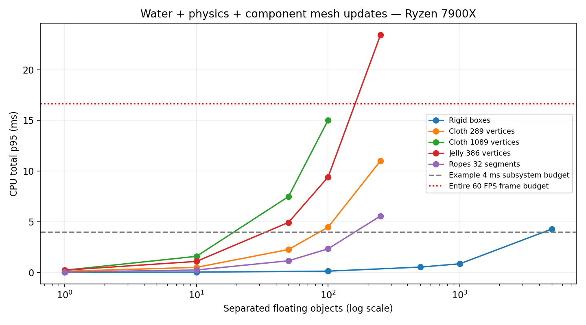
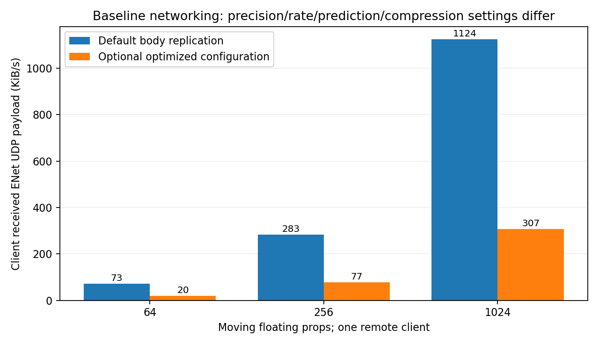

# Tessera desktop water, buoyancy and engine networking report

Tested engine: `6cfa1faa568940e629b71d9999605319d55bc037` (main at checkout). Ryzen 9 7900X, RTX 3070 8 GB, Linux, NVIDIA 595.104.02. Native and benchmark code built Release. Baseline measurements use that revision. Final validation also tests rollback fix `dfad1175ccf6a8bae0458f0aa1fb7c23b624604a`; native implementation is unchanged. Test library paths were adapted to this isolated checkout. Full machine metadata, binary hashes, raw samples and logs accompany this report.

## Findings

Endless water is inexpensive in this desktop scene and its grid stays bounded while moving. Rigid-body buoyancy is inexpensive through thousands of simple separated boxes. Fine cloth/jelly and rope mesh updates need an explicit scene budget. The existing networking tests passed, and an added regression exposed and now verifies a buoyancy rollback fix. Final correctness checks pass across the engine features listed in COVERAGE.md, but default full-body replication becomes expensive at hundreds to thousands of moving props. The optional optimized configuration is substantially smaller; it changes prediction policy and update cadence as well as compression. These are measured workload results, not a blanket guarantee that an arbitrary complete game meets 60 FPS.

## Buoyancy rollback fix and final validation

Fix commit: `dfad1175ccf6a8bae0458f0aa1fb7c23b624604a`. Normal physics applies water forces before stepping Jolt; rollback previously stepped Jolt without those forces. In a new 12-tick test that caused 0.202 m position / 1.872 m/s velocity error in flat water and 0.174 m / 1.610 m/s with waves. Rollback now applies buoyancy at each historical simulation tick, rather than using the current scene time. Four final regressions cover flat/wavy water for both owned and predicted server bodies; all match forward simulation exactly in position and velocity.

- **Complete listed CPU suite after the fix: 53 passed, 0 failed**, no retries.
- **Focused final validation: 593 checks across 13 runs, 0 failed runs**, including the Maps fixture omitted from the repository’s default 53-fixture list. These overlap the complete suite.
- **Affected/network stress reruns: 8 scenarios, 52 processes, 0 failed process validations**. Includes default floating-body loads, both impairment settings, 32-player optimized and mixed reliable state traffic.

Patched network results (early moving phase; same measurement method as the baseline table below):

| Scenario | Client ↓ KiB/s | Server ↑ Mbit/s | Fixed mean ms | Worst ms | Server Hz | Final error m | Max rollbacks | Pass |
|---|---|---|---|---|---|---|---|---|
| 00-64-default-waves-1-0-0-0 | 72.033 | 0.590 | 0.115 | 0.286 | 59.997 | 0.004 | 91 | True |
| 01-256-default-waves-1-0-0-0 | 282.443 | 2.315 | 0.356 | 0.690 | 59.995 | 0.004 | 90 | True |
| 02-1024-default-waves-1-0-0-0 | 1123.664 | 9.208 | 1.386 | 1.999 | 59.997 | 0.004 | 91 | True |
| 03-64-default-waves-1-75-25-5 | 69.295 | 0.553 | 0.119 | 0.202 | 60.003 | 0.004 | 91 | True |
| 04-64-default-waves-1-150-50-10 | 63.928 | 0.524 | 0.114 | 0.233 | 59.994 | 0.004 | 96 | True |
| 05-64-optimized-waves-31-0-0-0 | 23.638 | 5.998 | 0.850 | 2.674 | 60.000 | 0.003 | 1 | True |
| 06-256-mixed-waves-7-0-0-0 | 87.030 | 5.000 | 0.960 | 3.322 | 59.999 | 0.003 | 1 | True |
| 07-1024-budget-waves-1-0-0-0 | 63.187 | 0.518 | 1.321 | 2.355 | 59.998 | 0.003 | 1 | True |

Patched water spot checks (three fresh processes per workload):

| Case | Mode | Count | Water p95 ms | Total CPU p95 ms | Frame p95 ms |
|---|---|---|---|---|---|
| ocean | render | 0 | 0.000 | 0.003 | 1.014 |
| bodies | cpu | 1000 | 0.627 | 0.834 | 0.000 |
| bodies | render | 1000 | 0.699 | 1.091 | 1.519 |

The complete water matrix below is from the baseline; these spot checks validate the unchanged forward-water path after the rollback fix. Additional shell measurements use the fixed engine. The network section below retains all 28 baseline scenarios so the smaller post-fix rerun is not presented as a rerun of every configuration.

## Baseline correctness and coverage

- Full listed CPU suite: **53 fixtures passed, 0 failed**, no retries. Includes networking as well as the rest of the engine's listed CPU fixtures.
- Focused validation: **436 passing checks** across 10 runs (Debug/Release Water and NetworkBandwidth, Network, PhysicsPrediction, Voice, SoftBodies, CharacterController and AntiCheat). These overlap the complete suite; they are not all unique assertions.
- Independent-process networking: **28 scenarios, 120 processes, 0 failed process validations**. Final convergence, finite states, shared water settings/time, floating server bodies and mixed light changes are checked. Server tick gate: at least 55 Hz.
- Instrumented broad Network fixture retained its 82 assertions and recorded actual UDP payload deltas around complete feature workflows. See validation/tessera-network-feature-traffic.log. Concurrent player/session traffic is included; these totals must not be treated as bytes per isolated action.
- Full subsystem mapping and explicit transport exclusions: [COVERAGE.md](../../water-network/COVERAGE.md).

## Rendered water

No VSync or MSAA, render scale 1. One sun, seabed and 12 pillars; realistic look uses its water reflection effects. One simulation step plus scene update per rendered frame. Three fresh processes, 120 warmup + 300 sampled frames per process. Values below are medians of process p95 frame intervals; raw per-process samples and worst-process p95 remain in CSV. Baseline includes the same simple scene without water.

| Scene target | Case | Look | Frame p95 ms | GPU median ms |
|---|---|---|---|---|
| 1280×720 | baseline | real | 0.229 | 0.156 |
| 1280×720 | ocean | real | 0.646 | 0.410 |
| 1280×720 | ocean | low | 0.352 | 0.244 |
| 1280×720 | underwater | real | 0.547 | 0.301 |
| 1280×720 | waterline | real | 0.483 | 0.318 |
| 1920×1080 | baseline | real | 0.291 | 0.220 |
| 1920×1080 | ocean | real | 1.005 | 0.736 |
| 1920×1080 | ocean | low | 0.517 | 0.370 |
| 1920×1080 | underwater | real | 0.724 | 0.478 |
| 1920×1080 | waterline | real | 0.766 | 0.530 |
| 3840×2160 | baseline | real | 0.721 | 0.477 |
| 3840×2160 | ocean | real | 2.736 | 2.438 |
| 3840×2160 | ocean | low | 1.243 | 0.970 |
| 3840×2160 | underwater | real | 1.644 | 1.363 |
| 3840×2160 | waterline | real | 2.367 | 1.655 |

These are whole test-scene frame times, not isolated water GPU subtraction. CPU and GPU overlap, so subtracting frame intervals does not yield a precise water pass cost. Low/realistic runs hold mesh spacing and wave height constant to compare visual effects.

Resolution validation caught window-manager size clamping in the initial exploratory pass. **Only `render-fixed-resolution/` is used for rendered performance here**; each run checks the actual offscreen scene target width/height. Initial `water/` rendered logs are retained for audit and excluded from rendered conclusions.

## Endless water and traversal

The endless grid uploads **37,249 vertices / 73,728 triangles**, with a near dense region and coarse far region, reaching 8 km from the camera in each direction. It reuses one cached mesh rather than rebuilding an entire world as the camera moves. All tested endless spacings retain that same vertex count.

| Case | Spacing m | Vertices | Frame p95 ms | Peak RSS MiB | Cache entries |
|---|---|---|---|---|---|
| lake | 0.5 | 25921 | 0.955 | 264.074 | 1 |
| large-lake | 0.5 | 65536 | 0.911 | 263.230 | 1 |
| no-ssr | 0.5 | 37249 | 0.729 | 263.453 | 1 |
| travel | 0.5 | 37249 | 0.908 | 263.781 | 1 |
| far | 0.5 | 37249 | 0.934 | 263.891 | 1 |
| travel | 0.1 | 37249 | 0.909 | 263.234 | 1 |
| travel | 2 | 37249 | 0.864 | 263.656 | 1 |
| travel | 8 | 37249 | 0.812 | 263.473 | 1 |
| travel | 0.5 | 37249 | 0.936 | 280.684 | 1 |

The long traversal samples 10,000 frames at 7 m/frame (about 70 km), about 167 seconds of simulated time. `far` starts at 100 km coordinates. This validates finite states and bounded grid-cache entries, not multi-hour memory stability or perfect visual precision at arbitrary coordinates. Lake is 80×80 m; large-lake is 8,000×8,000 m with a capped finite grid. Finite large lakes have coarser vertex spacing because their grid is capped.

## Buoyancy and deformation budget

Separated 1 m boxes, mass 40 kg, moving waves/current. CPU values include water forces, native physics, and scene/component updates; no GPU rendering. Separate objects minimize contact stress and do not represent a colliding pile. The dry control eventually sleeps and is not used to claim a pure wet/dry percentage.

| Boxes | Water p95 ms | Physics p95 ms | Update p95 ms | Total p95 ms |
|---|---|---|---|---|
| 1 | 0.001 | 0.016 | 0.000 | 0.017 |
| 10 | 0.007 | 0.023 | 0.001 | 0.030 |
| 100 | 0.069 | 0.055 | 0.005 | 0.127 |
| 500 | 0.326 | 0.176 | 0.027 | 0.526 |
| 1000 | 0.627 | 0.175 | 0.058 | 0.851 |
| 5000 | 3.201 | 0.841 | 0.286 | 4.288 |

All measured wet box workloads retained at least 90% floating bodies and finite states. The 1,000-body rendered 1080p realistic-water workload has a frame p95 of 1.272 ms in this sparse scene.

Soft objects use default solver settings and small separated shapes: cloth is 2×2 m; jelly/shell are 1 m boxes; ropes are free, 3 m long. Cloth vertices = (cells+1)²; welded closed box vertices = 6×cells²+2; ropes have segments+1 points. Measured mesh updates remain enabled, including in headless mode.

| Kind | Objects | Cells/segments | Water p95 ms | Physics p95 ms | Update p95 ms | Total p95 ms |
|---|---|---|---|---|---|---|
| cloth | 50 | 8 | 0.402 | 0.280 | 0.215 | 0.896 |
| cloth | 100 | 8 | 0.805 | 0.561 | 0.429 | 1.788 |
| cloth | 250 | 8 | 2.064 | 1.352 | 1.026 | 4.346 |
| cloth | 50 | 16 | 0.563 | 1.036 | 0.746 | 2.263 |
| cloth | 100 | 16 | 1.172 | 2.009 | 1.371 | 4.465 |
| cloth | 250 | 16 | 2.869 | 4.813 | 3.417 | 11.022 |
| cloth | 50 | 32 | 1.219 | 3.752 | 2.605 | 7.487 |
| cloth | 100 | 32 | 2.474 | 7.402 | 5.314 | 15.036 |
| jelly | 50 | 4 | 0.242 | 0.948 | 0.321 | 1.489 |
| jelly | 100 | 4 | 0.488 | 1.851 | 0.642 | 2.955 |
| jelly | 250 | 4 | 1.229 | 4.477 | 1.663 | 7.256 |
| jelly | 50 | 8 | 0.415 | 3.471 | 1.080 | 4.934 |
| jelly | 100 | 8 | 0.830 | 6.475 | 2.274 | 9.419 |
| jelly | 250 | 8 | 2.147 | 15.975 | 5.643 | 23.447 |
| rope | 50 | 16 | 0.229 | 0.087 | 0.412 | 0.726 |
| rope | 100 | 16 | 0.467 | 0.167 | 0.794 | 1.387 |
| rope | 250 | 16 | 1.163 | 0.432 | 2.143 | 3.484 |
| rope | 50 | 32 | 0.233 | 0.146 | 0.774 | 1.149 |
| rope | 100 | 32 | 0.491 | 0.319 | 1.575 | 2.333 |
| rope | 250 | 32 | 1.164 | 0.692 | 3.925 | 5.576 |
| rope | 50 | 64 | 0.237 | 0.268 | 1.481 | 1.965 |
| rope | 100 | 64 | 0.486 | 0.564 | 3.113 | 4.116 |
| rope | 250 | 64 | 1.221 | 1.188 | 7.468 | 9.746 |
| shell | 50 | 4 | 0.043 | 0.389 | 0.365 | 0.781 |
| shell | 100 | 4 | 0.081 | 0.717 | 0.724 | 1.500 |
| shell | 250 | 4 | 0.198 | 1.753 | 1.688 | 3.603 |
| shell | 50 | 8 | 0.036 | 1.176 | 1.048 | 2.246 |
| shell | 100 | 8 | 0.085 | 2.381 | 2.277 | 4.712 |
| shell | 250 | 8 | 0.222 | 6.116 | 5.641 | 11.831 |

For a 60 FPS game, reserve only part of the 16.67 ms frame for these systems. A roughly **4 ms subsystem budget** is a useful starting point: 100 coarse 8-cell cloths, 50 medium 16-cell cloths, 10 fine 32-cell cloths; 100 coarse 4-cell jellys or 10–25 finer 8-cell jellys; around 100 32-segment ropes. These are planning examples based on sampled workloads, not promised maximum counts. 100 fine cloths consume almost the entire 60 FPS CPU budget, and 250 fine jellys exceed it before rendering/gameplay. Reduce counts/detail or add distance/update scheduling before using those scales.

Profiler captures confirm component mesh work matters: 100 fine cloths spend about 5.2 ms/frame in SoftBody.LateUpdate; 100 32-segment ropes spend about 1.5 ms/frame in Rope.LateUpdate. The direct native physics/water timing brackets in the CSV should be used for those portions; the profiler does not mark the direct harness calls as Physics. CPU profiler reports label their loop interval as a frame interval, but these headless runs do not measure displayed FPS.

SurfaceAt query tests check finite normals/heights at current time and 86,400-second wave time. Ten thousand queries per step cost around 1.9 ms p95. The day-time query is a numerical phase test, not a day-long soak. Large boats still use the stock center-sampled rigid-body buoyancy model; convincing long hull behavior requires a game-specific distributed buoyancy model.

## Network bandwidth — full baseline matrix

Measured ENet UDP payload bytes, including transport headers, compression and retransmissions; excluding UDP/IP/link headers. Rates use actual one-second windows, not just bytes handed to the network API. `moving` is the early input/motion phase; `idle-input` stops player input, but waves continue moving the wet props. Initialization, connection handshakes and the final synthetic truth dump are outside these steady-state traffic windows. Reliable gameplay changes during the active phase remain included. Each scenario is one integration run, with several traffic windows; no statistical claim across repeated network runs is made.

| Props | Profile | Water | Remote clients | Client ↓ KiB/s | Client ↑ KiB/s | Server ↑ Mbit/s | Server fixed mean ms | Worst ms | Pass |
|---|---|---|---|---|---|---|---|---|---|
| 0 | default | none | 1 | 2.455 | 1.742 | 0.020 | 0.008 | 0.025 | True |
| 0 | default | waves | 1 | 2.467 | 1.736 | 0.020 | 0.010 | 0.032 | True |
| 64 | default | waves | 1 | 72.906 | 2.231 | 0.597 | 0.118 | 0.389 | True |
| 256 | default | waves | 1 | 282.511 | 3.472 | 2.314 | 0.399 | 0.690 | True |
| 1024 | default | waves | 1 | 1123.907 | 8.354 | 9.204 | 1.258 | 1.908 | True |
| 0 | optimized | none | 1 | 1.263 | 1.457 | 0.010 | 0.011 | 0.034 | True |
| 0 | optimized | waves | 1 | 1.267 | 1.459 | 0.010 | 0.013 | 0.112 | True |
| 64 | optimized | waves | 1 | 20.046 | 1.456 | 0.164 | 0.136 | 0.309 | True |
| 256 | optimized | waves | 1 | 77.497 | 1.462 | 0.634 | 0.400 | 0.999 | True |
| 1024 | optimized | waves | 1 | 306.876 | 1.455 | 2.512 | 1.557 | 3.620 | True |
| 256 | default | none | 1 | 286.067 | 3.494 | 2.314 | 0.139 | 0.320 | True |
| 256 | exact | none | 1 | 446.439 | 1.737 | 3.656 | 0.153 | 0.434 | True |
| 256 | body | none | 1 | 125.985 | 1.735 | 1.019 | 0.131 | 0.332 | True |
| 256 | framed | none | 1 | 28.440 | 1.734 | 0.234 | 0.146 | 0.756 | True |
| 256 | budget | none | 1 | 63.144 | 1.735 | 0.517 | 0.128 | 0.322 | True |
| 256 | optimized | none | 1 | 28.694 | 1.461 | 0.230 | 0.140 | 0.499 | True |
| 64 | default | waves | 1 | 70.212 | 2.123 | 0.560 | 0.113 | 0.299 | True |
| 64 | optimized | waves | 1 | 19.472 | 1.258 | 0.159 | 0.126 | 0.316 | True |
| 64 | default | waves | 1 | 63.915 | 1.991 | 0.524 | 0.112 | 0.172 | True |
| 64 | optimized | waves | 1 | 17.399 | 1.119 | 0.142 | 0.143 | 0.306 | True |
| 256 | optimized | waves | 3 | 77.850 | 1.463 | 1.911 | 0.563 | 1.515 | True |
| 256 | optimized | waves | 7 | 78.390 | 1.462 | 4.490 | 0.841 | 2.364 | True |
| 1024 | optimized | waves | 7 | 307.889 | 1.483 | 17.620 | 3.294 | 8.836 | True |
| 64 | optimized | waves | 15 | 21.821 | 1.462 | 2.681 | 0.435 | 1.396 | True |
| 64 | optimized | waves | 31 | 23.487 | 1.475 | 5.961 | 0.805 | 2.378 | True |
| 64 | mixed | waves | 1 | 22.148 | 2.142 | 0.181 | 0.134 | 0.291 | True |
| 256 | mixed | waves | 7 | 87.069 | 4.343 | 5.008 | 0.976 | 3.313 | True |
| 1024 | budget | waves | 1 | 63.178 | 1.732 | 0.518 | 1.308 | 2.079 | True |

Profiles: `default` leaves engine prediction and Legacy body records intact. `exact` turns on batching/full-precision full-body records and disables remote prediction. `body` uses QuantizedBody at 20 Hz. `optimized` also switches remote updates to 10 Hz and enables ENet compression. `framed` tests independent compressed message framing over UDP. `budget` caps snapshot application payload at 64,000 B/s/client; reliable messages, owner corrections, retransmission and transport overhead can exceed that on the wire. `mixed` combines optimized moving props with reliable light enabled/intensity/color changes at 2 Hz. Therefore default-to-optimized ratios combine several choices and are not a lossless-compression-only result.

For busy multiplayer scenes, enable batching, choose remote-body formats/rates deliberately, use sleep/dormancy, and apply relevance and per-client snapshot budgets. Full default body replication at 1,024 moving props is roughly 9 Mbit/s per client and is a poor general-purpose bandwidth target. Water with no floating props adds only small settings/clock overhead; animated wave vertices are not streamed every frame. Voice fixture measured about 63 encoded bytes per 20 ms frame (~3.1 KiB/s of voice application payload per speaker), before transport and relay overhead.

## Network quality and limits

| Scenario | Server Hz | Final error m | Body error diagnostic | Max client rollbacks | Build mean ms | Read mean ms |
|---|---|---|---|---|---|---|
| 00-0-default-none-1-0-0-0 | 59.998 | 0.000 | 0.000 | 1 | 0.001 | 0.001 |
| 01-0-default-waves-1-0-0-0 | 60.000 | 0.000 | 0.000 | 1 | 0.001 | 0.001 |
| 02-64-default-waves-1-0-0-0 | 60.001 | 0.004 | 0.052 | 95 | 0.022 | 0.061 |
| 03-256-default-waves-1-0-0-0 | 59.998 | 0.004 | 0.055 | 100 | 0.081 | 0.180 |
| 04-1024-default-waves-1-0-0-0 | 59.998 | 0.004 | 0.057 | 102 | 0.305 | 0.826 |
| 05-0-optimized-none-1-0-0-0 | 60.007 | 0.000 | 0.000 | 0 | 0.002 | 0.001 |
| 06-0-optimized-waves-1-0-0-0 | 59.998 | 0.000 | 0.000 | 1 | 0.002 | 0.001 |
| 07-64-optimized-waves-1-0-0-0 | 60.000 | 0.003 | 0.000 | 1 | 0.024 | 0.003 |
| 08-256-optimized-waves-1-0-0-0 | 60.001 | 0.003 | 0.000 | 1 | 0.091 | 0.003 |
| 09-1024-optimized-waves-1-0-0-0 | 59.996 | 0.003 | 0.000 | 1 | 0.397 | 0.005 |
| 10-256-default-none-1-0-0-0 | 59.997 | 0.001 | 0.050 | 22 | 0.065 | 0.046 |
| 11-256-exact-none-1-0-0-0 | 59.996 | 0.000 | 0.000 | 1 | 0.094 | 0.001 |
| 12-256-body-none-1-0-0-0 | 60.001 | 0.000 | 0.000 | 1 | 0.096 | 0.004 |
| 13-256-framed-none-1-0-0-0 | 59.997 | 0.000 | 0.000 | 1 | 0.111 | 0.004 |
| 14-256-budget-none-1-0-0-0 | 60.000 | 0.000 | 0.000 | 1 | 0.095 | 0.004 |
| 15-256-optimized-none-1-0-0-0 | 59.995 | 0.000 | 0.000 | 0 | 0.072 | 0.003 |
| 16-64-default-waves-1-75-25-5 | 60.000 | 0.004 | history reset | 180 | 0.026 | 0.645 |
| 17-64-optimized-waves-1-75-25-5 | 60.000 | 0.003 | 0.000 | 5 | 0.026 | 0.003 |
| 18-64-default-waves-1-150-50-10 | 60.003 | 0.004 | history reset | 170 | 0.025 | 0.950 |
| 19-64-optimized-waves-1-150-50-10 | 59.999 | 0.003 | 0.000 | 7 | 0.025 | 0.003 |
| 20-256-optimized-waves-3-0-0-0 | 60.004 | 0.003 | 0.000 | 1 | 0.189 | 0.005 |
| 21-256-optimized-waves-7-0-0-0 | 59.998 | 0.003 | 0.000 | 1 | 0.366 | 0.005 |
| 22-1024-optimized-waves-7-0-0-0 | 59.994 | 0.003 | 0.000 | 1 | 1.568 | 0.008 |
| 23-64-optimized-waves-15-0-0-0 | 60.000 | 0.003 | 0.000 | 1 | 0.196 | 0.004 |
| 24-64-optimized-waves-31-0-0-0 | 60.003 | 0.003 | 0.000 | 1 | 0.396 | 0.005 |
| 25-64-mixed-waves-1-0-0-0 | 60.001 | 0.003 | 0.000 | 1 | 0.026 | 0.003 |
| 26-256-mixed-waves-7-0-0-0 | 59.998 | 0.003 | 0.000 | 1 | 0.388 | 0.005 |
| 27-1024-budget-waves-1-0-0-0 | 60.002 | 0.003 | 0.000 | 1 | 0.542 | 0.002 |

The final accuracy check freezes authoritative bodies, allows one second to settle, then compares every prop (tolerance 0.2 m); water parameters and waves are also checked. It does not measure continuous same-time render error. The diagnostic caps at 1,000 when a body has no comparable prediction history; that is a reset sentinel, not measured 1,000 m displacement. Finite diagnostic values combine position, rotation and velocity-based error and are not pure meters of visual drift. Correction and rollback metrics are included to expose prediction work, but visual smoothness still requires game playtesting. Clients may log a disconnect after successful truth exchange when the server exits; that expected teardown is not a failed session. The client effective_tick_hz diagnostic includes its post-disconnect linger and should not be used as its active simulation rate. Server Hz is the gated active-session measure.

Network impairment uses application-side delay/jitter/drop at both ends (75 ms / 25 ms / 5%, and 150 ms / 50 ms / 10%); ENet control traffic is not independently impaired. Co-located processes share this machine. This is not a WAN throughput benchmark, a NIC-level loss test, or an internet/Steam certification. Largest tested session is host + 31 remote clients.

Steam library was unavailable, so only clean failure behavior and common compression framing over UDP were verified. Live Steam, browser/WebRTC, NAT traversal, mobile/console hardware, and long-duration endurance runs remain untested. Networking does not automatically synchronize every soft-body vertex exactly; the tested authority/dent/rope protocols and shared transforms have their documented scope.

## Reproduction and artifacts

- Harnesses and commands: [README.md](../../water-network/README.md).
- Exact subsystem mapping: [COVERAGE.md](../../water-network/COVERAGE.md).
- Raw results directory: `Benchmarks/results/water-network-20261030-092547/`.
- `water/`: initial full matrix; use CPU rows only for published timing. Initial rendered rows are superseded.
- `render-fixed-resolution/`: validated rendered results used above.
- `shell/`: additional shell buoyancy CPU matrix.
- `network/`: all baseline scenarios. `network-after-fix/`: eight targeted final scenarios. Both retain per-process traffic, manifests and phase summaries.
- `water-after-fix/`: targeted forward-water timing checks on the fixed engine.
- `functional/`, `functional-after-fix/` and `validation/`: assertions, before/after full fixture summaries, failing/passing rollback regression logs, native build/shader logs and feature traffic.
- CSV p95 component columns are separate distributions; their sums need not equal the p95 of total. Typical water results use medians across three process p95s; worst-process rendered/water p95 are retained.
- Engine changes are limited to the buoyancy rollback fix above; four regression checks were added to Tests/Water. Harness fixes validated real mesh upload counts and offscreen resolution instead of assuming CPU vertex arrays/window dimensions.

## Plots and visual verification

[Realistic ocean](screenshots/ocean-real.png), [low-poly ocean](screenshots/ocean-low.png), and [underwater](screenshots/underwater-real.png) screenshots were captured and visually checked. The scene render target is fixed; screenshots reflect the window manager’s displayed backbuffer size.

The initial Maps launch used the wrong working directory and could not read its test model. The corrected run passed all 49 checks, including model loading and chunked map transfer. Both attempts are retained.

[Draft PR #4](https://github.com/LazyAlgorithm/Tessera/pull/4) contains the rollback fix and regression tests; it has not been merged into main.
