# ScrapWorkshop progress — 2026-10-16

## Staged wedge placement — 2026-10-16

This replaces the earlier hold-and-Q wedge workflow at the user's request.

- [x] Hold left mouse and drag two axes. Release to freeze those dimensions and enter third-axis adjustment. Move the mouse without holding a button, then click once to place the finished wedge.
- [x] Constrain the second stage to the remaining axis; sideways mouse motion and plane keys cannot alter the frozen base. Display the current stage and three dimensions; Escape/right-click cancel.
- [x] Preserve preview-only state until final confirmation and keep one placement/history transaction with continuous ramp geometry, sloped collision and save/load dimensions.
- [x] Compile after rebuilding the project's own stale Debug cache; no shared engine changes. Native stage-transition, axis-lock and undo/redo checks pass. Full native suite has 304 passes and the existing suspension rightward-steering failure (`Validation/staged-wedge-validation.log`).
- [x] Verify actual mouse release, unheld third-axis motion and final click for 16×1×16 and 16×16×16 ramps. Both first-stage and third-stage snapshots contain no placed parts; final click places one ramp; undo/redo restores its dimensions. Evidence: Validation/staged-drag-ui-validation.log and Validation/DragUiSaves/*-third-axis.tsave. Block placement/removal gestures remain covered by the same suite.

## Three-axis ramps and suspension visuals — 2026-10-16

- [x] Preserve wedge dimensions when switching drag planes with Q/Shift+Q. Keep holding left mouse to adjust width, height and depth in one placement; release once. Display all three dimensions, keep one continuous sloped collider and one undo transaction.
- [x] Test actual mouse input building a 16×16×16 ramp, save/load validation, complete undo/redo and no early placement; all 20 drag-test archives validate. Inspect `Validation/ui-drag-wedge-volume-placed.png`; evidence `Validation/volume-drag-ui-validation.log`.
- [x] Import both original suspension compression poses from each renderable's pose0 mesh. Align pose vertices to rest topology, deform per-instance geometry/normals from measured native slider travel, and retain original materials. Correct suspension art orientation so the fixed end faces its host. Original Steam files are unchanged.
- [x] Verify all four car suspension meshes move with actual slider travel and return exactly to rest; verify the offroad part uses its own longer compression pose. Compile, shaders and 304 native checks pass; the existing vehicle rightward-steering check still fails (`Validation/volume-suspension-final-validation.log`). Headless smoke run passes separately.
- [ ] Compare suspension animation visually against original-game motion, including extreme travel and source-pose correspondence at seams. Exact original physics, damping and steering parity remain open. Updated source build is compiled; distribution packaging remains blocked by the recorded steering test.

## Drag building, catalog and mounting increment — 2026-10-16

- [x] Drag-place and drag-remove rectangular surfaces up to 16×16 cells. Preview before release, preflight placement overlap/attachment/limits, rebuild once and record one undo transaction per gesture.
- [x] Drag a continuous wedge with dimensions up to 16 per axis, rotated placement, true sloped convex collision, material tiling and version-eight dimension persistence. Wedge occupancy reserves its bounding grid.
- [x] Verify actual mouse gestures in a separate nested display: 256-block floor, 256-block wall, one 16×1×16 wedge, 256-block removal, and undo/redo. All 16 captured archives validate (`Validation/drag-ui-validation.log`).
- [x] Add 45 original wedge materials and 108 static parts, bringing the catalog and icons to 214 entries. Native checks load their geometry/materials and instantiate physics. Fourteen unsupported source candidates remain recorded in `References/build-import-pending.json`; static props do not acquire unimplemented interactive behavior.
- [x] Restore switch/button source mount offsets so their bases sit flush against the host face. Require solid hosts on both sides of mechanical links and reject direct bearing-to-suspension mounting. Re-author the suspension example with solid carriers and a fresh `MechanicalSuspensionCar-v2` save profile.
- [x] Add original building bindings: left-drag place, right-drag erase, Q/Shift+Q rotate, Q during drag changes plane, I inventory, wheel hotbar and Alt+wheel zoom. Tab/T remain aliases.
- [ ] Complete original character first/third-person movement, camera and tool behavior, exact rotation-set ordering, full bearing face identity, and original-game comparison. Feature parity is not complete.
- [ ] Resolve the suspension vehicle's directional steering integration check. The latest native run passes 293 checks but fails expected rightward displacement; forward propulsion and both steering target angles pass. Manual source build launched for testing while this is investigated.
- [ ] Verify new static-part cutout/transparency materials and broader large articulated-map performance. Existing small-part and block-surface tests do not establish these limits.

Latest logic increment: E/U gate and timer settings, six modes, seconds/ticks controls, 40 Hz synchronous propagation, pulse-preserving timers, active output feedback and removable wires are implemented. The Logic Workbench provides an editable wired example. 269 construction checks pass, including engine/controller signal activation and saved timer continuation. Actual E settings, gate selection, timer adjustment and settings undo/redo pass isolated input tests with five valid saved archives.

Previous lift fix: ground spikes remain rigid with the base instead of stretching upward. All 208 spike vertices are checked at multiple platform heights; 228 native checks pass. Visual review remains pending.

Previous increment: editor regeneration now retains the project-local font library; the regenerated editor workspace compiles. Bearings mount at shared faces without a full spacer block, with direct thin-plate selection and right-click removal. The suspended car is the default test. 226 native construction checks pass. Opaque block surfaces now cull hidden faces and merge matching rectangles: the 4,096-block CPU benchmark uses 16 quads across four chunks and one collision box. Graphical bearing validation, older-layout migration, full face-attachment identity and large articulated-map stress tests remain open.

The actual Tessera scene now runs through X11 and Wayland with Vulkan. Building, lift release/recovery, splitting, welding, painting and starter driving received a direct-input graphical smoke test. Implementation, automated checks and playtesting remain distinct in the [checklist](ScrapWorkshop-CHECKLIST.md) and [roadmap](ScrapWorkshop-ROADMAP.md).

## Corrected art orientation and block materials

Block diffuse alpha is an original paint mask; local import now bakes its default block color into an opaque texture. The lift scale is corrected and its extra sideways rotation removed. The seat faces the vehicle's +Z forward direction. Left/right wheel art axles face outward and retain their facing while rolling. Vehicle art rotations and scales are Inspector-editable and survive saves. Up/Down adjusts lift height without also panning the camera.

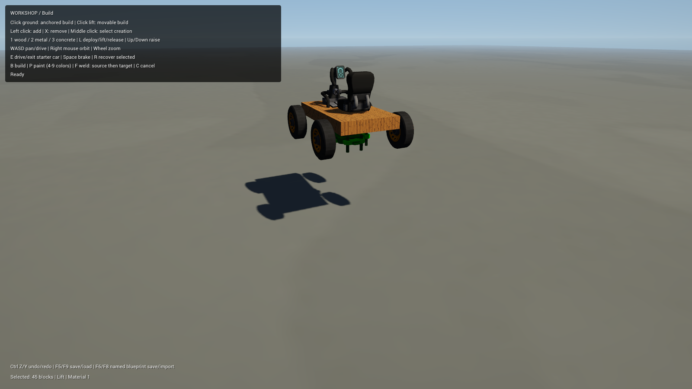

The lift art remains a fixed pose following the support height; ground-to-platform extension animation is still pending.

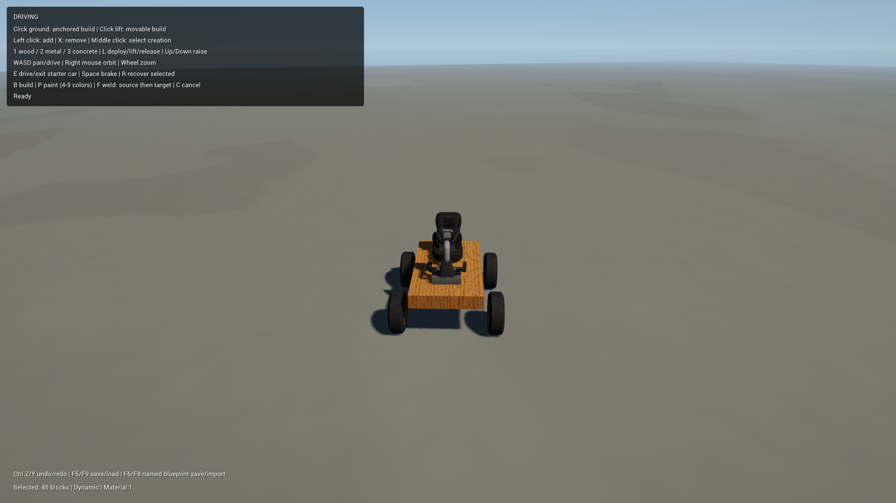

## Construction transactions and recovery

Versioned checksum archives retain creations, grid cells, materials, paint, world poses, motion, anchors, support state and prototype tuning. Loads validate the complete archive before replacing constructions. Local file saves replace atomically on Linux and retain a previous-save backup. Autosave, startup recovery, named blueprint save/import and bounded undo/redo are implemented.

Automated checks exercise the real construction operations and persistence failure paths. Actual-scene checks include F5/F9 save/load, a process restart restoring edits, named blueprint save/import and Ctrl+Z/Y paint undo/redo. The headless suite disables player-save access.

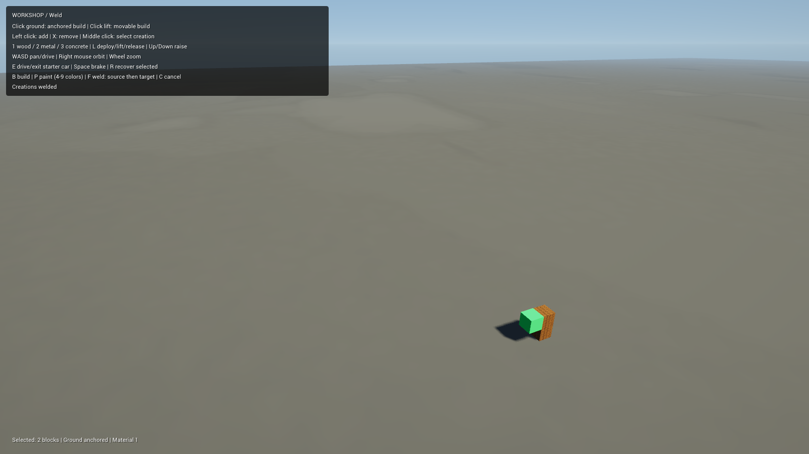

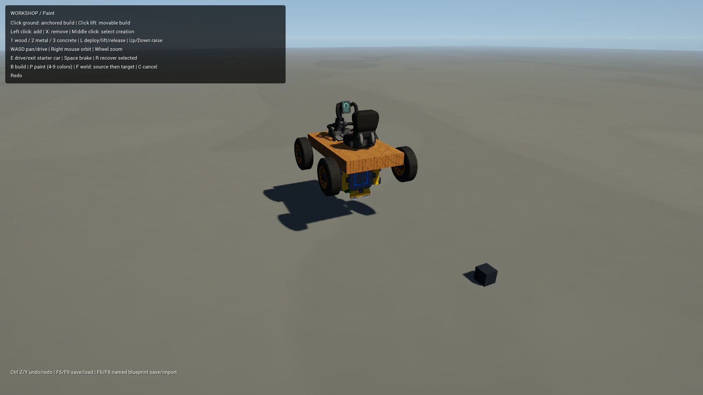

## Remaining work

Extended driving evaluation, the original item catalog with attachment/art-axis metadata, placeable mechanical assemblies, original player/tool/HUD integration, lift extension animation and packaging remain. Blueprint import currently uses the saved world pose and may overlap unrelated constructions. Paint uses a tint over baked default block colors; exact original shader behavior remains pending.

Only progress documentation and selected rendered gameplay screenshots are published. Imported source game models, textures, definitions and local gameplay source remain local.

## Latest catalog and material checkpoint

55 automated checks, both custom shader compilations, and a 180-frame headless scene run pass. All 47 base-game/Survival block definitions retain stable IDs and source UUIDs; the catalog is paged and editor-editable. Placement of every catalog block is checked automatically; several selections were placed through actual input. General non-block occupancy/attachment rules remain pending.

The earlier baked textures shown above have now been superseded for runtime materials. Original DIF/ASG/normal channels stay separate, paint follows the diffuse mask, and texture tiling spans adjacent blocks in creation coordinates. The existing wheel/seat/bearing/lift preview meshes also have companion-map materials. This is a reconstructed material response, not verified pixel parity with the original game. See [material investigation and remaining differences](ScrapWorkshop-MATERIALS.md).

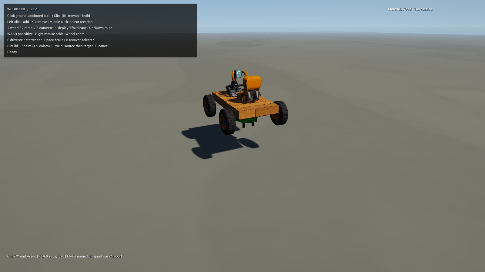

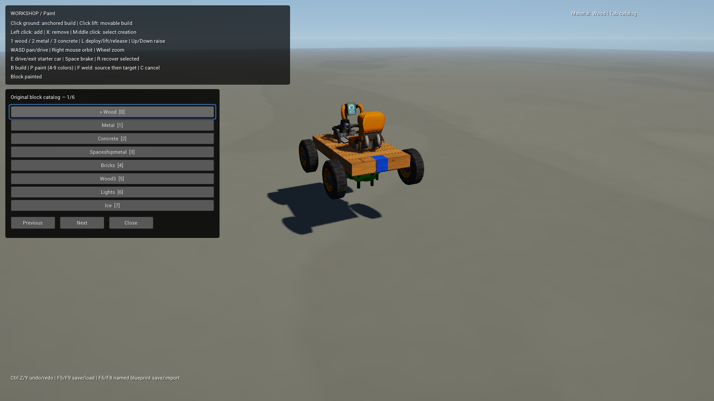

Actual-scene recovery was additionally checked in an isolated save folder: a damaged primary successfully loaded its valid backup; two invalid copies left the live workshop intact and paused autosave. Version-2 saves preserve explicit white paint separately from an original default color; version-1 saves remain readable. Exact specular/gloss calibration, original normal convention, glass refraction and environment reflections remain open.

## Oriented item geometry checkpoint

The next catalog increment is implemented and has 69 automated checks plus actual-scene placement/rotation/save-load verification. Six original mechanical candidates now retain their source UUID, original dimensions and sticky attachment faces. Q turns and T tilts placed-item previews; selection and removal work from every cell of a larger item. Shared footprint rules also govern collision rebuilding, splitting, welding and save validation. Definitions and import corrections remain editable in Tessera.

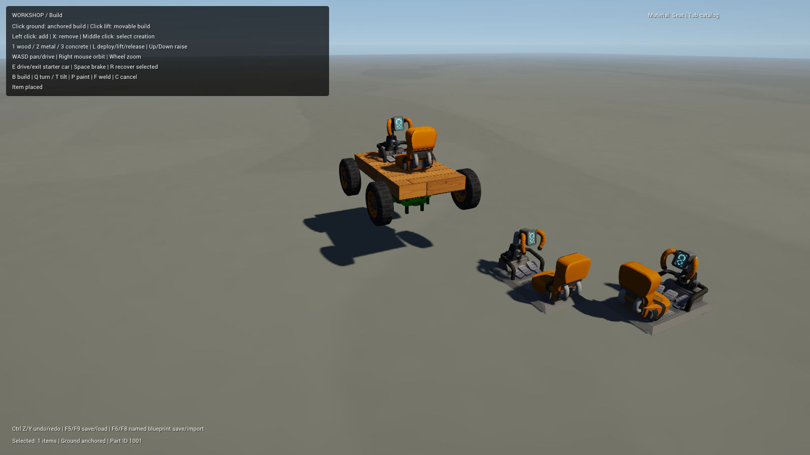

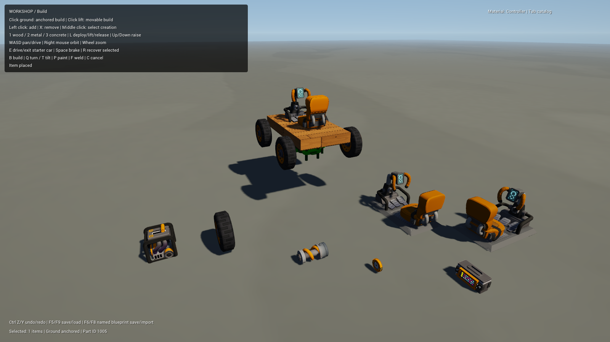

Placement is separate from working mechanics. Native hinge motors, round cylinder collision, connected-group recovery and mechanical control wiring are under the next physics/play validation increment; the entire mechanical-assembly milestone is still open. Exact source hull collision and remaining item families also remain open.

## Placed-part driving, steering and suspension

The latest checkpoint passes 98 automated construction/physics checks, both shader compilations and a 180-frame complete-scene smoke run. Separate editor-authored car examples now use ordinary placed seats, engines, bearing hinges and round wheel bodies, without a prototype vehicle component. The suspension example adds four spring sliders and two front steering bearings. Graph archives retain links, control wires, neutral frames and suspension anchors. Tuning and art corrections remain editable in Tessera.

Direct input in the actual Vulkan scene confirms lift release, E seat entry, W throttle, W+D turning, Space braking and R whole-car recovery. The speed HUD reached 7.3m/s. Recovery now brings the camera back to the car. Automated tests independently check compression under weight, steering target angles, forward/right motion and restoration of all ten joints.

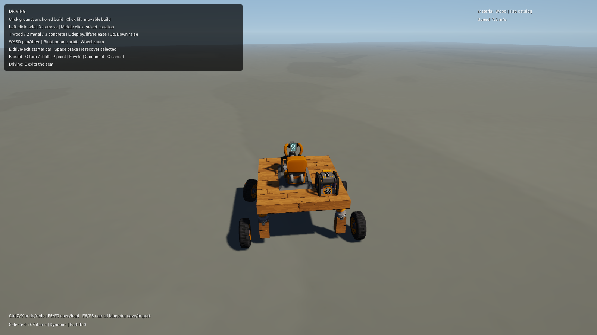

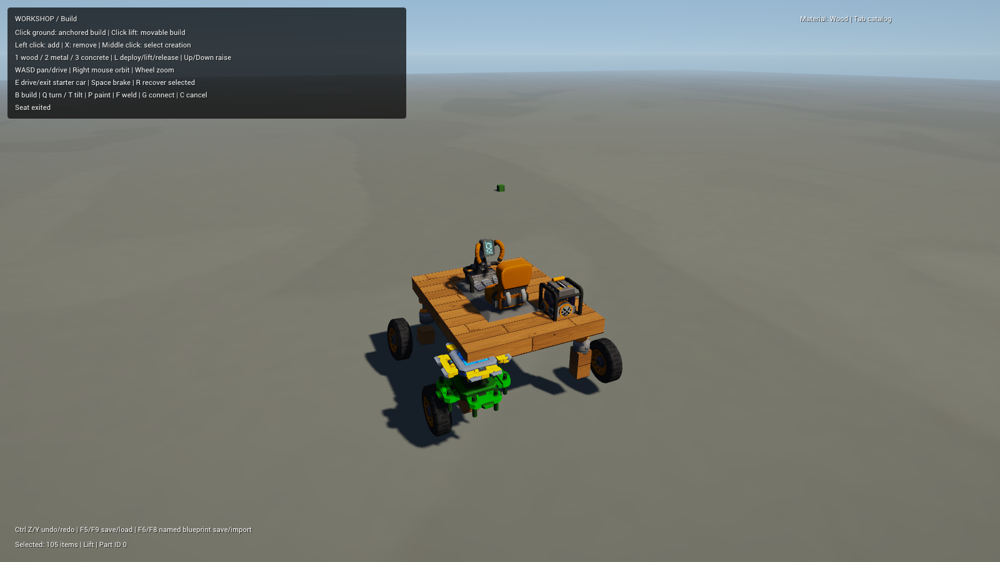

The Connect tool also successfully wires a placed seat to its engine through actual clicks.

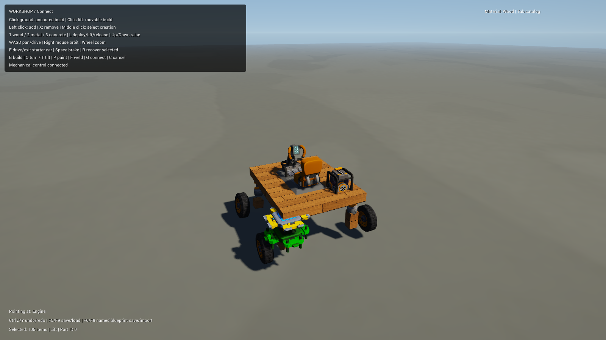

This is a verified mechanical increment. A complete car built from scratch through input, every wiring/edit combination, controller sequences, remaining item families, source hull collision, extended terrain handling, original suspension/lift animation and character/tools/HUD remain open. Main retains its original editable prototype. Imported game files and all gameplay/engine code remain local; this publication contains only documentation and selected rendered screenshots.

## Connection editing checkpoint — 2026-10-16

105 automated checks, both shaders and the 180-frame Main smoke run pass. In Connect mode, aim at a mounted bearing and press I to reverse it; X clears an item's incoming control wires. The HUD identifies the incoming mode/direction. A new mode replaces competing bearing controls. Tests cover a placed controller reaching +22.5°, inversion reaching −22.5°, clearing wires and rejection across unrelated assemblies.

Actual-scene input verifies I inversion, X clearing and Ctrl+Z/Y undo/redo. The playtest exposed a stale HUD hover reference after undo replaced creations; selection/hover are now cleared during restore and the repeated graphical test passes. Controller sequencing and complete from-scratch vehicle assembly remain open.
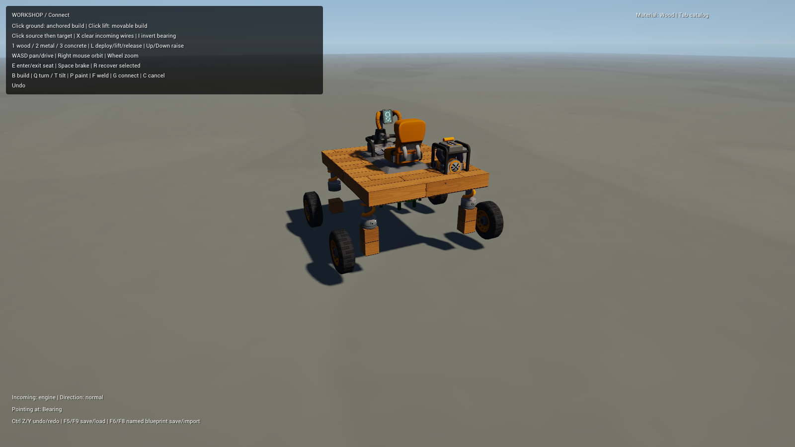

## Controller programs and recovery checkpoint — 2026-10-16

125 automated checks, both shaders and a 180-frame Main smoke run pass. Placed controllers have an optional Inspector-authored four-angle program, configurable step count/timing/speed, looping and return-on-release. Seat W advances, neutral pauses and S reverses. Archives version 5 preserve per-controller programs, accepting versions 1–4. Graph/body rebuild checks guard reused native constraint addresses; duplicate control wires and invalid programs are rejected before mutation.

Actual isolated-scene playtesting confirms controller seat entry, arm playback, pause/reverse, recovery and save/reload. Recovery exposed quaternion-norm drift during repeated lift movement; normalized assembly rotations fix it, with 600 subsequent frames checked automatically. Nonfinite live archives now fail before primary/backup replacement. All example scenes have isolated save folders, and playtest.sh isolates user-data paths as well as enabling reliable scoped X11 automation.

Wheel definitions now expose a mounting point so actual bearing-output placement aligns the axle with the bearing rather than a footprint corner. This is checked automatically and through actual from-scratch placement. The complete user-built car, remaining item families/source hulls, extended handling, original character/tools/HUD and animated lift/suspension art remain open.
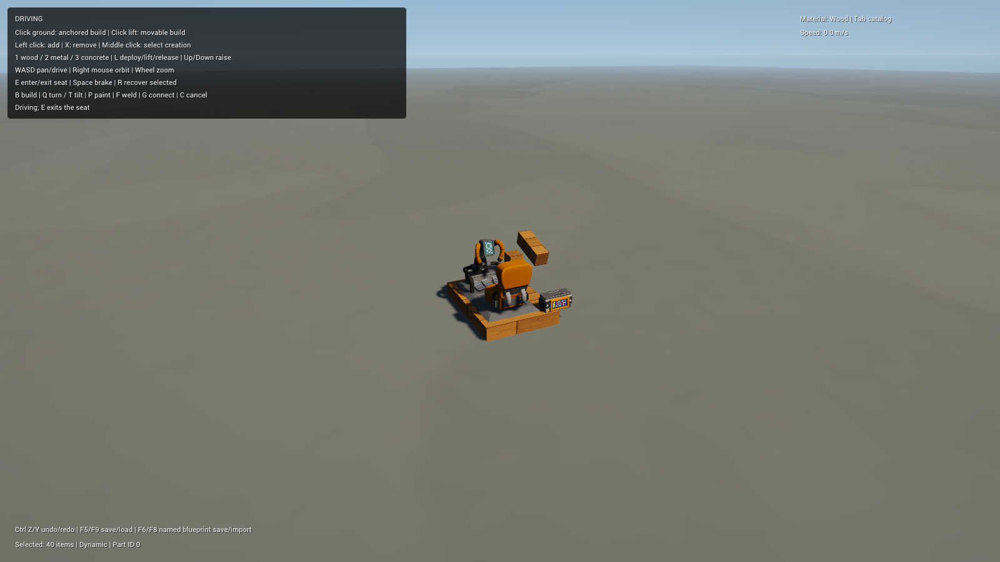

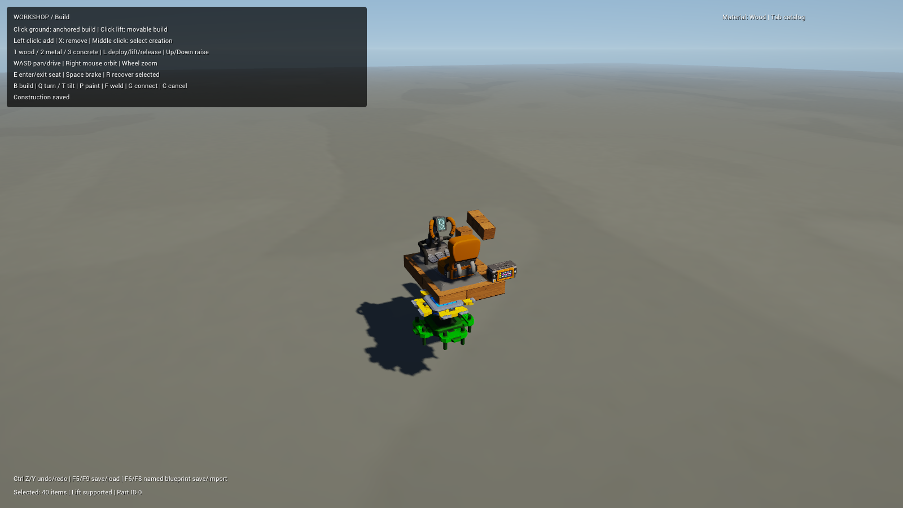

## From-scratch vehicle checkpoint — 2026-10-16

- [x] Build a complete working vehicle through actual catalog, keyboard and mouse input in an initially empty workshop.
- [x] Place 20 wood items, four bearings, four wheels, a driver seat and an engine; mount each wheel as a separate rigidbody group.
- [x] Wire seat→engine and engine→all four bearings through Connect; invert both left wheels through I.
- [x] Release, enter the seat, drive at 7.3m/s, brake, recover, save/reload and drive again.
- [x] Validate the saved result through the native read-only archive checker: five welded groups, 30 items and four mechanical links.

The saved construction and evidence remain in Validation/FromScratch/. No scene-authored creation or direct state injection was used for this build. The authored suspended car separately covers steering/spring behavior; controller programs have their own bench. Full manual steering/suspension assembly and every connection combination remain broader playtests.

Latest automated suite: 126 checks, both shaders and a 180-frame Main smoke run. The servo now wraps orientation error so a 270° target settles at its equivalent orientation instead of spinning indefinitely. The CLI `--check-construction-save PATH` checks archive checksum, catalog, topology, graph and program data without changing the scene or saves; it correctly rejects the preserved nonfinite incident sample.
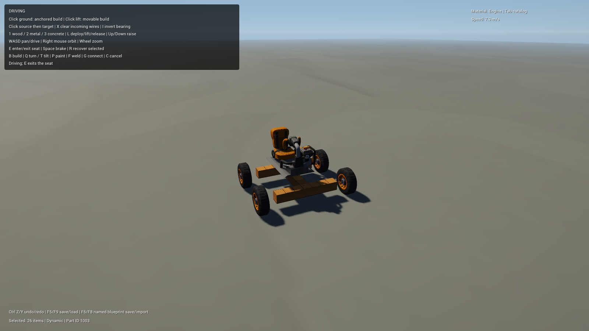

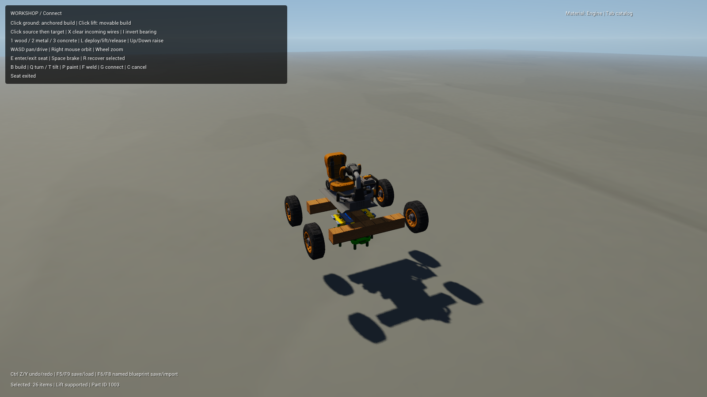

## Original collision-shape checkpoint — 2026-10-16

132 automated checks, both shaders and the Main smoke run pass. The imported driver seat now uses its original eight collision vertices as a convex child in the creation compound, replacing the full occupied-cell box approximation. Wheel/bearing/suspension definitions use round cylinders; engine/controller use their source box dimensions. Logical occupied cells and attachment rules remain separate from physical hull detail.

Tests distinguish the seat's upper taper, upper center and wider lower volume, verify rotated collision, and confirm malformed/degenerate editable hulls fall back to cell collision. Definitions expose collisionHull, hullRotation, hullOffset and hullMargin. Reimport preserved Main's editable definitions byte for byte. This completes the six imported items' source primitive/hull path; it does not cover unimported families or every source compound-hull format.

Actual scene: the saved from-scratch car loaded, the source seat was aimed/selected and entered after release, the car drove at 6.6m/s, braked/recovered and saved a valid five-group/four-joint archive. Source-hull logs and images remain local under Validation/. Imported collision data also stays local.

## Vehicle variants checkpoint — 2026-10-16

The catalog now has 57 entries: 47 original blocks and ten mechanical items. New stable IDs 1006–1009 add the original large wheel, offroad suspension, electric engine and driver saddle, retaining source UUIDs, sizes, attachment masks, materials and collision data. Large-wheel axle mounting accounts for its five-cell diameter and two-cell depth. The longer suspension uses its third-cell output; the electric motor's initial speed/power come from a source gear. Tuning and separate art/collision corrections remain editable.

142 automated checks, shader compilation and the Main smoke run pass. Checks cover all four placements with native bodies, FBX/Collada units/Y-up, wheel mounting, source saddle hull, the real offroad slider, large electric car movement and graph save/restore. Reimport and append-only catalog synchronization preserve existing scene overrides.

Graphical validation: a separate gallery shows all four variants beside the original driver-seat forward reference. The driver saddle is upright and faces +Z consistently; a side-on wheel comparison confirmed both faces have the same hub detail, so no extra art flip is applied. The separate LargeWheelCar accepts saddle entry, drives at 3.9m/s, brakes/recovers and saves a valid five-group/four-link archive. Main and previously built creations remain available. Original suspension/lift deformation, extended handling and other item families remain open.
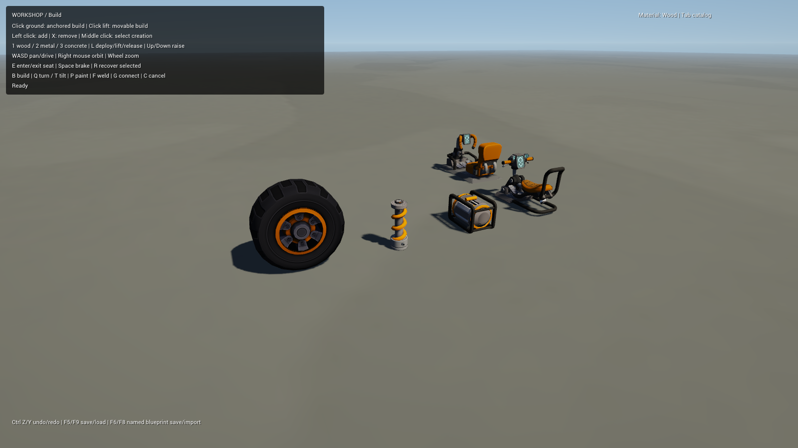

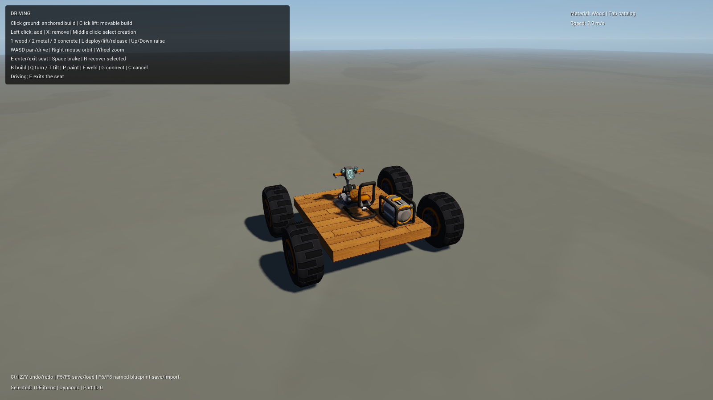
